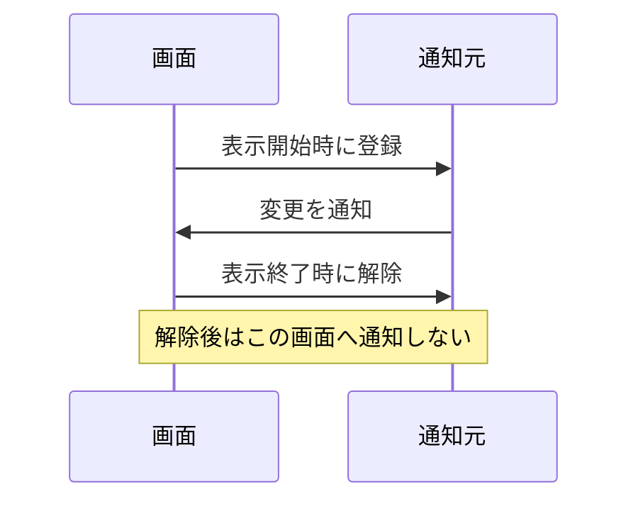

# 付録：delegate・event・購読の寿命

[シラバス](../index.md) ｜ 主教材：[ObserverとR3](../s4-csharp/r3.md)

## 概要

---

!!! note "準備中"
    講義資料の初稿です。説明用のコードは演習シーンへの組み込み・動作確認前です。画面写真と配布シーンの対応は確定後に更新します。

ボタンを1回押したのに処理が2回走る。画面を閉じた後も通知が届く。こうした不具合は、イベントの登録と解除が別々の場所にあり、寿命が揃っていないときに起こります。

この付録は[R3](../s4-csharp/r3.md)、[MVP](../s4-csharp/mvp.md)、[Timeline](../s1-character-camera/timeline.md)で共通して使う基礎です。

## メソッドを値として渡す

---

delegateは、引数や戻り値の形が一致するメソッドを参照するための型です。`Action`は戻り値のない処理、`Func`は戻り値のある処理を表すためによく使われます。

`Action<int>`なら「intを1つ受け取り、何も返さない処理」です。処理を呼ぶ側は、具体的なメソッド名を知らなくても、その契約で呼び出せます。

## event が制限すること

---

C#のeventは、外側の利用者に登録と解除を許し、通知の発火を宣言した型の中に限定するための仕組みです。単にpublicなActionフィールドを公開する場合と責任範囲が異なります。[Microsoftのイベント解説](https://learn.microsoft.com/en-us/dotnet/csharp/programming-guide/events/)を参照してください。

```csharp
using System;

public sealed class Counter
{
    public int Value { get; private set; }
    public event Action<int> Changed;

    public void Increment()
    {
        Value++;
        Changed?.Invoke(Value);
    }
}
```

`?.Invoke`は登録がない場合に呼び出しを省略します。「通知は常に非同期」という意味ではありません。通常のC# eventは呼んだ場所で受信処理を実行するので、重い受信処理や例外は通知側にも影響します。

## 登録と解除を対にする

---



表示中だけ必要な購読は、表示開始と終了で対にします。GameObjectの有効期間ならOnEnable／OnDisable、生成から破棄までなら別の組み合わせになります。生成直後から無効なオブジェクトなど、Unityの呼び出し順も考慮します。

```csharp
// 登録と解除で同じメソッドを渡す。
source.Changed += OnChanged;
// ...購読が必要な期間...
source.Changed -= OnChanged;
```

ラムダ式を使う場合、後から同じ見た目の式を書き直しても、同じ登録を指定できるとは限りません。解除に必要なdelegateを変数へ保存するか、名前付きメソッドを使います。

## UnityEvent・C# event・R3

---

| 仕組み | 主な使いどころ | 後始末 |
| --- | --- | --- |
| UnityEvent | Inspectorから接続するUIや演出 | コード登録分は対応するListenerを外す |
| C# event | C#の型として通知する | `-=`で解除する |
| R3の購読 | 通知の選別・変換・合成 | 返された購読をDisposeする |

ゲーム全体が通知元、短命な画面が受信側の場合、解除忘れが特に問題になります。通知元が受信側を参照し続けるためです。発信元のDisposeと購読のDisposeは、誰が何を所有するかに応じて使い分けます。

!!! note "画像準備中：二重登録の確認"
    画面を開く→閉じる→開く操作と、1回の入力に対応するログ件数を示します。解除あり／なしを比較します。予定画像：`images/subscription-lifecycle.png`。

## キャンセルとの違い

---

購読解除は今後の通知の受け取りをやめる操作です。既に開始した非同期処理が自動的に止まるとは限りません。そちらは[CancellationTokenSource](unitask.md)で中断要求を渡し、受け取る処理が協調して終了します。

「通知の接続を外す」「進行中の処理を止める」「資源を破棄する」を別々に考えると、Timelineの終了処理や画面遷移を整理できます。

[シラバス](../index.md) ｜ 主教材：[ObserverとR3](../s4-csharp/r3.md)
