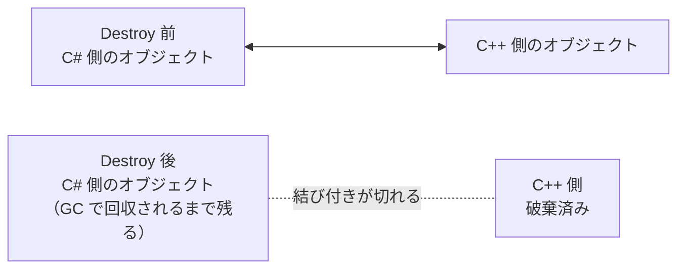

# 付録：fake null と UnityEngine.Object の null 判定

[シラバス](../index.md) ｜ 主教材：[C#② インターフェースとポリモーフィズム](../s2-ai-state/interface-polymorphism.md)

## 概要

---

倒した敵を `Destroy` したのに、`?.` で書いた処理から `MissingReferenceException` が出る。敵が消えたはずなのに、Interface 型で持っていた参照の `!= null` が `true` のまま、攻撃処理が動き続ける。こうした不具合は、Unity のオブジェクトが「C# としては残っているのに、Unity としては消えている」状態になることから起こります。

この付録では、その状態（fake null）が起こる理由と、書き方ごとの判定の違い、安全な書き方をまとめます。

## UnityEngine.Object は C++ と C# の2つで1組

---

`GameObject` や `MonoBehaviour` などの `UnityEngine.Object` は、エンジン本体（C++）側のオブジェクトと、スクリプトから触る C# 側のオブジェクトが組になっています。



`Destroy` すると、C++ 側のオブジェクトは破棄され、C# 側との結び付きも切れます。一方、C# 側のオブジェクトは、どこかの変数が参照している間は残り、参照がなくなってから GC（ガベージコレクション）で回収されます。

この「C# としては生きているが、Unity としては消えている」オブジェクトを、Unity は `null` のように見せたいので、`UnityEngine.Object` の `==` と `!=` を独自に定義（オーバーロード）しています。破棄済みのオブジェクトを `== null` で比べると `true` になるのはこのためです。本物の null ではないので、**fake null** と呼ばれます。

## Destroy はフレームの終わりに実行される

---

`Destroy` は呼んだ瞬間には破棄されず、そのフレームの処理が終わってから実行されます。同じフレームの中では、まだ `== null` は `false` です。

```csharp
using System.Collections;
using UnityEngine;

public class FakeNullSample : MonoBehaviour
{
    [SerializeField] GameObject _prefab;

    IEnumerator Start()
    {
        GameObject obj = Instantiate(_prefab);
        Destroy(obj);
        Debug.Log(obj == null);    // false ：まだ破棄されていない

        yield return null;         // 1フレーム待つ

        Debug.Log(obj == null);    // true  ：Unity の == で破棄済みと判定される
        Debug.Log(obj is null);    // false ：C# のオブジェクトは残っている

        if (obj != null)
        {
            Debug.Log(obj.name);   // 中には入らない
        }

        Debug.Log(obj?.name);      // MissingReferenceException
    }
}
```

最後の `obj?.name` は、`obj` が null なら何もしない書き方に見えます。しかし `?.` は Unity の `==` を使わず、C# の本物の null かどうかだけを見ます。`obj` は本物の null ではないので `name` を読みに行き、破棄済みの C++ 側に触れようとして例外が出ます。

## 書き方ごとの判定の違い

---

| 書き方 | 判定に使われるもの | 破棄済みを null とみなすか |
| --- | --- | --- |
| `obj == null` / `obj != null` | Unity の `==`（変数の型が `UnityEngine.Object` 系のとき） | みなす |
| `if (obj)` / `if (!obj)` | Unity の bool 変換 | みなす |
| `obj?.name` | C# の参照の比較 | みなさない |
| `obj ?? other` / `obj ??= other` | C# の参照の比較 | みなさない |
| `obj is null` / `obj is not null` | C# の参照の比較 | みなさない |
| Interface 型・`object` 型の変数の `== null` | C# の参照の比較 | みなさない |

`?.`、`??`、`is null` は、C# の仕様でオーバーロードした `==` を使わないと決まっています。変数の型が `GameObject` でも同じです。

### 変数の型で == が変わる

---

演算子のオーバーロードは仮想メソッドではないので、どの `==` を使うかは**コンパイル時の変数の型**で決まります。中身が同じオブジェクトでも、変数の型によって結果が変わります。

```csharp
EnemyController enemy = ...;      // EnemyController は MonoBehaviour と IDamageable を継承・実装
IDamageable damageable = enemy;   // アップキャスト（同じオブジェクトを指す）
object boxed = enemy;

// Destroy して1フレーム後
Debug.Log(enemy == null);         // true  ：Unity の == が選ばれる
Debug.Log(damageable == null);    // false ：Interface には == の定義がないので、C# の参照の比較
Debug.Log(boxed == null);         // false ：object 型も C# の参照の比較
Debug.Log(damageable.GetType());  // EnemyController（中身の型は変わらない）
```

アップキャストしても、オブジェクトが `System.Object` に変わるわけではありません。変わるのは変数の型だけで、その結果 `==` が `System.Object` と同じ参照の比較としてコンパイルされます。

## 安全に書くには

---

**Unity のオブジェクト型の変数**（`GameObject`、`Transform`、自作の `MonoBehaviour` など）は、`== null`・`!= null`・`if (obj)` で確かめます。`?.` と `??` は使いません。

**Interface 型の変数**は、中身が `UnityEngine.Object` なら戻してから Unity の `==` で比べます。何度も書くなら、小さな関数にまとめます。

```csharp
public static class UnityNull
{
    // 本物の null か、破棄済みの UnityEngine.Object なら true
    public static bool IsNullOrDestroyed(object target)
    {
        return target is null || (target is UnityEngine.Object obj && obj == null);
    }
}

if (UnityNull.IsNullOrDestroyed(damageable)) return;
damageable.TakeDamage(10);
```

ただし、破棄済みかどうかを毎回確かめるより、**破棄された相手の参照を持ち続けない**ほうが根本的な対策です。`IsDead` のような状態を契約に入れて先に判定する、破棄されるときにイベントで知らせて参照を外す、といった設計にすると、fake null に頼る場面が減ります。

!!! tip "エディタの警告"
    Visual Studio や Rider で Unity 用のアナライザーが有効なら、Unity のオブジェクトに `?.`（UNT0008）や `??`（UNT0007）、`is null`（UNT0029）を使うと警告が出ます。警告が出たら、`== null` の書き方に直します。

## 関連資料

---

- [C#② インターフェースとポリモーフィズム](../s2-ai-state/interface-polymorphism.md)
- [Unity スクリプトリファレンス：Object.operator ==](https://docs.unity3d.com/ScriptReference/Object-operator_eq.html)
- [Unity Blog：Custom == operator, should we keep it?](https://unity.com/blog/engine-platform/custom-operator-should-we-keep-it)
- [Microsoft Learn：等値演算子（参照型の等値）](https://learn.microsoft.com/ja-jp/dotnet/csharp/language-reference/operators/equality-operators#reference-types-equality)
- [Unity Object原論を見て躓いた所や学びのメモ（Zenn）](https://zenn.dev/ni_yy/articles/5e3a3ca3391bc8)：Unity Technologies Japan の講演「Unity Object原論」の学習メモ

[シラバス](../index.md) ｜ 主教材：[C#② インターフェースとポリモーフィズム](../s2-ai-state/interface-polymorphism.md)
