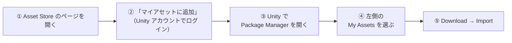
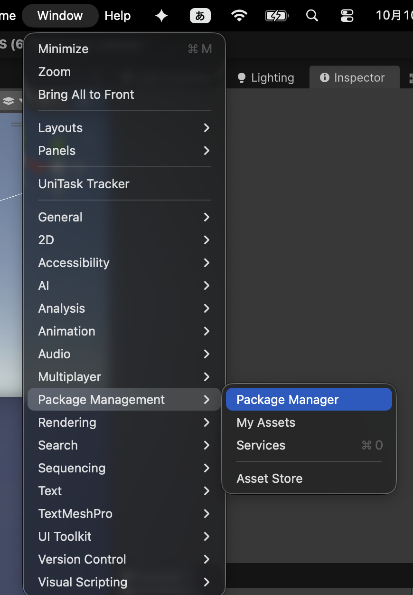
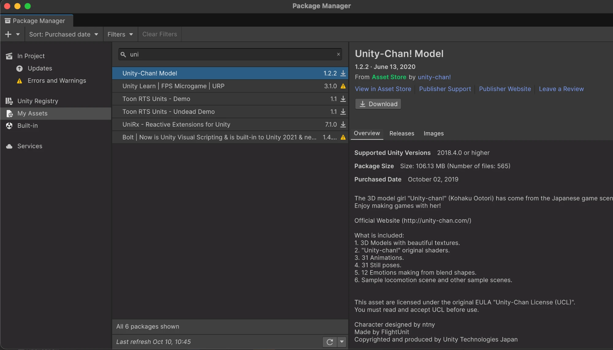

# 📦 使用アセット一覧

[シラバス](index.md)

この授業で使う外部アセットをまとめています。**すべて無料**です。各自でダウンロードしてください。
プロジェクトの取得から再生までの流れは **[授業用プロジェクトのセットアップ](s0-guidance/setup.md)** を見てください。

---

## なぜ自分でダウンロードするのか

---

配布しているプロジェクトには、**アセット本体が含まれていません。**

- Asset Store のアセットやユニティちゃんは、**再配布が禁止**されています
- プロジェクトに入っているのは、アセットを**参照する側**（Prefab・マテリアル・Animator Controller など）だけです

そのため、プロジェクトを開いた直後は **モデルが表示されない／ピンク色になる／Missing と出る** 状態です。
下のアセットを入れると、参照がつながって直ります。

> エラーが出ていても慌てないでください。アセットを入れる前は出て当たり前です。

---

## 1. 必須のアセット（全員）

---

初回の授業までに、この4つを入れておいてください。お手本作品『LUMEN』で使っています。

| アセット | 用途 | 入手先 | 入れ方 |
| --- | --- | --- | --- |
| **Unity-Chan! Model**（ユニティちゃん） | プレイヤー | [Asset Store](https://assetstore.unity.com/packages/3d/characters/unity-chan-model-18705) | §2（Asset Store） |
| **Monster Minion Survivor PBR Polyart** | 雑魚敵 | [Asset Store](https://assetstore.unity.com/packages/3d/characters/creatures/monster-minion-survivor-pbr-polyart-269515) | §2（Asset Store） |
| **Mini Legion Rock Golem PBR HP Polyart** | ボス | [Asset Store](https://assetstore.unity.com/packages/3d/characters/humanoids/fantasy/mini-legion-rock-golem-pbr-hp-polyart-94707) | §2（Asset Store） |
| **RPG Animations Pack FREE** | プレイヤーの攻撃モーション | [Asset Store](https://assetstore.unity.com/packages/3d/animations/rpg-animations-pack-free-288783) | §2（Asset Store） |

> **インポート先のフォルダは変えなくて構いません。** プロジェクト側はアセットを ID（GUID）で参照しているので、どこに入っても自動でつながります。

> インポート時にファイル一覧が出たら、**すべてチェックを入れたまま Import** してください。チェックを外すと、使っているファイルが抜けて Missing になることがあります。

---

## 2. Asset Store のアセットの入れ方

---

1. 上の表のリンクから Asset Store のページを開きます
2. **「マイアセットに追加」**（Add to My Assets）をクリックします
   - Unity アカウントでのログインが必要です。**Unity Hub と同じアカウント**でログインしてください
3. Unity でプロジェクトを開き、メニューの **Window → Package Management → Package Manager** を選びます

    { width="360" }

4. 左側の **My Assets** を選びます
5. 目的のアセットを選び、**Download** → **Import** を実行します

{ width="640" }

---

## 3. ユニティちゃんを使うときの注意

---

ユニティちゃんも、ほかのアセットと同じく **Asset Store から入れます**（§2 の手順）。入れるのは **[Unity-Chan! Model](https://assetstore.unity.com/packages/3d/characters/unity-chan-model-18705)** です。

> ユニティちゃんには「サニーサイドアップ ユニティちゃん」など別のモデルもありますが、**この授業で使うのは「Unity-Chan! Model」**です。別のモデルを入れても、お手本作品のキャラクターはつながりません。

> ユニティちゃんに同梱されているサンプルシーンはピンク色になりますが、問題ありません。お手本作品はユニティちゃんのモデルとテクスチャだけを使い、マテリアルは自前のものを当てています。

### ⚠️ ライセンスの順守が必要です（必ず読んでください）

---

ユニティちゃんの利用には **ユニティちゃんライセンス（UCL）** の順守が必要です。

| | 内容 |
| --- | --- |
| **ライセンス表記** | 作品を公開・提出するときは、**ライセンスロゴの表示**が必要です |
| **確認すること** | ライセンスは改訂されています。**必ず [公式サイト](https://unity-chan.com/) で現行版を確認**してください |
| **対象範囲** | 授業の課題提出だけでなく、**ポートフォリオとして公開する場合も対象**です |

> **「無料だから自由に使える」ではありません。**
> 他人が作ったものを使うときは、必ず条件を確認する。これは仕事でもまったく同じです。
> 面倒に見えますが、ここを飛ばして公開してしまうほうがずっと面倒なことになります。

---

## 4. 単元ごとに追加するアセット

---

単元の演習で別のアセットが必要になるときは、**その単元のページで案内します。** 今は「1. 必須のアセット」だけ入っていれば授業を受けられます。

---

## 5. 自動で入るもの（ダウンロード不要）

---

次のものはプロジェクトに設定済みで、**開くだけで自動で入ります。** 何もしなくて構いません。

| もの | 用途 |
| --- | --- |
| **Cinemachine**（2.10.6。プロジェクトに同梱） | カメラ制御 |
| **Timeline** | 演出・カットシーン |
| **AI Navigation（NavMesh）** | 敵の経路探索 |
| **Animation Rigging** | IK |
| **ProBuilder** | ステージ制作 |
| **Shader Graph** | シェーダー |
| **Input System** | 入力 |
| **UniTask**（プロジェクトに同梱） | 非同期処理 |
| **R3** | Observer パターン。プロジェクトに同梱 |

> ⚠️ **Cinemachine は 2.x を使います。** 2.10.6 をプロジェクトに同梱しています。Package Manager で Remove したり、別のバージョンを入れ直したりしないでください（3.x にすると、お手本のコードが動かなくなります）。

> エフェクトは **Particle System**（Unity 標準機能）を使います。VFX Graph は使いません。

---

## 6. うまくいかないときは

---

| 症状 | 原因と対処 |
| --- | --- |
| **キャラクターがピンク色 / Missing と出る** | 必須のアセットが入っていない。§1 の4つが入っているか確認する |
| **ユニティちゃんだけ Missing のまま** | 別のユニティちゃん（サニーサイドアップなど）を入れている。「Unity-Chan! Model」を入れる |
| **「マイアセットに追加」が押せない** | Unity アカウントにログインしていない |
| **Package Manager の My Assets に出てこない** | Asset Store と Unity Hub で別のアカウントにログインしている。同じアカウントにそろえる |
| **インポート時に上書き確認が出る** | 基本は上書きで問題なし。不安な場合は講師に確認してください |

上記で解決しない場合は、**エラーメッセージのスクリーンショット**を添えて Slack で質問してください。
