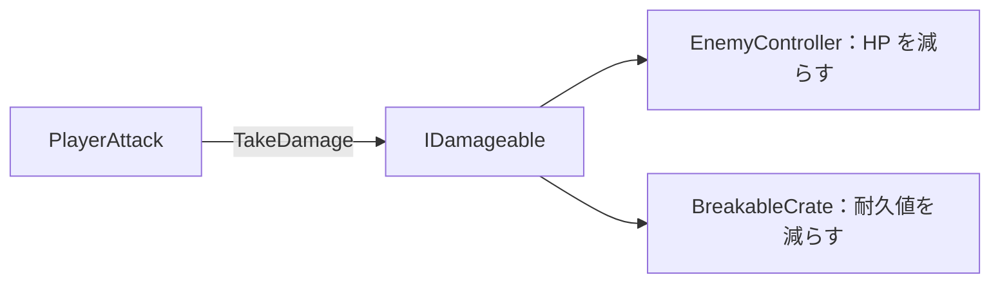

# ２−１１★★☆☆☆　プレイヤーの攻撃で壊せる木箱を作る

[課題について](../index.md) ｜ [2章の課題](index.md) ｜ 関連資料：[インターフェースとポリモーフィズム](../../s2-ai-state/interface-polymorphism.md)

---

プレイヤーの攻撃は、今はボスにしか効きません。**攻撃で叩くと耐久値が減り、0 になると壊れる木箱**を作ってください。

ただし、プレイヤーの攻撃のスクリプトは変更しません。攻撃する側は相手を `IDamageable` としてしか見ていないので、木箱が同じ約束を守れば、ボスと同じように叩けるはずです。



`PlayerAttack` から見ると、ボスも木箱も同じ `IDamageable` です。`TakeDamage` を呼んだときに何が起きるかは、相手のクラスが決めます。

### 推奨条件

---

```text
・Scripts/Gimmick/ に BreakableCrate を作り、Section.Common の IDamageable を実装する
・耐久値は Inspector で調整できるようにする
・TakeDamage は、実際に減らした値を返す。壊れた後は 0 を返す
・耐久値が 0 になったら、木箱を消す
・耐久値の違う木箱を2つ以上置き、叩く回数が変わることを確かめる
・PlayerAttack と EnemyController は変更しない
```

作業用シーンの準備は[Stateパターンの演習の準備](../../s2-ai-state/state-pattern.md)を参照してください。使用シーンは `Assets/Application/Section2-AIState/EnemyAI/EnemyAI_Work.unity` です。完成見本のシーンや共通素材の元ファイルは上書きしません。

### 提出方法

---

木箱を叩いて壊す動画をslackに提出してください。課題番号と、`BreakableCrate` のコードを添えてください。

### ヒント

---

`_CommonSectionAssets/Scripts/Core/IDamageable.cs` を開くと、実装しなければならないメンバーが分かります。`EnemyController.TakeDamage` が書き方の手本になります。

`PlayerAttack` は、攻撃の範囲に入った Collider と**同じ GameObject**から `IDamageable` を探します（`TryGetComponent`）。木箱のスクリプトは、Collider と同じ GameObject に付けてください。子の Collider だけに当たると、木箱だと認識されません。

叩いたときの手応えが欲しければ、`Debug.Log` で残りの耐久値を出すと確認しやすくなります。

---

[課題について](../index.md) ｜ [2章の課題](index.md) ｜ 関連資料：[インターフェースとポリモーフィズム](../../s2-ai-state/interface-polymorphism.md)
