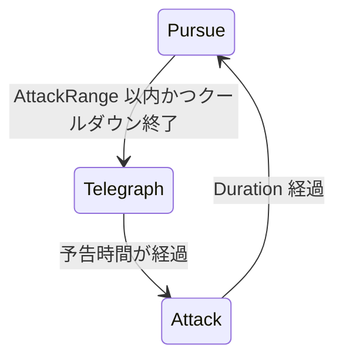

# ２−６★★★☆☆　攻撃の前に、予告の状態を足す

[課題について](../index.md) ｜ [2章の課題](index.md) ｜ 関連資料：[Stateパターン](../../s2-ai-state/state-pattern.md)

---

予告なしの攻撃は、プレイヤーにとって避けようがありません。`PursueState` と `AttackState` の間に**予告の状態を足し、体の色が変わってから攻撃する**ようにしてください。



追跡中に攻撃できる距離まで近づくと予告へ入り、予告時間が過ぎてから攻撃します。攻撃が終わった後は、今までどおり追跡へ戻ります。

### 推奨条件

---

```text
・IState を実装した TelegraphState を Scripts/Enemy/States/ に作る
・入った瞬間に止まり、CharacterVisual の SetOverlay で体の色を変える
・予告中はプレイヤーの方を向き、予告時間が過ぎたら AttackState へ切り替える
・予告時間は Inspector で調整できるようにする
・色は OnExit で戻し、予告中に被弾しても色が残らないようにする
・AttackState の中身は変更しない
```

作業用シーンとスクリプトの準備は[講義資料の演習の準備](../../s2-ai-state/state-pattern.md)を参照してください。完成見本のシーンや共通素材の元ファイルは上書きしません。

### 提出方法

---

予告してから攻撃する動画と、予告中に被弾しても色が残らない動画をslackに提出してください。課題番号と、変更したコードを添えてください。

### ヒント

---

`InvincibleState` の `OnEnter` と `OnExit` が色の変更の手本になります。状態のインスタンスは `EnemyController.Awake` で作ります。`PursueState` からも使えるように、`EnemyController` にプロパティを足しましょう。

ボスには `StaggerCooldown` があるので、一度怯むと次の怯みまで時間が空きます。被弾の確認をするときは、Inspector の値を小さくすると試しやすくなります。

---

[課題について](../index.md) ｜ [2章の課題](index.md) ｜ 関連資料：[Stateパターン](../../s2-ai-state/state-pattern.md)
