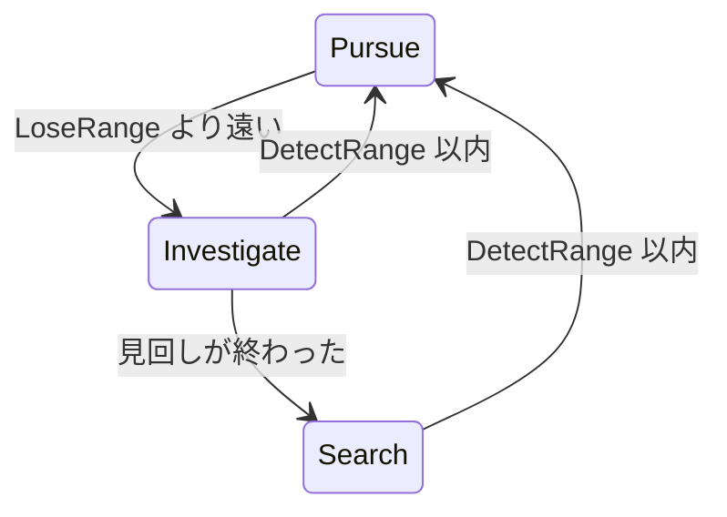

# ２−７★★★☆☆　見失った場所を調べてから、巡回に戻る

[課題について](../index.md) ｜ [2章の課題](index.md) ｜ 関連資料：[Stateパターン](../../s2-ai-state/state-pattern.md)

---

今のボスは、プレイヤーが `Lose Range` より遠くへ離れた瞬間に追跡をやめ、何事もなかったように巡回へ戻ります。**見失った場所まで行って周りを見回し、見つからなければ巡回へ戻る**ようにしてください。



### 推奨条件

---

```text
・IState を実装した InvestigateState を Scripts/Enemy/States/ に作る
・見失った地点へ向かい、到着したら数秒間その場で見回す
・調査の途中でも、Detect Range 以内に入ったら追跡へ戻る
・見回す時間や移動の速さは Inspector で調整できるようにする
・見失った地点がボスの NavMesh の外でも、近くの面へ向かえるようにする
・SearchState の中身は変更しない
```

作業用シーンとスクリプトの準備は[講義資料の演習の準備](../../s2-ai-state/state-pattern.md)を参照してください。完成見本のシーンや共通素材の元ファイルは上書きしません。

### 提出方法

---

ボスが見失った場所を調べ、見回した後に巡回へ戻る動画と、調査の途中で再発見して追跡へ戻る動画をslackに提出してください。課題番号と、見失った地点のデータをどのクラスに持たせたか、その理由を添えてください。

### ヒント

---

プレイヤーが狭い隙間にいると、その位置にはボスの NavMesh がありません。`EnemyController.TryFindPointOnNavMesh` で近くの面の点を探します。

到着判定には `HasArrived` を使えます。`MoveTo` を呼んだ直後は `pathPending` が残る場合があるので、`SearchState` の待ち方を参考にしましょう。

---

[課題について](../index.md) ｜ [2章の課題](index.md) ｜ 関連資料：[Stateパターン](../../s2-ai-state/state-pattern.md)
