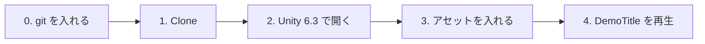

# 授業用プロジェクトのセットアップ

[シラバス](../index.md)

授業で使う Unity プロジェクトを GitHub から取得して、お手本作品『LUMEN』が動くところまでを準備します。
**初回の授業までに終わらせておいてください。**



---

## 0. git を入れる

---

前期の git の授業で入れた人は、この手順は飛ばして構いません。
入っているかは、ターミナル（Windows は「コマンドプロンプト」か「PowerShell」）で確かめます。

```bash
git --version
```

`git version 2.xx.x` のように表示されれば入っています。`command not found` などのエラーになったら入れます。

| OS | 入れ方 |
| --- | --- |
| **Windows** | [Git for Windows](https://git-scm.com/download/win) をダウンロードしてインストール（設定はすべて初期値のままで構いません） |
| **Mac** | ターミナルで `xcode-select --install` を実行し、出てきたダイアログで「インストール」 |

> インストールしたら、**ターミナルと Unity Hub を開き直してください。** 開き直さないと git が見つかりません。

> git はプロジェクトの取得だけでなく、**Unity がパッケージ（UniTask など）を取ってくるときにも使います。** git が無いと、プロジェクトを開いたときにエラーになります。

---

## 1. プロジェクトを取得する（Clone）

---

授業用プロジェクトのリポジトリ：**（後日ここに URL を掲載します）**

ターミナルで、保存したいフォルダに移動してから Clone します。

```bash
git clone <リポジトリの URL>
```

> 保存場所は、**パスに日本語や空白を含まないフォルダ**にしてください（例：`C:\Unity\` や `~/Unity/`）。日本語のパスだと Unity がうまく動かないことがあります。

> Fork はしません。Clone したフォルダで作業し、授業側の更新は下の手順で取り込みます。

### 触ってよいファイル

---

授業側の更新をあとで取り込めるように、**触ってよいファイルを決めています。**

| | ファイル |
| --- | --- |
| ✅ **触ってよい** | 各単元フォルダの **`〇〇_Work.unity`**（作業用シーン）と、**自分で新しく作ったファイル** |
| ❌ **触らない** | **`〇〇_Sample.unity`**（完成見本）／ 配布されたスクリプト（`namespace Section1.〜` などで始まるもの）／ `Assets/_DemoGame/` の中すべて |

> 配布されたスクリプトを変えたいときは、**コピーして自分のファイルとして作り直してください**（名前空間かクラス名を変えないと、同じ名前のクラスがあるとエラーになります）。

> `_Sample.unity` を開いて再生したり、中を覗いたりするのは自由です。**保存だけしない**でください。うっかり保存してしまったら、下の `git restore` で元に戻せます。

### 授業側の更新を取り込む（pull）

---

授業の進み具合に合わせて、単元のシーンやスクリプトを追加・修正することがあります。**Slack で「更新しました」と連絡したら**、次の手順で取り込んでください。

1. **Unity を閉じます**（開いたままだと、取り込んだファイルが正しく読み込まれないことがあります）
2. ターミナルで、Clone したフォルダに移動して pull します

```bash
git pull
```

3. Unity Hub からプロジェクトを開き直します

!!! warning "pull でエラーが出たとき"
    `Your local changes ... would be overwritten` と出たら、**触らないファイルを書き換えてしまっている**ためです。エラーに出ているファイル名を確かめて、変更を取り消してから、もう一度 `git pull` します。

    ```bash
    git restore <エラーに出ているファイル>
    ```

    `_Work.unity` で出たときは、自分の作業が消えてしまうので、**取り消す前に講師に声をかけてください。**

---

## 2. Unity 6.3 で開く

---

| 項目 | 値 |
| --- | --- |
| Unity バージョン | **6000.3 系**（推奨：**6000.3.19f1**） |
| 開き方 | Unity Hub → **Add → Add project from disk** → 1. で取得したフォルダを選ぶ |

1. Unity Hub の **Installs** に 6000.3 系が無ければ、先に入れておきます
2. **Projects → Add → Add project from disk** で、取得したフォルダ（`Assets` フォルダがある階層）を選びます
3. 一覧に追加されたプロジェクトをクリックして開きます

> 違うバージョン（6000.0 や 6000.4 など）で開くと、「バージョンを変更しますか」と聞かれます。**6000.3 系を選び直してください。**

初回はパッケージの取得と準備で、**数分〜十数分**かかります。次のものは、開くだけで自動で入ります。

| 自動で入るもの | 用途 |
| --- | --- |
| Cinemachine / Timeline / AI Navigation / Animation Rigging / ProBuilder / Shader Graph / Input System | 授業で使う Unity 公式パッケージ |
| UniTask | 非同期処理 |
| NuGetForUnity / R3 | Observer パターン（4章） |

開いた直後は **Console に赤いエラーが出ていたり、キャラクターがピンク色だったり**します。アセットをまだ入れていないためです。次の 3. で直ります。

---

## 3. アセットを入れる

---

キャラクターのモデルやモーションは、**再配布が禁止されているため、プロジェクトに含めていません。** 各自でダウンロードして入れます。

👉 **[使用アセット一覧とダウンロード手順](../assets.md)**

一覧の「1. 必須のアセット」の4つを入れてください。

---

## 4. お手本作品を再生する

---

1. Project ウィンドウで `Assets/_DemoGame/Scenes/DemoTitle.unity` をダブルクリックして開きます
2. 上の ▶（Play）ボタンを押します
3. タイトル画面が出て、開始するとゲーム画面に切り替われば完了です

| 確認すること | 合格の状態 |
| --- | --- |
| Console | **赤いエラーが0件** |
| キャラクター | ユニティちゃん・敵がピンク色ではなく表示されている |
| 操作 | キーボード・マウス（またはゲームパッド）でユニティちゃんが動く |

---

## よくある詰まり

---

| 症状 | 原因と対処 |
| --- | --- |
| `git` が見つからない / パッケージの取得に失敗したというエラー | git が入っていない、または入れたあと Unity Hub を開き直していない。0. をやり直す |
| `git pull` で `would be overwritten` と出る | 触らないファイルを書き換えている。1. の「pull でエラーが出たとき」を見る |
| Hub でプロジェクトを選べない | 選んだフォルダが1階層ずれている。`Assets` `Packages` `ProjectSettings` が並んでいるフォルダを選ぶ |
| キャラクターがピンク色 / Missing と出る | アセットが入っていない。[使用アセット一覧](../assets.md) の4つを入れる |
| `The type or namespace name 'R3' could not be found` | メニューの **NuGet → Restore Packages** を実行する |
| `The type or namespace name 'Cinemachine' could not be found` | Package Manager で Cinemachine を Update してしまった。講師に声をかける |

上記で解決しない場合は、**エラーメッセージのスクリーンショット**を添えて Slack で質問してください。
