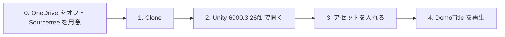

# 授業用プロジェクトのセットアップ

[シラバス](../index.md)

## 概要

---

保存先や Unity のバージョンが違うと、配布されたプロジェクトを正しく開けないことがあります。このページでは **Windows と Sourcetree** を使って、授業用プロジェクトの取得から起動確認までを進めます。
**初回の授業までに終わらせておいてください。**

保存先と道具を準備してから、プロジェクトの取得、指定バージョンでの起動、アセットの導入、再生確認の順に進めます。

---

## 0. Windows の保存先と Sourcetree を準備する

---

### OneDrive の同期をオフにする

---

Unity は多数のファイルを読み書きするため、授業用プロジェクトを OneDrive の同期対象に置かないようにします。取得前に、授業で使う PC の OneDrive の同期をオフにします。

1. タスクバーの通知領域にある **OneDrive の雲アイコン**をクリックします（見えない場合は **∧** の中を確認します）
2. **歯車 → 設定 → アカウント**を開きます
3. **この PC のリンク解除 → アカウントのリンク解除**を選びます
4. エクスプローラーで **`C:\Unity`** フォルダを作ります。以降、プロジェクトはここに保存します

「同期の一時停止」は時間が経つと再開するため、リンク解除を使います。OneDrive を設定していない PC は、保存先の準備から進めてください。

!!! warning "リンク解除とファイルの保存先は別です"
    リンクを解除しても、既存のファイルが自動で `C:\Unity` に移るわけではありません。オンラインのみのファイルは、リンク解除前にダウンロードしてください。授業用プロジェクトは、次の手順で `C:\Unity` に取得します。学校の管理設定で解除できない場合は講師に伝えてください。

手順の参考：[Microsoft：OneDrive をオフにするか、無効にするか、アンインストールする](https://support.microsoft.com/ja-jp/onedrive/turn-off-disable-or-uninstall-onedrive)

### Sourcetree を用意する

---

プロジェクトの取得（クローン）と更新（プル）は **Sourcetree** で行います。前期にインストール済みなら、そのまま使います。未導入の場合は [Sourcetree 公式サイト](https://www.sourcetreeapp.com/) から Windows 版をインストールします。

Sourcetree を起動できることを確認して、次へ進んでください。

---

## 1. プロジェクトを取得する（Clone）

---

授業用プロジェクトのリポジトリ：**[https://github.com/M-634/unity-game-dev-advance](https://github.com/M-634/unity-game-dev-advance)**

以下は Sourcetree での操作です。

> 保存場所は、**パスに日本語や空白を含まないフォルダ**にしてください（例：`C:\Unity\`）。日本語のパスだと Unity がうまく動かないことがあります。

!!! warning "OneDrive の中には置かないでください（Windows）"
    Windows では、**デスクトップ**や**ドキュメント**が OneDrive と同期されていることがあります（パスに `OneDrive` と入っています）。
    OneDrive の中に置くと、Unity が書き込み中のファイルを OneDrive が同期しようとして、同期の競合や読み込みエラーにつながることがあります。

    `C:\Unity\` のように、**C ドライブの直下にフォルダを作って**そこに Clone してください。

> Fork はしません。Clone したフォルダで作業し、授業側の更新は下の手順で取り込みます。

### Sourcetree で Clone する

---

1. リポジトリのページを開き、**Code** → **HTTPS** の URL を、右のコピーボタンでコピーします

    { width="640" }

2. Sourcetree を開き、上のタブの **＋** → **Clone** を選びます

3. 次の3つを入力します

    | 項目 | 入れるもの |
    | --- | --- |
    | **ソース URL**（Windows は「元のパス / URL」） | コピーした URL を貼り付ける |
    | **保存先のパス** | 保存したいフォルダ（例：`C:\Unity\unity-game-dev-advance`） |
    | **名前** | 自動で入ります。そのままで構いません |

4. 「これは Git リポジトリです」と表示されたら、**クローン**を押します

    { width="520" }

5. ダウンロードが終わり、左側に `master` ブランチが表示されれば完了です

> 「これは Git リポジトリです」と出ないときは、URL のコピーミスか、ネットワークにつながっていません。

### 触ってよいファイル

---

演習では `Assets/Application/` 以下を使います。`Assets/Application/_CommonSectionAssets/` は、キャラクター・カメラなどを各単元で共通利用するための配布素材です。各単元の作業用シーンから利用し、元ファイルは上書きしません。

詳しい役割とシーンテンプレートは [授業用プロジェクト構成の説明](project-structure.md) を確認してください。

授業側の更新をあとで取り込めるように、**触ってよいファイルを決めています。**

| | ファイル |
| --- | --- |
| ✅ **触ってよい** | 各単元フォルダの **`〇〇_Work.unity`**（作業用シーン）と、**各単元のフォルダに自分で新しく作ったファイル** |
| ❌ **触らない** | **`〇〇_Sample.unity`**（完成見本）／ 配布されたスクリプト／ **`Assets/Application/_CommonSectionAssets/` の元ファイル**／ `Assets/_DemoGame/` の中すべて |

> 配布されたスクリプトを変えたいときは、講師に確認し、**単元のフォルダにコピーして自分のファイルとして作り直してください**（名前空間かクラス名を変えないと、同じ名前のクラスがあるとエラーになります）。

> `_Sample.unity` を開いて再生したり、中を覗いたりするのは自由です。**保存だけしない**でください。うっかり保存してしまったら、講師に確認してから Sourcetree で対象ファイルの変更を破棄します。

### 授業側の更新を取り込む（pull）

---

授業の進み具合に合わせて、単元のシーンやスクリプトを追加・修正することがあります。**Slack で「更新しました」と連絡したら**、次の手順で取り込んでください。

1. **Unity を閉じます**（開いたままだと、取り込んだファイルが正しく読み込まれないことがあります）
2. Sourcetree の **ファイルステータス**で変更を確認します。自分の作業があれば、内容を確認してコミットします。判断できないファイルは講師に確認します
3. 上の **プル**を押し、取得先のリモートとブランチを確認して実行します

4. Unity Hub からプロジェクトを開き直します

!!! warning "プルでエラーや競合が出たとき"
    `Your local changes ... would be overwritten` は、取り込む更新と手元の変更が重なっているという意味です。編集禁止のファイルを変更したとは限りません。エラーのファイル名を確認し、**変更を破棄する前に講師に声をかけてください。** コミット後に競合が出た場合も、自己判断で上書きせず相談します。

    Sourcetree の **破棄**は、未コミットの作業を失う操作です。`_Work.unity` や自分で作ったスクリプトには安易に使わないでください。

---

## 2. Unity 6000.3.26f1 で開く

---

| 項目 | 値 |
| --- | --- |
| Unity バージョン | **6000.3.26f1**（プロジェクトと同じバージョン） |
| 開き方 | Unity Hub → **Add → Add project from disk** → 1. で取得したフォルダを選ぶ |

使用バージョンは、現在のプロジェクトの `ProjectSettings/ProjectVersion.txt` で確認した **6000.3.26f1** です。Unity Hub 自体のバージョンとは異なります。

1. Unity Hub の **Installs** に **6000.3.26f1** が無ければ、先に入れておきます
2. **Projects → Add → Add project from disk** で、取得したフォルダの**中にある** `unity-game-dev-advance` フォルダ（`Assets` フォルダがある階層）を選びます
3. 一覧に追加されたプロジェクトをクリックして開きます

{ width="720" }

> 一覧の Editor version に ⚠ が付いているときは、そのバージョンが入っていません。クリックして **6000.3.26f1** をインストールしてください。
> **別のバージョンで開かないでください**（6000.3 系のほかのバージョンでも同じです）。「バージョンを変更しますか」と聞かれたら、キャンセルして 6000.3.26f1 を選び直します。

初回はパッケージの取得と準備に時間がかかります。授業で使うパッケージは、開くだけでそろいます。

| もの | 入り方 | 用途 |
| --- | --- | --- |
| Timeline / AI Navigation / Animation Rigging / ProBuilder / Shader Graph / Input System | 開いたときに自動で取得 | 授業で使う Unity 公式パッケージ |
| **Cinemachine 2.10.6** | プロジェクトに同梱 | カメラ制御 |
| **UniTask** | プロジェクトに同梱 | 非同期処理 |
| **R3** | プロジェクトに同梱 | Observer パターン（4章） |

!!! warning "Cinemachine は 2.x を使います"
    Cinemachine には 3.x もありますが、授業のスクリプトとシーンは **2.x 用**です。3.x への変更にはスクリプトやシーンの移行が必要です。
    2.10.6 をプロジェクトに同梱しているので、何もしなければ 2.x のままです。**Package Manager で Cinemachine を Remove したり、別のバージョンを入れ直したりしないでください。**

開いた直後は **Console に赤いエラーが出ていたり、キャラクターがピンク色だったり**します。参照先のアセットがまだそろっていない可能性があります。次の 3. を行い、解消しない場合は Console の内容を講師に確認してください。

---

## 3. アセットを入れる

---

キャラクターのモデルやモーションは、**再配布が禁止されているため、プロジェクトに含めていません。** 各自でダウンロードして入れます。

👉 **[使用アセット一覧とダウンロード手順](../assets.md)**

一覧の「1. 必須のアセット」の4つを、Asset Store から **Download → Import** してください。これは、配布された `.prefab`（共通素材の `DemoPlayer.prefab` など）が参照するモデルやアニメーションを読み込めるようにするためです。

インポート完了時には **`AssetStoreImportRelocator`** が動き、新しく作られた対象フォルダを **`Assets/_GitIgnore/`** 以下へ自動で移動します。このフォルダは Git の管理対象外ですが、Unity がモデルを読み込むために必要です。削除しないでください。

自動移動後の格納先と Prefab のモデル表示を確認してから、次の再生確認へ進みます。処理の対象や移動できない場合の対応は、[使用アセット一覧の「インポート後の格納先」](../assets.md#import-location)を確認してください。

---

## 4. お手本作品を再生する

---

1. Project ウィンドウで `Assets/_DemoGame/Scenes/DemoTitle.unity` をダブルクリックして開きます
2. 上の ▶（Play）ボタンを押します
3. タイトル画面が出て、開始するとゲーム画面に切り替われば完了です

| 確認すること | 合格の状態 |
| --- | --- |
| Console | **赤いエラーが0件** |
| キャラクター | ユニティちゃん・敵がピンク色ではなく表示されている |
| 操作 | キーボード・マウス（またはゲームパッド）でユニティちゃんが動く |

---

## よくある詰まり

---

| 症状 | 原因と対処 |
| --- | --- |
| `No 'git' executable was found` / パッケージ（UniTask）の取得に失敗したというエラー | プロジェクトが古い。最新のプロジェクトは UniTask を同梱していて、このエラーは出ない。1. の「授業側の更新を取り込む（pull）」を行う |
| プロジェクトを開くときにエラーになる / 開くたびにファイルが壊れる（Windows） | プロジェクトが **OneDrive の中**にある。Unity と Unity Hub を閉じ、フォルダごと `C:\Unity\` などへ移動してから、Hub の **Add project from disk** で登録し直す |
| プルで `would be overwritten` と出る | 手元の変更と更新が重なっている。1. の「プルでエラーや競合が出たとき」を見る |
| Hub でプロジェクトを選べない | 選んだフォルダが1階層ずれている。`Assets` `Packages` `ProjectSettings` が並んでいるフォルダを選ぶ |
| キャラクターがピンク色 / Missing と出る | アセットが入っていない。[使用アセット一覧](../assets.md) の4つを入れる |
| `The type or namespace name 'Cinemachine' could not be found` / Cinemachine のエラーが大量に出る | Cinemachine が 3.x になっている。下の「Cinemachine を 2.x に戻す」を見る |

### Cinemachine を 2.x に戻す

---

Package Manager で変更した場合は、まず講師に確認してください。現在の配布構成では `Packages/com.unity.cinemachine` に **2.10.6** が同梱されています。`manifest.json` の指定は **2.10.7** ですが、同梱パッケージがあるため、その数字だけで実際のバージョンを判断しません。

1. **Unity を閉じます**
2. Sourcetree の **ファイルステータス**で `Packages` 以下の変更を確認します
3. 講師と確認した不要な変更だけを **破棄**します。自分の作業を含むファイルをまとめて破棄しないでください
4. 1. の「授業側の更新を取り込む（pull）」を行います
5. Unity Hub から開き直し、**Window → Package Management → Package Manager** の **In Project** で、Cinemachine が **2.10.6** になっていることを確かめます

> Update のあとに「Cinemachine Upgrader」でシーンを変換してしまった場合は、シーンも書き換わっています。自分で直そうとせず、講師に声をかけてください。

上記で解決しない場合は、**エラーメッセージのスクリーンショット**を添えて Slack で質問してください。
