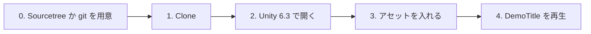
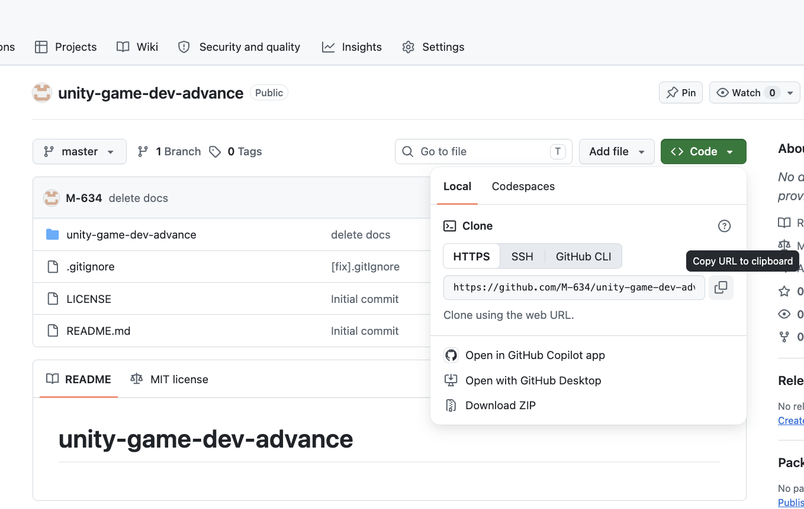
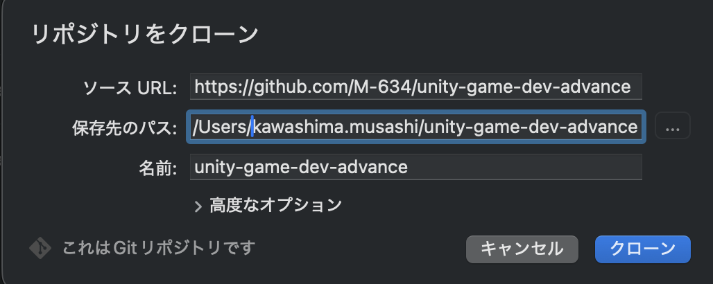
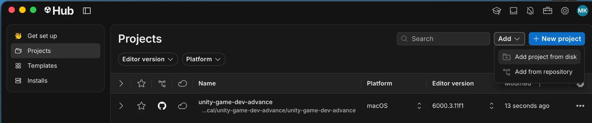

# 授業用プロジェクトのセットアップ

[シラバス](../index.md)

授業で使う Unity プロジェクトを GitHub から取得して、お手本作品『LUMEN』が動くところまでを準備します。
**初回の授業までに終わらせておいてください。**



---

## 0. Sourcetree か git を用意する

---

プロジェクトの取得（Clone）と更新（pull）に使います。**どちらか片方**があれば構いません。

| 道具 | 向いている人 | 入れ方 |
| --- | --- | --- |
| **Sourcetree** | 前期の授業で使っていた人。画面の操作で進めたい人 | [Sourcetree 公式サイト](https://www.sourcetreeapp.com/) からダウンロードしてインストール |
| **git（ターミナル）** | コマンドで操作したい人 | 下の表 |

git が入っているかは、ターミナル（Windows は「コマンドプロンプト」か「PowerShell」）で確かめます。

```bash
git --version
```

`git version 2.xx.x` のように表示されれば入っています。`command not found` などのエラーになったら入れます。

| OS | 入れ方 |
| --- | --- |
| **Windows** | [Git for Windows](https://git-scm.com/download/win) をダウンロードしてインストール（設定はすべて初期値のままで構いません） |
| **Mac** | ターミナルで `xcode-select --install` を実行し、出てきたダイアログで「インストール」 |

> Sourcetree には専用の git が内蔵されています。**Sourcetree だけを使う人は、git を別に入れる必要はありません。**

---

## 1. プロジェクトを取得する（Clone）

---

授業用プロジェクトのリポジトリ：**[https://github.com/M-634/unity-game-dev-advance](https://github.com/M-634/unity-game-dev-advance)**

Clone の方法は2つあります。**どちらか片方**で構いません。

> 保存場所は、**パスに日本語や空白を含まないフォルダ**にしてください（例：`C:\Unity\` や `~/Unity/`）。日本語のパスだと Unity がうまく動かないことがあります。

!!! warning "OneDrive の中には置かないでください（Windows）"
    Windows では、**デスクトップ**や**ドキュメント**が OneDrive と同期されていることがあります（パスに `OneDrive` と入っています）。
    OneDrive の中に置くと、Unity が書き込み中のファイルを OneDrive が同期しようとして、**プロジェクトを開くときにエラーになります。**

    `C:\Unity\` のように、**C ドライブの直下にフォルダを作って**そこに Clone してください。

> Fork はしません。Clone したフォルダで作業し、授業側の更新は下の手順で取り込みます。

### Sourcetree で Clone する

---

1. リポジトリのページを開き、**Code** → **HTTPS** の URL を、右のコピーボタンでコピーします

    { width="640" }

2. Sourcetree を開き、Clone の画面を出します

    | OS | 操作 |
    | --- | --- |
    | **Windows** | 上のタブの **＋** → **Clone** |
    | **Mac** | **新規...** → **URL からクローン** |

3. 次の3つを入力します

    | 項目 | 入れるもの |
    | --- | --- |
    | **ソース URL**（Windows は「元のパス / URL」） | コピーした URL を貼り付ける |
    | **保存先のパス** | 保存したいフォルダ（例：`C:\Unity\unity-game-dev-advance`） |
    | **名前** | 自動で入ります。そのままで構いません |

4. 「これは Git リポジトリです」と表示されたら、**クローン**を押します

    { width="520" }

5. ダウンロードが終わり、左側に `master` ブランチが表示されれば完了です

> 「これは Git リポジトリです」と出ないときは、URL のコピーミスか、ネットワークにつながっていません。

### ターミナルで Clone する

---

保存したいフォルダに移動してから、次のコマンドを実行します。

```bash
git clone https://github.com/M-634/unity-game-dev-advance.git
```

### 触ってよいファイル

---

授業側の更新をあとで取り込めるように、**触ってよいファイルを決めています。**

| | ファイル |
| --- | --- |
| ✅ **触ってよい** | 各単元フォルダの **`〇〇_Work.unity`**（作業用シーン）と、**自分で新しく作ったファイル** |
| ❌ **触らない** | **`〇〇_Sample.unity`**（完成見本）／ 配布されたスクリプト（`namespace Section1.〜` などで始まるもの）／ `Assets/_DemoGame/` の中すべて |

> 配布されたスクリプトを変えたいときは、**コピーして自分のファイルとして作り直してください**（名前空間かクラス名を変えないと、同じ名前のクラスがあるとエラーになります）。

> `_Sample.unity` を開いて再生したり、中を覗いたりするのは自由です。**保存だけしない**でください。うっかり保存してしまったら、下の `git restore` で元に戻せます。

### 授業側の更新を取り込む（pull）

---

授業の進み具合に合わせて、単元のシーンやスクリプトを追加・修正することがあります。**Slack で「更新しました」と連絡したら**、次の手順で取り込んでください。

1. **Unity を閉じます**（開いたままだと、取り込んだファイルが正しく読み込まれないことがあります）
2. pull します

    | 方法 | 操作 |
    | --- | --- |
    | **Sourcetree** | プロジェクトを開き、上の **プル** → そのまま **OK** |
    | **ターミナル** | Clone したフォルダに移動して `git pull` |

3. Unity Hub からプロジェクトを開き直します

!!! warning "pull でエラーが出たとき"
    `Your local changes ... would be overwritten` と出たら、**触らないファイルを書き換えてしまっている**ためです。エラーに出ているファイル名を確かめて、変更を取り消してから、もう一度 `git pull` します。

    ```bash
    git restore <エラーに出ているファイル>
    ```

    Sourcetree では、**ファイルステータス**でそのファイルを右クリック → **破棄**を選びます。

    `_Work.unity` で出たときは、自分の作業が消えてしまうので、**取り消す前に講師に声をかけてください。**

---

## 2. Unity 6.3 で開く

---

| 項目 | 値 |
| --- | --- |
| Unity バージョン | **6000.3.11f1**（プロジェクトと同じバージョン） |
| 開き方 | Unity Hub → **Add → Add project from disk** → 1. で取得したフォルダを選ぶ |

1. Unity Hub の **Installs** に **6000.3.11f1** が無ければ、先に入れておきます
2. **Projects → Add → Add project from disk** で、取得したフォルダの**中にある** `unity-game-dev-advance` フォルダ（`Assets` フォルダがある階層）を選びます
3. 一覧に追加されたプロジェクトをクリックして開きます

{ width="720" }

> 一覧の Editor version に ⚠ が付いているときは、そのバージョンが入っていません。クリックして **6000.3.11f1** をインストールしてください。
> **別のバージョンで開かないでください**（6000.3 系のほかのバージョンでも同じです）。「バージョンを変更しますか」と聞かれたら、キャンセルして 6000.3.11f1 を選び直します。

初回はパッケージの取得と準備で、**数分〜十数分**かかります。授業で使うパッケージは、開くだけでそろいます。

| もの | 入り方 | 用途 |
| --- | --- | --- |
| Timeline / AI Navigation / Animation Rigging / ProBuilder / Shader Graph / Input System | 開いたときに自動で取得 | 授業で使う Unity 公式パッケージ |
| **Cinemachine 2.10.6** | プロジェクトに同梱 | カメラ制御 |
| **UniTask** | プロジェクトに同梱 | 非同期処理 |
| **R3** | プロジェクトに同梱 | Observer パターン（4章） |

!!! warning "Cinemachine は 2.x を使います"
    Cinemachine には 3.x もありますが、授業のスクリプトとシーンは **2.x 用**です。3.x にすると、すべて動かなくなります。
    2.10.6 をプロジェクトに同梱しているので、何もしなければ 2.x のままです。**Package Manager で Cinemachine を Remove したり、別のバージョンを入れ直したりしないでください。**

開いた直後は **Console に赤いエラーが出ていたり、キャラクターがピンク色だったり**します。アセットをまだ入れていないためです。次の 3. で直ります。

---

## 3. アセットを入れる

---

キャラクターのモデルやモーションは、**再配布が禁止されているため、プロジェクトに含めていません。** 各自でダウンロードして入れます。

👉 **[使用アセット一覧とダウンロード手順](../assets.md)**

一覧の「1. 必須のアセット」の4つを入れてください。

---

## 4. お手本作品を再生する

---

1. Project ウィンドウで `Assets/_DemoGame/Scenes/DemoTitle.unity` をダブルクリックして開きます
2. 上の ▶（Play）ボタンを押します
3. タイトル画面が出て、開始するとゲーム画面に切り替われば完了です

| 確認すること | 合格の状態 |
| --- | --- |
| Console | **赤いエラーが0件** |
| キャラクター | ユニティちゃん・敵がピンク色ではなく表示されている |
| 操作 | キーボード・マウス（またはゲームパッド）でユニティちゃんが動く |

---

## よくある詰まり

---

| 症状 | 原因と対処 |
| --- | --- |
| `No 'git' executable was found` / パッケージ（UniTask）の取得に失敗したというエラー | プロジェクトが古い。最新のプロジェクトは UniTask を同梱していて、このエラーは出ない。1. の「授業側の更新を取り込む（pull）」を行う |
| プロジェクトを開くときにエラーになる / 開くたびにファイルが壊れる（Windows） | プロジェクトが **OneDrive の中**にある。Unity と Unity Hub を閉じ、フォルダごと `C:\Unity\` などへ移動してから、Hub の **Add project from disk** で登録し直す |
| `git pull` で `would be overwritten` と出る | 触らないファイルを書き換えている。1. の「pull でエラーが出たとき」を見る |
| Hub でプロジェクトを選べない | 選んだフォルダが1階層ずれている。`Assets` `Packages` `ProjectSettings` が並んでいるフォルダを選ぶ |
| キャラクターがピンク色 / Missing と出る | アセットが入っていない。[使用アセット一覧](../assets.md) の4つを入れる |
| `The type or namespace name 'Cinemachine' could not be found` / Cinemachine のエラーが大量に出る | Cinemachine が 3.x になっている。下の「Cinemachine を 2.x に戻す」を見る |

### Cinemachine を 2.x に戻す

---

以前のプロジェクトで Package Manager の Update を押した人は、`Packages` フォルダの中の2つのファイル（`manifest.json` と `packages-lock.json`）が書き換わっています。**この2つを元に戻してから pull** すれば直ります。

1. **Unity を閉じます**
2. 2つのファイルの変更を取り消します

    | 方法 | 操作 |
    | --- | --- |
    | **Sourcetree** | **ファイルステータス**で `manifest.json` と `packages-lock.json` を右クリック → **破棄** |
    | **ターミナル** | Clone したフォルダで `git restore unity-game-dev-advance/Packages` |

3. 1. の「授業側の更新を取り込む（pull）」を行います
4. Unity Hub からプロジェクトを開き直します
5. Package Manager の **In Project** で、Cinemachine が **2.10.6** になっていることを確かめます

> Update のあとに「Cinemachine Upgrader」でシーンを変換してしまった場合は、シーンも書き換わっています。自分で直そうとせず、講師に声をかけてください。

上記で解決しない場合は、**エラーメッセージのスクリーンショット**を添えて Slack で質問してください。
