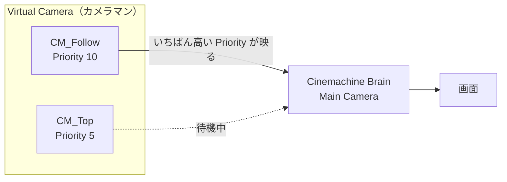
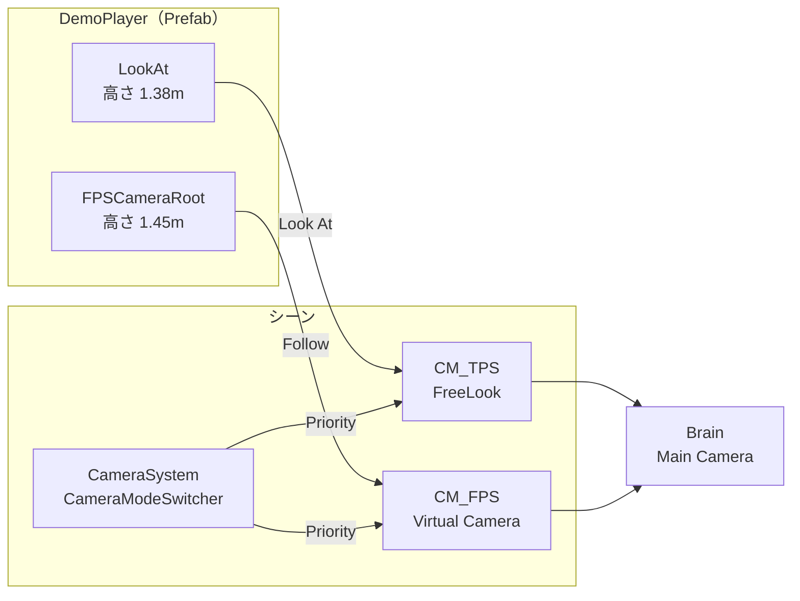

# Cinemachineとカメラ制御

[シラバス](../index.md) ｜ 章の課題：[1章の課題](../problems/s1/index.md)

## この単元の目的

---

Cinemachine の **Brain・Virtual Camera・Priority・Blend** の仕組みを理解し、
**対象を追いかけるカメラ**と**カメラの切り替え**を、スクリプトを書かずに作れるようになることが目標です。
最後に、3Dキャラクター（`DemoPlayer`）で同じ仕組みがどう使われているかを確認します。

## 演習の準備

---

**使用シーン**：`Assets/Application/Week02-Cinemachine/Cinemachine_Work.unity`
**完成見本**：`Assets/Application/Week02-Cinemachine/Cinemachine_Sample.unity`
**活用例を見るシーン**：`Assets/Application/Week01-Animation/Week01-Animation_Sample.unity`

`Cinemachine_Work` には、次のものだけを置いてあります。

| GameObject | 内容 |
| --- | --- |
| `Main Camera` | ふつうのカメラ。Cinemachine のコンポーネントはまだ付いていない |
| `Ground` | 床 |
| `Target` | カメラで追いかける対象（Capsule）。`TargetMover` で左右に往復する。タグは `Player` |
| `Wall` | 壁。発展の「壁を避ける」で使う |

`TargetMover`（`Week02-Cinemachine/Scripts/`）は、`Target` を一定の速さで往復させるだけの配布スクリプトです。
止めたいときは、Inspector でコンポーネントのチェックを外してください。

## 授業の進め方

---

1. カメラの仕事と、Cinemachine の登場人物（Brain・Virtual Camera）を確認する。
2. `Cinemachine_Work` に Virtual Camera を1台置く。
3. **Follow** と **Look At** を設定し、`Target` を追いかけるカメラにする。
4. **Damping** と構図（Dead Zone・Soft Zone）を調整する。
5. 2台目の Virtual Camera を置き、**Priority** で映るカメラを切り替える。
6. Brain の **Blend** で、切り替わり方を変える。
7. `DemoPlayer` を開き、3Dキャラクターでの使われ方を確認する。

---

## 概要

---

カメラは「置けば映る」ものではありません。キャラクターを追いかけ、画面のちょうどよい位置に収め、場面によっては視点そのものを持ち替えます。
これを自分でスクリプトに書くと、追従の遅れ・構図・切り替えのなめらかさ・壁の回避と、書くものがどこまでも増えていきます。

**Cinemachine** は、こうしたカメラの仕事を引き受ける Unity 公式のパッケージです。
このプロジェクトには **Cinemachine 2.10**（`using Cinemachine;`）が入っています。

> **この単元の問い**：カメラの動きを、スクリプトを書かずにどこまで作れるか？

### Brain と Virtual Camera

---

登場人物は2つです。

- **Cinemachine Brain（本物のカメラ）**
`Main Camera` に付けるコンポーネント。画面を映す本物のカメラは、シーンに**1台だけ**です
- **Virtual Camera（カメラマン）**
「誰を追いかけて、どこから、どう映すか」を決めたもの。**何台置いても重くなりません。** 実際に映すのは Brain です

> 基本的な考え方は、Brain が「**撮影機材**」、Virtual Camera が「**カメラマン**」に相当すると覚えるとよいでしょう。
> 機材は1台。カメラマンは何人でも待機させておけて、**いちばん優先度の高いカメラマン**の指示どおりに機材が動きます。



Virtual Camera は何台あっても、画面に映るのは Priority がいちばん高い1台です。残りは待機しています。

| 用語 | 意味 |
| --- | --- |
| **Priority** | Virtual Camera の優先度。**値がいちばん高いもの**が映る |
| **Blend** | 映るカメラが変わったとき、前のカメラから次のカメラへ**なめらかに移る**時間と動き方。Brain の **Default Blend** で決める |
| **Follow** | カメラが**ついていく**対象（位置） |
| **Look At** | カメラが**向く**対象（向き） |

### Body と Aim

---

Virtual Camera は、**Body（どこに置くか）**と **Aim（どこを向くか）**の組み合わせで動きを決めます。

| | よく使うもの | 動き |
| --- | --- | --- |
| **Body** | Transposer | Follow の対象から、決めた距離を保ってついていく |
| | 3rd Person Follow | 肩越しの視点。TPS のシューターなど |
| | Hard Lock To Target | Follow の対象と**同じ位置**に置く。FPS に使う |
| | Do nothing | 位置を動かさない。固定カメラに使う |
| **Aim** | Composer | Look At の対象を、画面の決めた位置に入れ続ける |
| | POV | 入力（マウス）で向きを変える。FPS に使う |
| | Hard Look At | Look At の対象を、常に画面の中央に入れる |

今日のハンズオンでは、いちばん基本の **Transposer ＋ Composer** を使います。

---

## ハンズオン：追いかけるカメラを作る

---

`Cinemachine_Work` を開いてください。ここからは、**スクリプトを1行も書きません。**

### Step 1：Virtual Camera を置く

---

1. メニューの **GameObject → Cinemachine → Virtual Camera** を選ぶ
2. Hierarchy にできた `CM vcam1` の名前を `CM_Follow` にする
3. `Main Camera` を選び、**Cinemachine Brain** が自動で付いたことを確かめる

Virtual Camera は、**Scene ビューで今見ている位置と向き**に作られます。Game ビューが、その視点に変わったはずです。

ここで `Main Camera` の Transform を動かしてみてください。**すぐに元の位置に戻されます。**
Brain が、Virtual Camera の位置と向きを毎フレーム `Main Camera` に書き込んでいるためです。

> これ以降、**カメラを動かしたいときは Virtual Camera を動かします。** `Main Camera` は直接触りません。

### Step 2：Follow と Look At を設定する

---

1. `CM_Follow` を選び、**Follow** と **Look At** の両方に `Target` をドラッグする
2. **Body** が **Transposer**、**Aim** が **Composer** になっていることを確かめる
3. **Body** を下の表のとおりに設定する
4. 再生する

| 項目 | 値 | 意味 |
| --- | --- | --- |
| **Body → Binding Mode** | World Space | 対象が向きを変えても、カメラは回り込まない |
| **Body → Follow Offset** | X 0 ／ Y 3 ／ Z -6 | 対象から見て、上に 3m・後ろに 6m の位置に置く |

`Target` が左右に往復し、カメラが後ろからついていきます。

| 設定 | 受け持つこと | 外すとどうなるか |
| --- | --- | --- |
| **Follow** | カメラの**位置** | カメラはその場から動かず、首だけ振って対象を見る |
| **Look At** | カメラの**向き** | カメラは同じ向きのまま、平行に移動する |

再生したまま、Follow と Look At を片方ずつ `None` にして、違いを確かめてください。確かめたら `Target` に戻します。

### Step 3：Damping と構図を調整する

---

再生したまま `CM_Follow` を選ぶと、Game ビューに**ガイド**が表示されます（出ないときは **Game Window Guides** にチェックを入れる）。

| ガイド | 名前 | 意味 |
| --- | --- | --- |
| 黄色い点 | 対象の位置 | Look At の対象が、画面のどこにいるか |
| 透明な領域 | **Dead Zone** | 対象がこの中にいる間、カメラは**向きを変えない** |
| 青い領域 | **Soft Zone** | 対象がここに入ると、カメラが**ゆっくり**向きを直す |
| 赤い領域 | 侵入禁止 | 対象をここには入れない。入りそうになると、カメラは**すぐに**向きを直す |

次の値を順番に変えて、動きの違いを見てください。

| 項目 | 試す値 | 見るところ |
| --- | --- | --- |
| **Body → X Damping** | 0 → 1 → 5 | 折り返しのとき、カメラが**遅れてついてくる**量 |
| **Aim → Horizontal Damping** | 0 → 0.5 → 3 | カメラが対象のほうへ**向き直る速さ** |
| **Aim → Dead Zone Width** | 0 → 0.3 | 対象が少し動いただけでは、カメラが反応しなくなる |
| **Aim → Screen X** | 0.5 → 0.3 | 対象を画面の**左寄り**に置く。進行方向を広く見せるときに使う |

> **Damping は「遅れ」の量です。** 0 にすると対象に貼り付いたように動き、大きくすると重たいカメラになります。
> アクションゲームは小さめ、ゆったり歩くゲームは大きめ、というように**ゲームの手ざわり**を決める値です。

> ⚠️ 再生中に変えた値は、再生を止めると元に戻ります。残したい値は、止める前にメモしておいてください。

調整が終わったら、次の値にして再生を止めます。

| 項目 | 値 |
| --- | --- |
| **Body → X Damping ／ Y Damping ／ Z Damping** | 1 ／ 1 ／ 1 |
| **Aim → Horizontal Damping ／ Vertical Damping** | 0.5 ／ 0.5 |
| **Aim → Dead Zone Width ／ Dead Zone Height** | 0.1 ／ 0.1 |
| **Aim → Screen X ／ Screen Y** | 0.5 ／ 0.5 |

### Step 4：2台目を置いて、Priority で切り替える

---

上から見下ろす固定カメラを足します。

1. **GameObject → Cinemachine → Virtual Camera** を選び、名前を `CM_Top` にする
2. 下の表のとおりに設定する
3. 再生する

| 項目 | 値 | 意味 |
| --- | --- | --- |
| **Transform → Position** | X 0 ／ Y 10 ／ Z -8 | 高いところに置く |
| **Priority** | 5 | `CM_Follow`（10）より低い。待機する |
| **Follow** | None | 位置は動かさない |
| **Look At** | `Target` | 対象のほうを向く |
| **Body** | Do nothing | 置いた場所から動かない |
| **Aim** | Composer | 対象を画面に入れ続ける |

再生しても、映っているのは `CM_Follow` のままです。Priority が高いほうが映るからです。

再生したまま `CM_Top` の **Priority** を **20** に書き換えてください。**カメラが上からの視点へ移ります。**
**5** に戻すと、`CM_Follow` に戻ります。

> **カメラを切り替えたいときは、Priority を変えるだけです。**
> 今は Inspector で手で書き換えましたが、ゲームではこの書き換えをスクリプトが行います。

`Main Camera` を選ぶと、Cinemachine Brain の **Live Camera** に、今映っている Virtual Camera の名前が出ています。
映らないときは、まずここを見ます。

### Step 5：Blend で切り替わり方を変える

---

Step 4 では、カメラが2秒かけてなめらかに移りました。この動きを決めているのが、Brain の **Default Blend** です。

`Main Camera` を選び、**Cinemachine Brain → Default Blend** を変えて、Step 4 と同じ切り替えを試してください。

| Default Blend | 時間 | 動き | 使いどころ |
| --- | --- | --- | --- |
| **Cut** | — | 一瞬で切り替わる | 会話のカット割り、場面転換 |
| **Ease In Out** | 2 | ゆっくり動き始め、ゆっくり止まる | 演出、見せたい場所への誘導 |
| **Ease In Out** | 0.3 | すばやく、なめらかに移る | 操作中の視点切り替え |
| **Linear** | 1 | 一定の速さで移る | 機械的な動き |

**切り替わりの途中の位置や向きは、どこにも書いていません。** 2台の Virtual Camera の間を、Brain が埋めています。

> 「このカメラからこのカメラへ移るときだけ長くしたい」というときは、Brain の **Custom Blends** で組み合わせごとに決められます。

確認が終わったら、Default Blend を **Ease In Out ／ 0.5 秒**にして再生を止めます。

---

## 発展：壁を避ける（Cinemachine Collider）

---

> 授業の時間内に扱えなかった場合は、課題演習の時間に試してください。

`Wall` を `Target` の通り道の手前に動かすと、カメラと `Target` の間に壁が入り、`Target` が見えなくなります。
Virtual Camera に**拡張（Extension）**を足すと、これを避けられます。

`CM_Follow` の Inspector の一番下、**Extensions → Add Extension** から **CinemachineCollider** を選びます。

| 項目 | 値 | 意味 |
| --- | --- | --- |
| **Collide Against** | Default | このレイヤーの物を壁として扱う |
| **Ignore Tag** | Player | 対象自身には当たらない |
| **Minimum Distance From Target** | 0.2 | 対象にこれ以上近づかない |
| **Avoid Obstacles** | ✅ | 壁を避ける |
| **Camera Radius** | 0.2 | カメラの太さ。壁にめり込まないための余白 |
| **Strategy** | Pull Camera Forward | 壁に当たったら、カメラを手前に引き寄せる |
| **Damping ／ Damping When Occluded** | 0.5 ／ 0.5 | 引き寄せるとき・戻るときの遅れ。0 にするとガクッと動く |

再生して、`Target` が壁の裏を通るときのカメラの動きを確かめてください。

---

## 3Dキャラクターでの活用：DemoPlayer を見る

---

ここからは、`Week01-Animation_Sample` を開いて、**同じ仕組みが3Dキャラクターでどう使われているか**を見ます。
新しい仕組みは出てきません。ハンズオンで触った Follow・Look At・Priority・Blend の組み合わせです。

| 操作 | キーボード・マウス | ゲームパッド |
| --- | --- | --- |
| 移動 | WASD | 左スティック |
| 視点 | マウス | 右スティック |
| 走る | 左 Shift | 左トリガー |
| ジャンプ | Space | South ボタン |
| TPS / FPS の切り替え | Tab | 右スティック押し込み |

### 全体の構成

---



**Virtual Camera はシーンに置き、Prefab が持つのは「追いかけてもらう場所」だけです。**

### 見るところ①：Prefab は追従先だけを持つ

---

`Assets/Application/Week01-Animation/Prefabs/DemoPlayer.prefab` を開いてください。

| 子の GameObject | 位置 | 使われ方 |
| --- | --- | --- |
| `LookAt` | 高さ 1.38m（胸のあたり） | `CM_TPS` の **Look At**。足元ではなく上半身を画面の中心に入れる |
| `FPSCameraRoot` | 高さ 1.45m（目の高さ） | `CM_FPS` の **Follow**。FPS のカメラを置く場所 |

どちらも、何もコンポーネントが付いていない空の GameObject です。

> ハンズオンでは `Target` そのものを Follow と Look At に入れました。
> キャラクターでは、**狙いたい高さに空の GameObject を置いて**、それを対象にします。ルートは足元にあるためです。

> 追従先を頭のボーンにしないのは、頭はモーションで揺れて酔いやすいからです。プレイヤーのルートの子に、固定の高さで置いています。

### 見るところ②：TPS のカメラ（FreeLook）

---

シーンの `CM_TPS` を選んでください。これは **FreeLook Camera** です。
ハンズオンの「Transposer ＋ Composer」を TPS 用にまとめたもので、上・中・下の3段の円（Orbit）の上をカメラが動きます。

| 項目 | 値 | 意味 |
| --- | --- | --- |
| **Priority** | 20 | ふだん映るカメラ |
| **Follow ／ Look At** | `DemoPlayer` ／ `DemoPlayer/LookAt` | 位置はルートに、向きは胸の高さに合わせる |
| **Lens → Vertical FOV** | 40 | 画角 |
| **Binding Mode** | Simple Follow With World Up | プレイヤーが向きを変えても、カメラは勝手に回り込まない |
| **Orbits → Top Rig** | Height 4.5 ／ Radius 1.75 | 見下ろすときの高さと距離 |
| **Orbits → Middle Rig** | Height 2.5 ／ Radius 3 | ふだんの高さと距離 |
| **Orbits → Bottom Rig** | Height 0.4 ／ Radius 1.3 | 見上げるときの高さと距離 |

Scene ビューに、3段の赤い円が表示されます。マウスを上下に動かすと、カメラはこの円をつないだ面の上を移動します。

マウスの入力は、`CM_TPS` に付いている **Cinemachine Input Provider** がカメラに渡しています。

> **Input Provider が必要な理由**：このプロジェクトは新しい Input System だけを使う設定です。
> FreeLook は何もしないと古い Input の軸名（`Mouse X` など）を読みに行き、エラーになります。
> 自分のシーンに FreeLook を置くときは、Input Provider を付けて **XY Axis** に Look のアクションを入れ、
> Axis Control の **Speed Mode** を **Input Value Gain** にしてください。

### 見るところ③：FPS のカメラ

---

`CM_FPS` を選んでください。こちらはハンズオンと同じ **Virtual Camera** で、Body と Aim の組み合わせだけが違います。

| 項目 | 値 | 意味 |
| --- | --- | --- |
| **Priority** | 0 | ふだんは待機 |
| **Follow** | `DemoPlayer/FPSCameraRoot` | 目の高さに置く |
| **Body** | Hard Lock To Target | Follow の対象と同じ位置に置く |
| **Aim** | POV | マウスで向きを変える |
| **Lens → Vertical FOV** | 60 | TPS より広い画角 |

**Body と Aim の組み合わせを変えるだけで、まったく別の視点になります。**

### 見るところ④：Priority の入れ替え

---

再生して **Tab** を押すと、TPS と FPS が切り替わります。
やっていることは、Step 4 で手で行った **Priority の書き換え**と同じです。

```csharp
if (_tpsCamera != null) _tpsCamera.Priority = mode == CameraMode.Tps ? _livePriority : _standbyPriority;
if (_fpsCamera != null) _fpsCamera.Priority = mode == CameraMode.Fps ? _livePriority : _standbyPriority;
```

`CameraSystem` に付いている `CameraModeSwitcher`（`Week01-Animation/Scripts/Camera/`）の一部です。
映すほうを 20、待機するほうを 0 にしています。

切り替わりのなめらかさは、`Main Camera` の Brain の **Default Blend（Ease In Out ／ 0.3 秒）**が受け持っています。
Step 5 の表の「操作中の視点切り替え」にあたる値です。

> 切り替える瞬間に視線が飛ばないよう、`CameraModeSwitcher` は**今のカメラの向きを、切り替え先のカメラに写してから** Priority を入れ替えています。

### 見るところ⑤：プレイヤーはカメラを知らない

---

`PlayerController` は、**カメラの向き**を移動の基準にしています。**どの Virtual Camera が映っているかは知りません。**
だから、Virtual Camera を何台足しても、移動のスクリプトは変わりません。

### 見るところ⑥：画面の揺れ（Impulse）

---

高いところから着地すると、画面が揺れます。Cinemachine の **Impulse** は、揺れを**出す側**と**受け取る側**に分かれています。

| 部品 | 付いている場所 | 役割 |
| --- | --- | --- |
| **Cinemachine Impulse Source** | `DemoPlayer` | 揺れを出す。形は Bump、長さ 0.2 秒 |
| **Cinemachine Impulse Listener** | `CM_TPS` と `CM_FPS`（Extension） | 揺れを受け取って、カメラを揺らす |
| `PlayerCameraShake` | `DemoPlayer` | 着地や被弾のときに、Impulse Source に「揺らせ」と伝える |

揺らす側は、**どのカメラが揺れるかを知りません。** Listener を付けたカメラが揺れます。
TPS でも FPS でも同じように揺れるのは、両方に Listener が付いているからです。

---

## 🧯 よくある詰まり

---

| 症状 | 原因と対処 |
| --- | --- |
| Virtual Camera を置いたのに**映らない** | Priority がほかのカメラより低い／`Main Camera` に Cinemachine Brain が付いていない。Brain の **Live Camera** を見る |
| `Main Camera` の Transform を直接動かしても**戻される** | Brain が毎フレーム位置を上書きしている。動かしたいなら Virtual Camera を動かす |
| カメラが対象を**追いかけない** | **Follow** が空／Body が Do nothing になっている |
| カメラが対象のほうを**向かない** | **Look At** が空／Aim が Do nothing になっている |
| Game ビューに**ガイドが出ない** | Virtual Camera を選んでいない／**Game Window Guides** のチェックが外れている |
| Priority を変えると**一瞬で飛ぶ** | Brain の **Default Blend** が Cut になっている |
| 調整した値が**消えた** | 再生中に変えた値は、止めると元に戻る。止めてから入れ直す |
| Collider を付けたのに**対象に当たって寄りすぎる** | **Ignore Tag** に対象のタグが入っていない |
| FreeLook を置いて再生すると **InvalidOperationException** が出る | **Cinemachine Input Provider** が付いていない。付けて XY Axis に Look を入れる |

---

## 🔗 参考リンク

---

- [Cinemachine 2.10 マニュアル](https://docs.unity3d.com/Packages/com.unity.cinemachine@2.10/manual/index.html)
- [Cinemachine Virtual Camera](https://docs.unity3d.com/Packages/com.unity.cinemachine@2.10/manual/CinemachineVirtualCamera.html)
- [Cinemachine FreeLook Camera](https://docs.unity3d.com/Packages/com.unity.cinemachine@2.10/manual/CinemachineFreeLook.html)
- [Cinemachine Collider](https://docs.unity3d.com/Packages/com.unity.cinemachine@2.10/manual/CinemachineCollider.html)
- [Cinemachine Impulse](https://docs.unity3d.com/Packages/com.unity.cinemachine@2.10/manual/CinemachineImpulse.html)
- [Cinemachine Input Provider（Input System との連携）](https://docs.unity3d.com/Packages/com.unity.cinemachine@2.10/manual/InputSystem.html)

---

[シラバス](../index.md) ｜ 章の課題：[1章の課題](../problems/s1/index.md)
