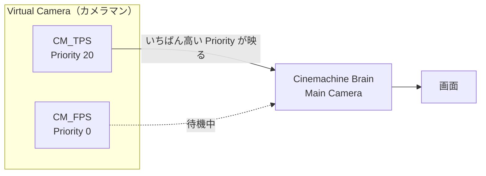
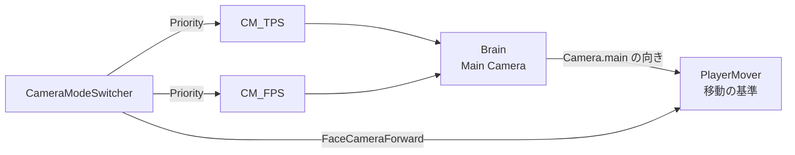

# Cinemachineとカメラ制御

[シラバス](../index.md) ｜ 章の課題：[1章の課題](../problems/s1/index.md)

## この単元の目的

---

カメラを手で書いたときに何が起きるかを体験したうえで、Cinemachine の **Brain・Virtual Camera・Priority・Blend** の仕組みを使い、
**追従・壁の回避・視点の切り替え・画面の揺れ**を作れるようになることが目標です。

## 演習の準備

---

**使用シーン**：`Assets/Application/Section1-CharacterCamera/CameraControl/CameraControl_Start.unity`
**完成見本**：`Assets/Application/Section1-CharacterCamera/CameraControl/CameraControl_Goal.unity`

| 操作 | キーボード・マウス | ゲームパッド |
| --- | --- | --- |
| 移動 | WASD | 左スティック |
| 視点 | マウス | 右スティック |
| 走る | 左 Shift | 左トリガー |
| ジャンプ | Space | South ボタン |
| TPS / FPS の切り替え（`_Goal` のみ） | Tab | 右スティック押し込み |
| カーソルの固定を解除 ／ 再び固定 | Esc ／ 左クリック | — |

| 部品 | 場所（`CameraControl/`） | 内容 |
| --- | --- | --- |
| **LessonPlayer** | `Prefabs/LessonPlayer.prefab` | 演習用のプレイヤー。DemoGame のプレイヤーから、移動・ジャンプ・向きだけを残したもの |
| `PlayerMover` | `Scripts/` | 移動。**移動の基準は `Camera.main` の向き**で、カメラが何で動いているかは知らない |
| `SimpleFollowCamera` | `Scripts/` | `_Start` のカメラ。**手で書いた追従カメラ** |
| `CameraModeSwitcher` | `Scripts/` | `_Goal` の TPS / FPS 切り替え |
| `LandingShake` | `Scripts/` | `_Goal` の着地の揺れ |
| `CameraLessonInput` | `Input/` | 入力アクション（Move / Look / Jump / Sprint / SwitchView） |

シーンには、**カメラが困る場所**を4つ置いてあります。

| 場所 | 置いてあるもの | 確かめること |
| --- | --- | --- |
| 奥の壁（`Wall`） | 大きな壁 | 壁を背にして振り向くと、カメラはどこへ行くか |
| 左の柱（`Pillars`） | 柱3本 | カメラとプレイヤーの間に柱が入ると、どう見えるか |
| 右の通路（`Tunnel`） | 天井のある狭い通路 | 通路の中で視点を回すと、どう見えるか |
| 手前の高台（`Platform`） | 坂と高台 | 高台から飛び降りたとき、どう見えるか |

編集するのは `CameraControl/` の中だけです。追加するスクリプトには `Section1.CameraControl` の namespace を付けてください。

## 授業の進め方

---

1. `_Start` を遊び、手書きのカメラで**困る場面**を4つの場所で探す。
2. 困りごとの1つ（壁抜け）を、自分でスクリプトに書いて直してみる。
3. Cinemachine の仕組み（Brain・Virtual Camera・Priority・Blend）を確認する。
4. 手書きのカメラを外し、**FreeLook** で同じ追従カメラを作る。
5. **Collider** の拡張で、壁を避けるようにする。
6. FPS のカメラを足し、**Priority の入れ替え**で TPS / FPS を切り替える。
7. **Impulse** で、高台から着地したときに画面を揺らす。

---

## 概要

---

カメラは「置けば映る」ものではありません。プレイヤーを追いかけ、壁の向こうに回り込まず、狭い場所では寄り、場面によっては視点そのものを持ち替える。
これを自分でスクリプトに書くと、条件分岐がどこまでも増えていきます。

この単元では、**まずカメラを手で書いて、その困りごとを体験してから** Cinemachine に置き換えます。
順番が逆だと、Cinemachine が何を肩代わりしてくれているのかが分かりません。

> **この単元の問い**：カメラを自分で書くと、何がそんなに大変なのか？

---

## 手で書いたカメラ

---

`_Start` のカメラは、`SimpleFollowCamera` だけで動いています。中身はこれだけです。

```csharp
// CameraControl/Scripts/SimpleFollowCamera.cs（抜粋）
private void Update()
{
    Vector2 delta = _look.action.ReadValue<Vector2>();
    _yaw += delta.x * _sensitivity;
    _pitch -= delta.y * _sensitivity;
    _pitch = Mathf.Clamp(_pitch, -30f, 70f);

    Vector3 focus = _target.position + Vector3.up * _height;
    Quaternion rotation = Quaternion.Euler(_pitch, _yaw, 0f);

    // 注視点から、向きの反対側へ _distance だけ離れた位置に置く
    transform.position = focus - rotation * Vector3.forward * _distance;
    transform.LookAt(focus);
}
```

「プレイヤーの後ろから、マウスで回して見る」なら、これで動きます。
`_Start` を再生して、4つの場所を回ってみてください。

### 困りごとを探す

---

| 場所 | 起きること |
| --- | --- |
| 奥の壁 | 壁を背にすると、カメラが**壁の向こう側**に行き、壁しか映らない |
| 左の柱 | 柱がプレイヤーを**隠す** |
| 右の通路 | カメラが天井や壁に**めり込む** |
| 手前の高台 | 飛び降りても、着地の**手応えが画面に出ない** |

ほかにも、気づいたことを書き出してください。
「走り始めの一瞬だけプレイヤーがぶれる」「FPS 視点も欲しい」なども、立派な困りごとです。

### 1つだけ、自分で直してみる

---

壁抜けを直すなら、「注視点からカメラへ線を飛ばし、何かに当たったら、その手前にカメラを置く」と書けます。

```csharp
Vector3 desired = focus - rotation * Vector3.forward * _distance;

// 注視点からカメラの置きたい位置へ、球を飛ばして壁を探す
if (Physics.SphereCast(focus, 0.2f, (desired - focus).normalized, out RaycastHit hit, _distance))
{
    desired = focus + (desired - focus).normalized * hit.distance;
}

transform.position = desired;
```

これで壁抜けは減ります。ところが、すぐに次の困りごとが出てきます。

- 自分自身（プレイヤーのコライダー）にも当たってしまう → 当たる対象を絞る必要がある
- 柱の横を通るたびに、カメラが**ガクッと前後する** → なめらかに戻す処理が要る
- FPS も欲しい → カメラをもう1つ書いて、切り替えて、切り替えの瞬間をなめらかにして……

**1つ直すたびに、次の「直さないといけないこと」が出てきます。** これがこの単元の問いの答えです。

---

## Cinemachine の考え方

---

Cinemachine は、Unity 公式のカメラ制御パッケージです。このプロジェクトには **Cinemachine 2.10**（`using Cinemachine;`）が入っています。

登場人物は2つです。

- **Cinemachine Brain（本物のカメラ）**
`Main Camera` に付けるコンポーネント。画面を映す本物のカメラは、シーンに**1台だけ**です
- **Virtual Camera（カメラマン）**
「誰を追いかけて、どこから、どう映すか」を決めたもの。**何台置いても重くなりません。** 実際に映すのは Brain です

> 基本的な考え方は、Brain が「**撮影機材**」、Virtual Camera が「**カメラマン**」に相当すると覚えるとよいでしょう。
> 機材は1台。カメラマンは何人でも待機させておけて、**いちばん優先度の高いカメラマン**の指示どおりに機材が動きます。



| 用語 | 意味 |
| --- | --- |
| **Priority** | Virtual Camera の優先度。**値がいちばん高いもの**が映る |
| **Blend** | 映るカメラが変わったとき、前のカメラから次のカメラへ**なめらかに移る**時間と動き方。Brain の **Default Blend** で決める |
| **Follow** | カメラが**ついていく**対象（位置） |
| **Look At** | カメラが**向く**対象（向き） |

**カメラを切り替えたいときは、Priority を変えるだけです。** なめらかにつなぐ処理は Brain が受け持ちます。

### Body と Aim

---

Virtual Camera は、**Body（どこに置くか）**と **Aim（どこを向くか）**の組み合わせで動きを決めます。

| | よく使うもの | 動き |
| --- | --- | --- |
| **Body** | Transposer | Follow の対象から、決めた距離を保ってついていく |
| | 3rd Person Follow | 肩越しの視点。TPS のシューターなど |
| | Hard Lock To Target | Follow の対象と**同じ位置**に置く。FPS に使う |
| **Aim** | Composer | Look At の対象を、画面の決めた位置に入れ続ける |
| | POV | 入力（マウス）で向きを変える。FPS に使う |
| | Hard Look At | Look At の対象を、常に画面の中央に入れる |

**FreeLook Camera** は、TPS 用にこれらをまとめた特別な Virtual Camera です。上・中・下の3段の円（Orbit）の上をカメラが動きます。

---

## FreeLook で追従カメラを作る

---

`_Start` を開いて、手で書いたカメラを Cinemachine に置き換えます。

1. `Main Camera` の **SimpleFollowCamera** を外す（コンポーネント右上の ︙ → Remove Component）
2. メニューの **GameObject → Cinemachine → FreeLook Camera** を選ぶ
    - `Main Camera` に **Cinemachine Brain** が自動で付く
    - `FreeLook Camera` という GameObject ができる。名前を `CM_TPS` にする
3. `CM_TPS` の **Follow** に `LessonPlayer`、**Look At** に `LessonPlayer/LookAt` を入れる
4. 下の表のとおりに設定する

| 項目 | 値 | 意味 |
| --- | --- | --- |
| **Lens → Vertical FOV** | 40 | 画角 |
| **Binding Mode** | Simple Follow With World Up | プレイヤーが向きを変えても、カメラは勝手に回り込まない |
| **Orbits → Top Rig** | Height 4.5 ／ Radius 1.75 | 見下ろすときの高さと距離 |
| **Orbits → Middle Rig** | Height 2.5 ／ Radius 3 | ふだんの高さと距離 |
| **Orbits → Bottom Rig** | Height 0.4 ／ Radius 1.3 | 見上げるときの高さと距離 |

Scene ビューに、3段の赤い円が表示されます。**カメラはこの円をつないだ面の上を動きます。**

### マウスで回す：Cinemachine Input Provider

---

このままではマウスで回りません。Input System の入力をカメラに渡します。

1. `CM_TPS` に **Add Component → Cinemachine Input Provider** を付ける
2. **XY Axis** に `CameraLessonInput` の **Player/Look** を入れる
3. `CM_TPS` の **Axis Control** を次のように設定する

| 項目 | X Axis（左右） | Y Axis（上下） |
| --- | --- | --- |
| **Speed Mode** | Input Value Gain | Input Value Gain |
| **Speed** | 1 | 0.02 |
| **Accel Time ／ Decel Time** | 0 | 0 |
| **Input Axis Name** | 空にする | 空にする |
| **Invert** | ✅ | ✅ |

> **Speed Mode を Input Value Gain にする理由**：マウスの入力は「そのフレームで動いた量」です。
> 既定の Max Speed は入力を「速さ」として扱うので、マウスでは回りすぎたり、フレームレートで変わったりします。

> **Input Axis Name を空にする理由**：このプロジェクトは新しい Input System だけを使う設定です。
> Input Provider が付いていないとき、カメラは軸名（`Mouse X` など）で古い Input を読みに行き、エラーになります。
> Provider を付ければ軸名は使われませんが、付け忘れたときに気づけるよう空にしておきます。

> ⚠️ 手順 1〜4 のあと、Input Provider を付ける前に再生すると、上のエラーが出ます。

再生して、`_Start` と同じように追いかけて回せることを確かめてください。**スクリプトは1行も書いていません。**

---

## 壁を避ける：Cinemachine Collider

---

`CM_TPS` の Inspector の一番下、**Extensions → Add Extension** から **CinemachineCollider** を選びます。

| 項目 | 値 | 意味 |
| --- | --- | --- |
| **Collide Against** | Default | このレイヤーの物を壁として扱う |
| **Ignore Tag** | Player | プレイヤー自身には当たらない |
| **Minimum Distance From Target** | 0.2 | 注視点にこれ以上近づかない |
| **Avoid Obstacles** | ✅ | 壁を避ける |
| **Camera Radius** | 0.2 | カメラの太さ。壁にめり込まないための余白 |
| **Strategy** | Pull Camera Forward | 壁に当たったら、カメラを手前に引き寄せる |
| **Damping ／ Damping When Occluded** | 0 | 引き寄せたあと戻るまでの遅れ。大きくすると、ゆっくり戻る |

再生して、奥の壁・柱・通路を回ってください。手で書いたときに出てきた「自分に当たる」「ガクッと動く」も、**設定の項目として最初から用意されています。**

---

## TPS と FPS を切り替える

---

探索では周りが見える TPS、狭い場所や高いところの印を読むときは FPS。**場面によって視点を持ち替えます。**

### FPS のカメラを作る

---

1. **GameObject → Cinemachine → Virtual Camera** を選び、名前を `CM_FPS` にする
2. **Follow** に `LessonPlayer/FPSCameraRoot`（目の高さ 1.45m に置いた空の GameObject）を入れる
3. **Body** を **Hard Lock To Target**、**Aim** を **POV** にする
4. **Lens → Vertical FOV** を 60、**Priority** を 0 にする
5. `CM_TPS` と同じように **Cinemachine Input Provider** を付け、POV の軸を Input Value Gain にする（水平 1・垂直 0.7）

> 追従先を頭のボーンにしないのは、頭はモーションで揺れて酔いやすいからです。プレイヤーのルートの子に、固定の高さで置いています。

### Priority を入れ替える

---

切り替えのスクリプトがやっていることは、**2台の Priority を入れ替えるだけ**です。

```csharp
// CameraControl/Scripts/CameraModeSwitcher.cs（抜粋）
private void Apply(bool fps)
{
    _isFps = fps;

    // Priority の高いカメラが映る。切り替えのなめらかさは CinemachineBrain の Blend が受け持つ
    _tpsCamera.Priority = fps ? _standbyPriority : _livePriority;
    _fpsCamera.Priority = fps ? _livePriority : _standbyPriority;

    _player.FaceCameraForward = fps;
    // …（FPS では体を影だけにする）…
}
```

`Main Camera` の **Cinemachine Brain → Default Blend** を **Ease In Out ／ 0.3 秒**にします。
Tab を押すと、0.3 秒かけてカメラが TPS と FPS の間を移ります。

> 切り替える瞬間に視線が飛ばないよう、`CameraModeSwitcher` は**今のカメラの向きを、切り替え先のカメラに写してから** Priority を入れ替えています（`SyncDirection`）。

### プレイヤーはカメラを知らない

---

`PlayerMover` は `Camera.main`（Brain が動かしている本物のカメラ）の向きを移動の基準にしています。
**どの Virtual Camera が映っているかは知りません。** だから、カメラを何台足しても、プレイヤーのスクリプトは変わりません。



---

## 画面を揺らす：Impulse

---

高台から飛び降りたとき、着地の衝撃を画面の揺れで伝えます。Cinemachine の **Impulse** は、揺れを**出す側**と**受け取る側**に分かれています。

| 部品 | 付ける場所 | 役割 |
| --- | --- | --- |
| **Cinemachine Impulse Source** | `LessonPlayer` | 揺れを出す。形は Bump、長さ 0.2 秒 |
| **Cinemachine Impulse Listener** | `CM_TPS` と `CM_FPS`（Add Extension） | 揺れを受け取って、カメラを揺らす |
| `LandingShake` | `LessonPlayer` | 着地したら Impulse Source に「揺らせ」と伝える |

```csharp
// CameraControl/Scripts/LandingShake.cs（抜粋）
private void OnLanded(float fallSpeed)
{
    if (fallSpeed < _threshold) return;

    _source.GenerateImpulseWithForce(Mathf.Min(_maxForce, fallSpeed * _forcePerSpeed));
}
```

揺らす側は、**どのカメラが揺れるかを知りません。** Listener を付けたカメラが、勝手に揺れます。
TPS でも FPS でも同じように揺れるのは、両方に Listener が付いているからです。

---

## 🧯 よくある詰まり

---

| 症状 | 原因と対処 |
| --- | --- |
| 再生すると **InvalidOperationException**（古い Input の軸を読もうとした）が出る | **Cinemachine Input Provider** が付いていない。付けて XY Axis に Look を入れる（軸名も空にしておく） |
| マウスで**回りすぎる／回らない** | Speed Mode が Max Speed のまま。**Input Value Gain** にして Speed を調整する |
| 上下が**逆に動く** | Axis の **Invert** を切り替える |
| Virtual Camera を置いたのに**映らない** | Priority がほかのカメラより低い／`Main Camera` に Cinemachine Brain が付いていない |
| Collider を付けたのに**自分に当たって寄りすぎる** | **Ignore Tag** にプレイヤーのタグが入っていない |
| Tab で切り替えると**一瞬で飛ぶ** | Brain の **Default Blend** が Cut になっている |
| Impulse を出しても**揺れない** | 映っているカメラに **Impulse Listener** が付いていない |
| `Main Camera` の Transform を直接動かしても**戻される** | Brain が毎フレーム位置を上書きしている。動かしたいなら Virtual Camera を動かす |

---

## 🎬 お手本（DemoGame）で見るところ

---

| 見るところ | 使われている仕組み | 場所 |
| --- | --- | --- |
| ふだんの追従カメラと、壁際での寄り | FreeLook ＋ Collider | `DemoInGame` の `CM_TPS` |
| Tab での TPS / FPS 切り替え | Priority の入れ替え ＋ Brain の Blend（0.3 秒） | `CM_TPS`・`CM_FPS`・`CameraSystem` |
| 被弾と、高いところからの着地で画面が揺れる | Impulse Source ／ Listener | `DemoPlayer` の `PlayerCameraShake` |
| 導入・封印解除・ボス登場の演出 | Timeline から Virtual Camera を切り替える | `Cutscenes/` の `CM_*`（次の単元 [Timeline](timeline.md) で扱う） |

> `Assets/_DemoGame/` は、各章の内容をすべて使った**完成形の参考展示**です。授業中に編集はしません。

---

## 💡 持ち帰る考え方

---

> **すでにある仕組みに乗るか、自分で作るか**を見極める

手で書いたカメラは、壁抜けを1つ直すたびに「自分に当たる」「ガクッと動く」「切り替えたい」と次の仕事が出てきました。
Cinemachine は、その**先に出てくる困りごと**まで、設定の項目として先回りして用意しています。

自分で作ると、仕組みは深く分かります。ただし、その先の困りごとも全部自分で引き受けることになります。
何かを作り始める前に「**これは誰かがもう解いている問題ではないか**」を一度調べる。
そのうえで、乗るか作るかを選べると、時間を使うべきところに時間を使えます。

---

## ✅ 理解の確認

---

- [ ] 手で書いた追従カメラで、どんな困りごとが起きるかを3つ言える
- [ ] Cinemachine Brain と Virtual Camera の役割の違いを説明できる
- [ ] Priority を変えると、映るカメラが変わる仕組みを説明できる
- [ ] FreeLook で、マウスで回せる追従カメラを作れる
- [ ] CinemachineCollider で、壁にめり込まないようにできる
- [ ] Priority の入れ替えで、TPS と FPS を切り替えられる
- [ ] Impulse Source と Listener で、画面を揺らせる

---

## 🔗 参考リンク

---

- [Cinemachine 2.10 マニュアル](https://docs.unity3d.com/Packages/com.unity.cinemachine@2.10/manual/index.html)
- [Cinemachine FreeLook Camera](https://docs.unity3d.com/Packages/com.unity.cinemachine@2.10/manual/CinemachineFreeLook.html)
- [Cinemachine Collider](https://docs.unity3d.com/Packages/com.unity.cinemachine@2.10/manual/CinemachineCollider.html)
- [Cinemachine Impulse](https://docs.unity3d.com/Packages/com.unity.cinemachine@2.10/manual/CinemachineImpulse.html)
- [Cinemachine Input Provider（Input System との連携）](https://docs.unity3d.com/Packages/com.unity.cinemachine@2.10/manual/InputSystem.html)

---

[シラバス](../index.md) ｜ 章の課題：[1章の課題](../problems/s1/index.md)
