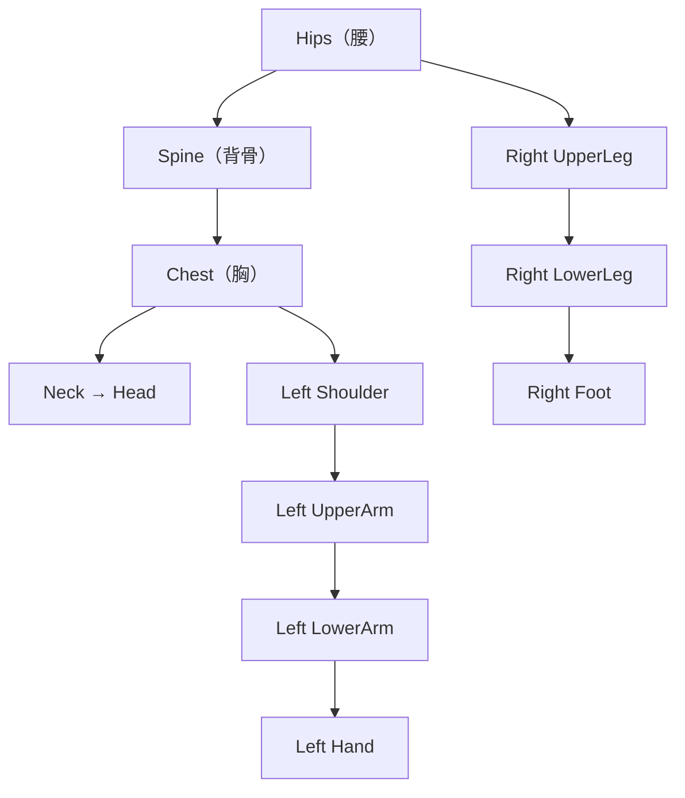
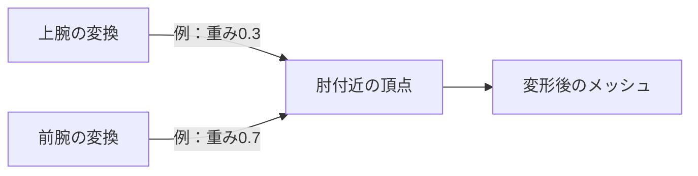
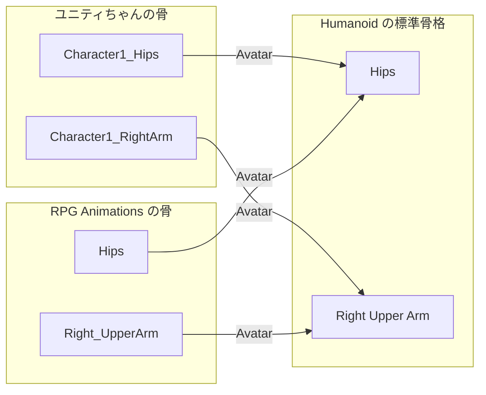

# 補足：Rig と Avatar

主教材：[IKとFK、AnimationRigging](ik-fk.md) ｜ 章の課題：[1章の課題](../problems/s1/index.md)

## 概要

---

> **補足資料**：必要な内容を参照してください。授業の主教材は「[IKとFK、AnimationRigging](ik-fk.md)」です。

!!! note "準備中"
    講義資料を改訂中です。図解は概念を示し、画面写真の差し替え箇所は「画像準備中」としています。配布シーンとの最終照合はこれから行います。

3D キャラクターは、**骨（ボーン）を回して**動かします。
この骨組みを Unity にどう読ませるかを決めるのが **Rig** の設定で、ここで選んだ種類によって「できること」が大きく変わります。

特に大事なのは、**手に入れたモーションが自分のキャラクターで動くかどうか**がここで決まることです。

---

## Rig とは

---

- **ボーン（Bone）**
キャラクターの中に入っている「骨」。実体は**親子関係を持った Transform** です。Hierarchy で FBX を展開すると見えます
- **スキニング（Skinning）**
メッシュの各頂点が「どのボーンに、どれくらい引っ張られるか」を決めたもの。これがあるので、骨を回すと皮膚（メッシュ）が一緒に曲がります
- **Rig（リグ）**
ボーンとスキニングをまとめた**骨組み一式**のこと。Unity の Import Settings では、この骨組みを**どう解釈するか**を Rig タブで設定します

ボーンは**親から子へ**つながっています。上腕を回すと、前腕と手も一緒に回ります。
この「親を回すと子がついてくる」性質が、[IKとFK、AnimationRigging](ik-fk.md) で効いてきます。

!!! note "画像準備中：ユニティちゃんのボーン階層"
    撮影対象：ユニティちゃんのボーン階層。直前の手順で選択した対象と、直後の説明にある設定値が読める構図で撮影します。予定画像：`images/unitychan-bone-hierarchy.png`。
    この枠を画像リンクへ置き換えます。

Hierarchy で `DemoPlayer → Visual → unitychan` を展開したところです。`Character1_Hips` から下に、骨が親子で並んでいます。
右手の `Character1_RightHand` の下には、杖を持たせるための `WeaponSocket` が足してあります。

---

## 骨を動かすと、なぜ表面も曲がるのか

---

メッシュの頂点には、どの骨の影響をどれだけ受けるかという**スキンウェイト**が保存されています。肘の近くの頂点なら、上腕と前腕の両方の変換を混ぜることで曲がりを表現できます。

この図の0.3と0.7は説明用です。骨の姿勢が正しくても、頂点の重みが適切でなければ表面はつぶれます。逆にウェイトが正しくても、骨の基準姿勢や対応づけが誤っているとねじれます。**骨格・基準姿勢・ウェイト・モーション**を別々に点検します。

スキニングとリターゲットは別の処理です。前者は骨から表面を動かし、後者は別の骨格へ動きを対応づけます。Avatarを変更しても、元モデルのスキンウェイトが自動で修正されるわけではありません。Unityでの骨格間の対応は[公式のリターゲット解説](https://docs.unity3d.com/6000.3/Documentation/Manual/Retargeting.html)を参照してください。

## Rig タブの設定

---

Project ウィンドウで FBX を選ぶと、Inspector に **Import Settings** が出ます。上部のタブから **Rig** を開きます。

!!! note "画像準備中：Rig タブ"
    撮影対象：Rig タブ。直前の手順で選択した対象と、直後の説明にある設定値が読める構図で撮影します。予定画像：`images/fbx-rig-tab.png`。
    この枠を画像リンクへ置き換えます。

| 設定項目 | 内容 |
| --- | --- |
| **Animation Type** | 骨組みをどう解釈するか。下の表の4種類から選ぶ |
| **Avatar Definition** | Avatar をこのモデルから作るか（**Create From This Model**）、他のモデルの Avatar を使うか（**Copy From Other Avatar**） |
| **Source** | Copy From Other Avatar のときに、借りてくる Avatar |
| **Configure...** | Humanoid のときに、ボーンの対応表を確認・修正する画面を開く |
| **Skin Weights** | 1頂点が影響を受けるボーンの数。通常は Standard（4本）のまま |
| **Optimize Game Objects** | ボーンの GameObject を Hierarchy から隠して軽くする。**武器を手に付けたい場合はオフのまま** |

変更したら、必ず右下の **Apply** を押してください。押さないと反映されません。

### Animation Type の4種類

---

| Animation Type | どういうものか | 使う場面 |
| --- | --- | --- |
| **None** | アニメーションしない | 背景のモデルなど |
| **Legacy** | 古い Animation コンポーネント用 | 基本使いません |
| **Generic** | 骨組みを**そのまま**扱う。アニメーションが参照するTransformのパスなどに互換性が必要。人型の標準対応による自動リターゲットは行わない | 人型でないもの（モンスター・動物・機械）。付属のモーションだけで足りるキャラ |
| **Humanoid** | 骨組みを**人の形の標準的な骨格**に読み替える。人型同士なら、ボーン名や本数が違ってもモーションを共有できる | 人型のキャラクター。**他のアセットのモーションを使いたいとき** |

> **迷ったら「そのキャラに、他から持ってきたモーションを使うか？」で決めてください。**
> 使うなら Humanoid、付属のモーションだけで済むなら Generic で構いません。

お手本『LUMEN』では、次のように使い分けています。

| キャラクター | Animation Type | 理由 |
| --- | --- | --- |
| プレイヤー（ユニティちゃん） | **Humanoid** | 攻撃モーションが付属していないので、別アセットから借りる |
| ボス（Rock Golem） | **Humanoid** | アセットが Humanoid で作られている。付属のモーションをそのまま使う |
| 雑魚敵（Monster Minion） | **Generic** | 人型ではない。付属のモーションだけで足りる |

---

## Avatar とは

---

- **Avatar**
Humanoidでは「**このモデルのこのボーンは、標準骨格のどこにあたるか**」などを持つアセットです。GenericにもAvatarはありますが、人型の標準対応とは役割が異なります。FBX の中に `〇〇Avatar` というアセットとして入っています

ボーンの名前は、作った人によってバラバラです。ユニティちゃんは `Character1_RightArm`、RPG Animations Pack は `Right_UpperArm` です。
それぞれが Avatar で**同じ標準骨格に読み替えられている**ので、片方用のモーションをもう片方で再生できます。

> この「別のキャラクターの動きを、自分のキャラクターに当てはめ直すこと」を **リターゲット（Retargeting）** と呼びます。
> Humanoid を選ぶ一番の理由はこれです。

### Avatar の Configure 画面

---

Rig タブで **Humanoid** を選んで Apply すると、**Configure...** ボタンが押せるようになります。押すと Avatar の設定画面に切り替わります。

!!! note "画像準備中：Avatar Configure の Mapping タブ"
    撮影対象：Avatar Configure の Mapping タブ。直前の手順で選択した対象と、直後の説明にある設定値が読める構図で撮影します。予定画像：`images/avatar-configure-mapping.png`。
    この枠を画像リンクへ置き換えます。

| タブ | 内容 |
| --- | --- |
| **Mapping** | 標準骨格の各部位に、どのボーンが割り当てられているか。**緑**＝割り当て済み、**赤**＝必須なのに未割り当て、**灰色の点線**＝任意で未割り当て |
| **Muscles & Settings** | 各関節がどこまで曲がるか（可動域）。スライダーで動かしてプレビューできる |

#### 必ず確認すること

1. **Mapping で赤い部位が無いこと**
   赤があると Avatar が無効になり、モーションが再生されません。下の **Mapping → Automap** で直るか試します
2. **Muscles & Settings でスライダーを動かして、変な曲がり方をしないこと**
   腕がねじれる、膝が逆に曲がるなどしたら、割り当てが間違っています
3. **キャラクターが T ポーズになっていること**
   腕が下がった A ポーズのモデルは、**Pose → Enforce T-Pose** で T ポーズに直してから使います

確認が終わったら **Done** を押して元の画面に戻ります。

!!! note "画像準備中：Muscles & Settings でプレビューしているところ"
    撮影対象：Muscles & Settings でプレビューしているところ。直前の手順で選択した対象と、直後の説明にある設定値が読める構図で撮影します。予定画像：`images/avatar-configure-muscles.png`。
    この枠を画像リンクへ置き換えます。

> **Avatar の割り当ては、ほとんどのモデルで自動でうまくいきます。**
> 開くのは「モーションの動きがおかしい」ときで構いません。ただ、**どこを見れば原因がわかるか**は今のうちに知っておいてください。

---

## Humanoid の限界

---

Humanoidの標準リターゲットだけでは、**標準骨格にないボーンの動きを他モデルへ自動で対応づけられません。** 追加ボーンはTransformのアニメーションや物理など、別の方法で動かせます。

| 標準リターゲットだけでは足りない例 | 対処 |
| --- | --- |
| 髪・スカート・しっぽ・マント | 揺れものは物理（ユニティちゃんの場合は付属の **SpringBone**）で動かす |
| 指の細かい動き | 指のボーンは任意。割り当てていないと動かない |
| 体型が極端に違うキャラ同士の流用 | 手が体にめり込む・届かないなどのずれが出る。**IK で補正する**（[IKとFK、AnimationRigging](ik-fk.md)） |

> リターゲットは「同じ動き」を当てはめるだけで、**体型差に応じた接触位置まで保証するものではありません。**
> 腕の短いキャラに、腕の長いキャラ用の拍手モーションを流すと、手が合いません。

---

## 🧯 よくある詰まり

---

| 症状 | 原因と対処 |
| --- | --- |
| モーションを入れても**キャラが T ポーズのまま**動かない | Animator の **Avatar** 欄が空。モデルの Avatar を入れる |
| モーションが**再生されているのに体が動かない** | モデルが Generic、モーションが Humanoid（またはその逆）。**両方を Humanoid に揃える** |
| 腕や足が**ありえない方向に曲がる** | Avatar の Mapping が間違っている。Configure で割り当てを確認する |
| **Configure** ボタンが押せない | Animation Type が Humanoid になっていない、または Apply していない |
| 手に武器を持たせたいのに**手のボーンが見つからない** | **Optimize Game Objects** がオンになっている。オフにして Apply |

---

## 🔗 参考リンク

---

- [Rig タブ](https://docs.unity3d.com/Manual/FBXImporter-Rig.html)
- [Avatar の作成](https://docs.unity3d.com/Manual/ConfiguringtheAvatar.html)
- [Humanoid アニメーションのリターゲット](https://docs.unity3d.com/Manual/Retargeting.html)

---

主教材：[IKとFK、AnimationRigging](ik-fk.md) ｜ 章の課題：[1章の課題](../problems/s1/index.md)
