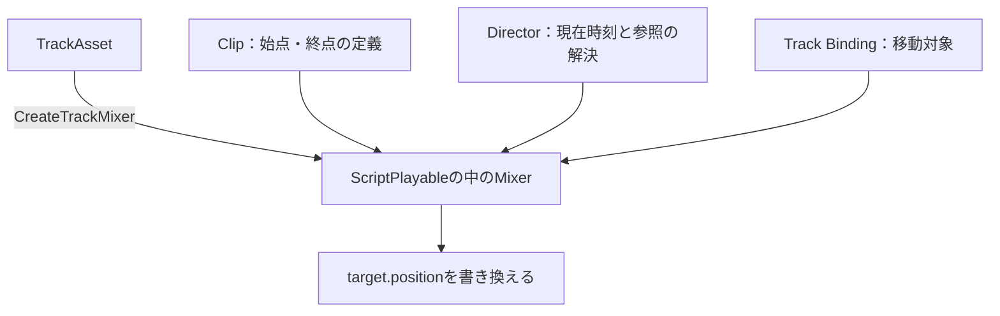

# 補足：Custom TrackとBinding

[シラバス](../index.md) ｜ 主教材：[Timeline](timeline.md) ｜ 章の課題：[1章の課題](../problems/s1/index.md)

## 概要

---

同じ「始点から終点へ移動する」演出でも、キャラクターや目印の場所はシーンごとに異なります。座標をClipへ固定すると、別の場所で使うたびに作り直すことになります。

この補足では、ボス演出にある **Transform Move Track** を読み、処理の定義とシーン内の参照を分ける考え方を学びます。最初から全コードを書ける必要はありません。

## 3つのファイルの役割

---

保存先は `Assets/Application/Section1-CharacterCamera/Timeline/BossDirection/`、名前空間は `Section1.Timeline` です。

| ファイル | 継承元 | 役割 |
| --- | --- | --- |
| `TransformMoveTrack.cs` | TrackAsset | 対応するClipとBindingの型、実行するMixerを決める |
| `TransformMoveClip.cs` | PlayableAsset | 始点・終点の参照と、Playableの生成方法を定義する |
| `TransformMoveMixer.cs` | PlayableBehaviour | 現在時刻から移動位置を計算する |



Trackが実行時の処理を組み立て、Clipの定義とDirectorの時刻から、Mixerが位置を求めます。本文の「AssetからGraphを作り、結果を出力する」が、具体的なコードとして現れる場所です。

## 動かす対象と、目印を分ける

---

| 参照 | 今回の役割 | 持ち方 |
| --- | --- | --- |
| Track Binding | 移動するTransform | DirectorのGeneric Binding |
| startPoint | 始点の目印 | Clipの `ExposedReference<Transform>` |
| endPoint | 終点の目印 | Clipの `ExposedReference<Transform>` |

Trackの `[TrackBindingType(typeof(Transform))]` は、Trackが受け取る対象の型を表します。一方、始点と終点はClipごとの参照です。

```csharp
// TransformMoveClip.cs から抜粋
public ExposedReference<Transform> startPoint;
public ExposedReference<Transform> endPoint;
```

アセット内にシーンのTransformを直接固定する代わりに、Directorを通じて参照を解決します。Sampleでは `PlayerStartPoint` と `PlayerEndPoint` が目印として置かれています。

```csharp
// TransformMoveMixer.cs から抜粋
var start = asset.startPoint.Resolve(Director);
var end = asset.endPoint.Resolve(Director);
```

同じTimeline Assetでも、別のDirectorが別の目印へ対応づけられます。ここでいうCustom Bindingは独自の参照設計のことで、`CustomBind`という名前の標準APIを呼ぶという意味ではありません。

!!! note "画像準備中：3つの参照"
    Trackの移動対象欄、ClipのStart Point／End Point、Sceneビューの2つの目印を並べます。予定画像：`images/timeline-transform-binding.png`。

## 現在時刻から位置を求める

---

現在のMixerでは、開始時刻順に並べたClipから対象を選び、次の式で進行度を求めます。

`進行度 = (Directorの時刻 − Clipの開始時刻) / Clipの長さ`

```csharp
// TransformMoveMixer.cs から抜粋
float progress = selected.duration > 0.0
    ? Mathf.Clamp01((float)((time - selected.start) / selected.duration))
    : (time >= selected.start ? 1f : 0f);
target.position = Vector3.Lerp(start.position, end.position, progress);
```

| 進行度 | 位置 |
| --- | --- |
| 0 | 始点 |
| 0.5 | 始点と終点の中間 |
| 1 | 終点 |

毎フレーム少しずつ足す方法と異なり、現在時刻から位置を直接求めるため、再生ヘッドを途中へ動かしてもその時刻の位置を評価できます。今回はワールド座標の直線補間です。曲がった経路や向きの変更は別の処理になります。

### 目印を対象の子にしない

---

移動対象自身を始点にすると、前のフレームで動かした位置を次の始点として読んでしまいます。子オブジェクトも親の移動に追従するため、固定した目印になりません。現在のコードでは、目印が対象自身やその子なら処理を行わないようにしています。

## 今回のMixerが行わないこと

---

`TransformMoveClip` は `ClipCaps.None` を返します。現在のMixerは入力のBlend Weightを合成せず、開始時刻で選んだ1つのClipから位置を決めます。

- 最初のClipより前では、進行度0として始点を使う。
- Clipの終了後から次のClipまでの間は、選択中のClipの終点を使う。
- Clipが重なると、開始時刻が後のClipを選ぶ。重なりを滑らかに混ぜる実装ではない。

「Mixerという名前だから自動でBlendできる」とは限りません。Blendを拡張するなら、入力の重み、どの座標を混ぜるか、Clipの外の状態まで設計します。

## Previewを終えたときの位置

---

`TransformMoveTrack.GatherProperties` は、編集前に戻す対象として位置のプロパティを登録しています。これによりエディターのPreview終了時の復元に参加します。

これはゲーム実行中のスキップ後の状態を保証する処理ではありません。ゲーム中にどの位置で操作を戻すかは、[再生・停止とスキップ](timeline-playback.md)で別に決めます。

## 読み進める順番

---

まずSceneビューで目印を動かして結果を観察し、次にClipの開始時刻と長さを変えます。その後、上の進行度の式へ戻ると、操作と計算を対応づけられます。標準のAnimation Trackで足りるものと、シーンごとに参照を差し替えたい独自Trackの役割を比べてください。

[主教材：Timelineへ戻る](timeline.md)
