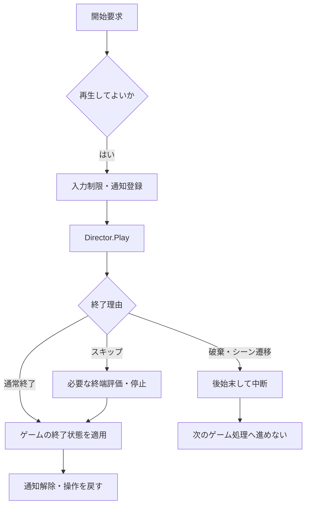
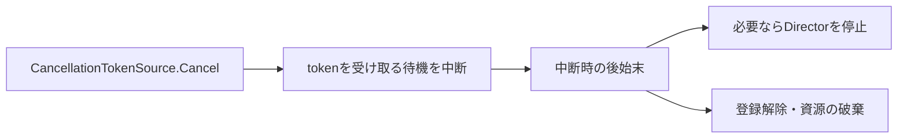

# 補足：Timelineの再生・停止とスキップ

[シラバス](../index.md) ｜ 主教材：[Timeline](timeline.md) ｜ 章の課題：[1章の課題](../problems/s1/index.md)

## 概要

---

演出を途中で止めたら、プレイヤーが動けないままになった。画面の黒帯だけ残ってしまった。スキップでは再生時刻を変えるだけでなく、**ゲームをどの状態へ戻すか**まで決める必要があります。

この補足では、演出の起動・終了・中断を整理します。非同期処理の基礎は[付録：CancellationTokenSourceとスキップ処理](../appendix/unitask.md)、通知の登録解除は[付録：イベントと購読の寿命](../appendix/events-lifetime.md)を参照してください。

## 再生の前後にも仕事がある

---



通常終了とスキップでは、最終的に同じ遊べる状態へ揃えます。シーンを抜けたための中断では、消えた対象へ操作したり、次の戦闘を始めたりしません。

## ボス用トリガーで見るところ

---

`Assets/Application/Section1-CharacterCamera/Timeline/BossDirection/BossDirectionTrigger.cs` は、Playerとの接触、InputReader、Directorの停止通知をつなぐファイルです。

| 段階 | 役割 |
| --- | --- |
| 接触確認 | PlayerタグとInputReaderを持つ相手を判定する |
| 演出開始の準備 | Cutscene Modeへ切り替え、SkipPressedとstoppedへ登録する |
| 再生 | DirectorのPlayを呼ぶ入口が必要 |
| Skip | 終端へ時刻を移し、EvaluateしてStopする |
| 終了通知 | 登録を外し、Cutscene Modeを解除する |

入力制限を有効にしただけではTimelineは始まりません。再生入口がどこにあるかと、同じトリガーへ再度入ったときに二重登録しないかを分けて確認します。

### 停止と完了は同じではない

---

`PlayableDirector.stopped` は停止を知らせます。通常の終端、スキップ、別のコードからのStopをそれだけで区別することはできません。さらにHoldやLoopでは、期待した時刻に停止通知を受け取る設計になっているか注意が必要です。

「停止したからボスを起動する」という1つの条件だけにせず、終了理由とゲーム側の状態を決めてから次へ進みます。

## 終端へ移してから止める

---

現在のボス用トリガーでは、次の順序でスキップします。

```csharp
_director.time = _director.duration;
_director.Evaluate();
_director.Stop();
```

`time`は評価する時刻、`Evaluate()`はその時刻の結果を反映する操作です。ただし、終端の評価によって途中のSignalがすべて実行されるとは考えないでください。Trackの終了動作や独自Trackの実装によっても結果は変わります。

| 終了時に決めるもの | 例 |
| --- | --- |
| プレイヤーの位置 | 演出終点か、開始前の位置か |
| カメラ | 通常のTPS制御へ戻る |
| UI | 黒帯・スキップ表示を閉じる |
| 入力 | 通常の操作へ戻る。押し続けたスキップ入力の扱いも確認 |
| ゲーム進行 | 必要ならボスを起動する。破棄による中断では進めない |

終端評価と、ゲームに必要な終了状態の適用は分けて考えます。たとえばボスの表示は、登場途中のSignalが飛ばされても必要な状態へ揃えます。

## CancellationTokenSourceとのつながり

---

「演出の終了を待つ処理」と「スキップ入力を待つ処理」を並行して待つと、どちらかが終わった後に不要な待機が残ります。キャンセル要求は、その待機を終了させるために使います。



tokenは中断要求を伝えるものであり、Directorを自動で止める機能ではありません。呼び出し側と待機側が協調して処理を終えます。`WhenAny`で先に終わった処理を選んでも、残った処理が自動的にすべてキャンセルされるとは限りません。

導入の `SampleTimeLine.cs` にある `TimelineExtensions.PlayAsync` は、停止イベントをUniTaskの完了へ変換する例です。現在のキャンセル経路はイベント登録を解除して待機をキャンセルしますが、Director.Stopは呼びません。**この拡張メソッドだけで完成したスキップになるわけではありません。**

完成形では、キャンセル登録自体の破棄、自然終了時の解除、対象破棄、二重実行への対処も揃えます。付録の概念例を、そのままこの拡張メソッドと同じ実装として読まないようにします。

## 確認する再生パターン

---

| 操作 | 見る結果 |
| --- | --- |
| 最後まで再生する | カメラ・入力・UIが通常状態へ戻る |
| 始まってすぐスキップする | 必要な位置・表示が未適用のまま残らない |
| 中間・終端付近でスキップする | どの時刻でも後始末が一度だけ行われる |
| 続けて再生する | 古い登録が残らず、処理が増えない |
| 再生中にシーンを抜ける | 破棄された対象へアクセスせず、次の進行を起動しない |

これは再生制御の確認観点です。Timelineの見た目の調整と、コードが担当する終了処理を分けて点検します。

[主教材：Timelineへ戻る](timeline.md)
