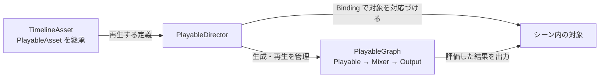

# Timeline(タイムライン)とカットシーン制作

[シラバス](../index.md) ｜ 章の課題：[1章の課題](../problems/s1/index.md)

## 概要

---

ボスが現れ、プレイヤーが振り向き、カメラが切り替わる。こうした演出では、複数の対象の動きを同じ時間軸で調整する必要があります。処理ごとに待ち時間をスクリプトへ書き込むと、演出の順番や間を変更するたびに、関連する処理を追い直すことになります。

**Timeline は、アニメーション・カメラ・音・表示などを時間軸に並べて演出を組むための仕組みです。** まず小さなシーンで再生の仕組みを理解し、次にプレイヤーとボスを使った登場演出へ進みます。

!!! note "作成中：講義の骨組み"
    サンプルシーンは制作中です。このページは扱う内容と順序をまとめた構成案です。操作手順・画面写真・完成コード・演出の秒数は、シーンの確定後に追加します。参照中のプロジェクトは Timeline 1.8.13、Cinemachine 2.10.7 を使用しています。

## 演習の準備

---

導入用に、短い演出の完成見本 `_Sample` と作業用 `_Work` を **1セット** 用意します。ボス演出は、その後に取り組む別の題材として扱います。

| 用途 | シーン・準備状況 |
| --- | --- |
| **使用シーン** | 導入用 `_Work`：制作中・正式名未確定。配置先は `Assets/Application/Section1-CharacterCamera/Timeline/` |
| **完成見本** | 導入用 `_Sample`：制作中・正式名未確定。配置先は `Assets/Application/Section1-CharacterCamera/Timeline/` |
| **使用シーン（ボス演出）** | `Assets/Application/Section1-CharacterCamera/Timeline/BossDirectionTimline_Work.unity`（ファイルの存在のみ確認。内容は制作中） |
| **完成見本（ボス演出）** | `Assets/Application/Section1-CharacterCamera/Timeline/BossDirectionTimline_Sample.unity`（ファイルの存在のみ確認。内容は制作中） |

現在ある `Assets/Application/Section1-CharacterCamera/Timeline/SampleTimeLine.unity` は導入の参考です。上記の導入用1セットとの対応は、制作後に確定します。ボス用のファイル名の `Timline` 表記は現状の名前に合わせています。

DemoGame のプレイヤーとボスは、講師が演習用に `Assets/Application/` 以下へ用意したものを使います。`Assets/_DemoGame/` は完成形の参照先です。

## 授業の流れ

---

| 順序 | 題材 | 理解すること |
| --- | --- | --- |
| 1 | 小さな演出の `_Sample` と `_Work` | Timeline の基本操作、PlayableAsset と PlayableGraph の関係 |
| 2 | プレイヤーとボスの登場演出 | Track・Clip・Binding の組み合わせと再生の起動 |
| 3 | ボス演出の調整 | Signal による通知と Blend によるつなぎ |
| 応用1 | 演出のスキップ | キャンセル・再生停止・終了状態の整理 |
| 応用2 | 演出機能の拡張 | Custom Track と独自の Binding 設計 |

## 1. Timeline の導入：小さな演出を作る

---

### 完成見本を見て、時間軸を読む

---

**この節で扱うこと**

- 導入用 `_Sample` で、文字やオブジェクトの表示が順番に変わる短い演出を見る。題材の詳細はシーン完成後に確定する。
- Timeline ウィンドウの Track、Clip、再生ヘッドを確認する。
- Preview とゲーム実行時の再生を区別する。
- 対応する `_Work` で同じ演出を組み、Clip の開始時刻と長さを変える。

### Timeline Asset・PlayableAsset・PlayableGraph

---

「時間軸に置いたデータが、どうやってシーンの動きになるのか」を説明します。

| 要素 | 講義で押さえる役割 |
| --- | --- |
| **PlayableAsset** | 実行時の Playable を作るための定義を持つアセットの基底クラス |
| **TimelineAsset** | PlayableAsset を継承し、Track や Clip を時間軸として保持するアセット |
| **PlayableDirector** | アセットからのグラフ生成と再生を管理し、シーン内の対象との Binding を保持するコンポーネント |
| **PlayableGraph** | 実行時の Playable と Output のつながり。処理や混合の結果を出力先へ渡す |
| **Binding** | Track の出力先と、シーン内の Animator などを対応づける設定 |

保存された Timeline Asset をもとに、Director が実行時のグラフを組み立てて再生します。アセットの定義、実行時のグラフ、シーン側の対象という3つの役割を分けて捉えます。図は混合を含む概念図で、すべての Track が同じ構造になるわけではありません。

**後で追加する説明・図**

- Clip の定義から Playable が作られる関係と、PlayableAsset と Playable の違い。
- `CreatePlayable` の役割。導入では概念までとし、独自実装は応用で扱う。
- Timeline を使わずに Playables API でグラフを構築することもできる、という位置づけ。

### 演出を再生する

---

- Timeline Asset の作成、Director への割り当て、Track の Binding を順に確認する。
- `Play On Awake` による自動再生と、`PlayableDirector.Play()` による明示的な起動を比較する。
- 「アセットそのものを起動する」という表現を、**Director にアセットを割り当て、Director を再生する**操作へ結びつける。
- `Play()`・`Pause()`・`Stop()`、Wrap Mode の違いを導入用シーンで確認する。

## 2. プレイヤーとボスを使った登場演出

---

### 演出を Track と Clip に分ける

---

DemoGame のプレイヤーとボスを題材に、「誰が動くか」「どのカメラで見せるか」「何を同時に起こすか」を分解します。カット割りと具体的な動作はサンプル完成後に決めます。

| Track | 題材の候補 | Binding で確認する対象 |
| --- | --- | --- |
| Animation Track | プレイヤーとボスの動作 | 各キャラクターの Animator |
| Cinemachine Track | 全景、プレイヤー側、ボス側のカット | Cinemachine Brain と各 Shot のカメラ参照 |
| Activation Track | ボス名や演出用オブジェクトの表示 | 対象の GameObject |
| Audio Track | 登場音・演出音 | Audio Source など出力の設定 |

**この節で扱うこと**

- `_Sample` の演出を Track ごとに読み、各 Clip の役割を説明する。
- `_Work` で動作とカットを組み合わせる。
- 演出中の Animator・カメラと、通常のゲーム制御が競合しないように役割を整理する。
- [Cinemachine の講義](cinemachine.md)で扱った通常時のカメラ制御と、演出時の制御をつなげる。

### ゲーム側から Timeline を起動する

---

- 開始要求 → 操作の制限 → Binding の設定 → Director の再生 → 終了処理、という流れを読む。
- 起動方法はトリガーやボタンなどからサンプルに合わせて確定する。
- Inspector で設定する Binding と、`SetGenericBinding` で再生対象を設定する方法を比較する。
- 再生完了と任意の停止を区別し、停止通知だけで「必ず戦闘開始」と判断しない設計を考える。

## 3. Signal と Blend で演出をつなぐ

---

### Signal：指定した時刻にゲーム側へ通知する

---

- Signal Emitter、Signal Asset、Signal Receiver の役割と対応関係。
- 演出中のある瞬間に効果音やゲーム側の処理を呼ぶ例。
- Track の Binding と Signal の通知先の設定を確認する。
- 再生し直した場合、途中から再生した場合、スキップした場合の発火条件を確認する。
- 戦闘開始など必須の状態変更を、通過しない可能性がある Signal だけに任せない。

### Blend：動きやカメラの切り替わりを調整する

---

- 対応する Clip を重ね、重なりの長さと曲線でつながり方が変わる様子を見る。
- Animation Clip の混合と、Cinemachine Shot 間のカメラブレンドをそれぞれ比較する。
- すべての Track・Clip が同じ Blend に対応するわけではないことを整理する。
- `_Work` で、急なカットと滑らかな切り替えを使い分ける。

## 応用1. 演出中のスキップ

---

関連資料：[C#発展 CancellationTokenSource とスキップ処理](../appendix/unitask.md)

**この節で扱うこと**

- 再生終了待ちとスキップ入力待ちを組み合わせる考え方。
- `CancellationTokenSource` はキャンセル要求を伝える仕組みであり、トークンをキャンセルするだけで Director が自動停止するわけではないこと。
- 通常終了、ユーザーのスキップ、シーン破棄による中断を区別する。
- 通常終了とスキップは、ボスの表示・操作権・カメラ・HUD などを同じ戦闘開始状態へ揃える。シーン破棄時は戦闘を開始しない。
- Director の停止、イベント購読の解除、待機処理のキャンセル、CTS の破棄をどこで行うか。
- 途中の Signal が発火することを前提にせず、必要な終了状態を明示的に適用する。

付録のコードは考え方を示す例です。現在の DemoGame はスキップ要求のフラグとキャンセルトークンを使い、終了時の評価・停止とボスの状態適用を行っています。講義用の完成コードは、演習シーンの実装と付録の説明を照合してから掲載します。

## 応用2. Custom Track・Custom Binding による拡張

---

### 独自 Track を作る

---

- 標準 Track だけでは扱いにくい演出を、Timeline の時間軸へ載せる目的。
- `TrackAsset`、Clip 用の `PlayableAsset`、`PlayableBehaviour` の役割。
- `CreatePlayable` による Playable の生成と、導入で学んだ PlayableGraph とのつながり。
- 混合が必要な場合の Mixer と入力ウェイト。独自 Track が自動で Blend 対応になるわけではないこと。
- DemoGame の `DissolveTrack`・`DissolveClip`・`DissolveBehaviour` を参照例にする。シェーダーの詳細は [Shader の講義](../s3-graphics/shader.md)につなぐ。

### 独自の対象へ Binding する

---

ここでいう **Custom Binding** は、独自 Track の対象型や参照の渡し方を設計することを指します。`CustomBind` という名前の標準 API がある、という意味ではありません。

- `TrackBindingType` で対象の型を指定し、Inspector で対応づける。
- `SetGenericBinding` で再生時の対象を差し替える。
- Track 全体の Binding と、Clip が個別に持つ参照（`ExposedReference` など）を区別する。
- 同じ演出を別の対象に使う場合、Track 名や型だけで一括指定して誤った相手に結びつけないよう、対応関係を設計する。
- DemoGame の実装を読んだ後、講義用に用意された対象で小さく拡張する。具体的な実装範囲はサンプル完成後に確定する。

## シーン完成後に追加する内容

---

- 導入用 `_Sample`・`_Work` の正式パスと、初期状態・完成状態の比較。
- ボス演出の Hierarchy、Track・Clip・Binding の対応表。
- Timeline ウィンドウと Inspector の画像、手順ごとの確認ポイント。
- 再生の起動、Signal、Blend、スキップ、独自 Track の検証済みコードと操作例。
- 通常終了・途中スキップ・再実行・シーン破棄での動作確認。

## 参考資料

---

- [Unity Timeline 1.8 マニュアル](https://docs.unity3d.com/Packages/com.unity.timeline@1.8/manual/index.html)
- [Unity Playables API の概要](https://docs.unity3d.com/6000.0/Documentation/Manual/Playables.html)
- [PlayableAsset API](https://docs.unity3d.com/6000.0/Documentation/ScriptReference/Playables.PlayableAsset.html)
- [Timeline の Signal](https://docs.unity3d.com/Packages/com.unity.timeline@1.8/manual/wf-signals.html)

[シラバス](../index.md) ｜ 章の課題：[1章の課題](../problems/s1/index.md)
