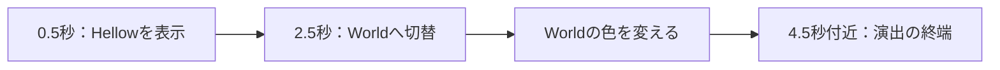
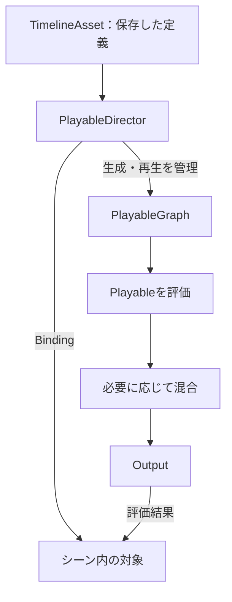
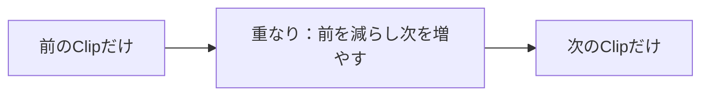
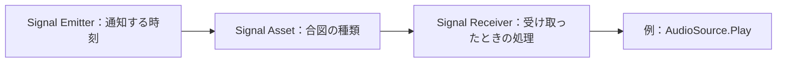

# Timeline(タイムライン)とカットシーン制作

[シラバス](../index.md) ｜ 章の課題：[1章の課題](../problems/s1/index.md)

## 概要

---

プレイヤーが歩いて止まり、カメラがボスへ寄り、画面に黒帯が出る。こうした演出では、複数の動作を同じ時間軸で合わせます。待ち時間をスクリプトへ個別に書くと、「登場を少し遅くする」だけでも関連する処理を探して直す必要があります。

**Timelineは、いつ・誰に・何をするかを時間軸へ並べ、見ながら調整する仕組みです。** 動画編集のように区間を配置しますが、完成映像を流すのではなく、その場のキャラクター・カメラ・UIを動かします。

!!! note "準備中"
    授業用の改訂稿です。シーン・アセット・コードの保存内容に合わせて説明しています。ボス演出の秒数は調整中のため目安とし、画面写真と実行時の最終確認はこれから反映します。対象はTimeline 1.8／Cinemachine 2.10です。

## 演習の準備

---

| 用途 | シーン |
| --- | --- |
| **使用シーン：導入** | `Assets/Application/Section1-CharacterCamera/Timeline/Sample/SampleTimeLine_Work.unity` |
| **完成見本：導入** | `Assets/Application/Section1-CharacterCamera/Timeline/Sample/SampleTimeLine_Sample.unity` |
| **使用シーン：ボス演出** | `Assets/Application/Section1-CharacterCamera/Timeline/BossDirection/BossDirectionTimline_Work.unity` |
| **完成見本：ボス演出** | `Assets/Application/Section1-CharacterCamera/Timeline/BossDirection/BossDirectionTimline_Sample.unity` |

`TimeLine`・`Timline`は現在のファイル名の表記です。導入とボス演出ではフォルダも異なります。

共通のキャラクター素材は `Assets/Application/_CommonSectionAssets/` にあります。元のPrefabや共通スクリプトを上書きせず、講師が用意したシーン内の設定を調整します。`Assets/_DemoGame/` は完成形の参照先です。

!!! warning "シーンを分けても、Timeline Assetは自動で分かれません"
    現在の導入用SampleとWorkは、どちらも `Assets/Application/Section1-CharacterCamera/Timeline/Sample/SampleTimeLine.playable` を参照しています。Workで変更する前に、そのアセットを単元フォルダ内へ複製し、Work側のDirectorへ割り当てます。複製後はTrackのBindingも確認してください。シーンだけを保存し直しても、共有アセットの編集は見本へ影響します。

ボス演出用Workは、確認時点ではカメラとライトがある初期シーンです。講師の説明ではSampleを使い、手を動かす際は講師が配布するWorkの状態を確認してから進めます。

## 授業の流れ

---

1. 文字の表示・色の変化を見て、Track・Clip・Bindingを覚える。
2. Asset・Director・Graphを区別し、再生の仕組みを理解する。
3. Workで表示時刻と長さを変え、1つの変更が何に影響するか確かめる。
4. ボス演出を「動き・移動・カメラ・黒帯」に分けて読む。
5. BlendとSignalで、動作のつながりと通知の時刻を調整する。

スキップと独自Trackのコードは、基本操作の後に読む[補足：再生とスキップ](timeline-playback.md)・[補足：独自TrackとBinding](timeline-custom-track.md)へ分けています。

## 1. 小さな演出で時間軸を読む

---

### Sampleを開く

---

1. 導入用 `SampleTimeLine_Sample.unity` を開く。
2. Hierarchyの `PlayableDirector` を選ぶ。
3. **Window → Sequencing → Timeline** を開く。
4. Timelineウィンドウをロックし、別の対象を選んでも同じ演出を見られるようにする。
5. 再生ヘッドを動かし、`HellowText (TMP)` と `WorldText (TMP)` の表示・色を確認する。

ここでのPreviewは、指定時刻の演出結果を編集画面で確認する機能です。ゲームを実行してトリガーへ入ることとは異なります。操作を終えたらPreviewを解除して、シーン編集へ戻ります。

### Track・Clip・Binding

---

| 用語 | 意味 | 導入シーンの例 |
| --- | --- | --- |
| **Track** | 同じ種類の処理を並べる行 | 表示切替を置くActivation Track |
| **Clip** | 開始時刻と長さを持つ区間 | 文字を2秒間表示する区間 |
| **Binding** | その行が作用するシーン内の相手 | `HellowText (TMP)` |
| **再生ヘッド** | 現在評価している時刻 | 1秒、3秒など |

まず「いつ」をClip、「誰に」をBinding、「どんな処理」をTrackの種類で読むと、長い演出も分解できます。

保存されている導入アセットには、次の内容があります。

| Track | 対象 | 内容 |
| --- | --- | --- |
| Activation Track | `HellowText (TMP)` | 0.5〜2.5秒の表示区間 |
| Activation Track (1) | `WorldText (TMP)` | 2.5〜4.5秒の表示区間 |
| Animation Track | `WorldText (TMP)` のAnimator | 録画した文字色の変化。Infinite Clipとして保持 |



最初の2行は有効・無効を切り替え、3行目は値を時間とともに変えます。Clipの外や再生終了後の状態は、Activation TrackのPost-playback stateなどにも依存します。「終われば必ず非表示」とは限りません。

!!! note "画像準備中：導入シーンの全体"
    Timelineの3行と、2種類の文字が見えるGameビューを並べます。Track名・Binding・再生ヘッド・表示区間へ番号を振ります。予定画像：`images/timeline-basics-overview.png`。

## 2. Asset・Director・Graphを分ける

---

### 保存するものと、シーンに置くもの

---

**Timeline Assetは演出の定義、Playable Directorはそれをシーン内で再生するコンポーネント**です。台本を別の舞台へ持っていけるように、同じAssetを別の対象へ結びつけて使えます。

| 要素 | 持っているもの・役割 |
| --- | --- |
| TimelineAsset | TrackとClip、時刻などの保存データ。PlayableAssetを継承する |
| PlayableAsset | 実行時のPlayableを生成するための基底クラス |
| PlayableDirector | 再生・停止・時刻と、シーン側のBindingを管理する |
| PlayableGraph | 実行時に作られる処理のつながり |
| Playable | グラフを構成する処理の単位 |



時間軸のデータから、実行時の処理のつながりを作ります。Assetそのものが毎フレーム勝手に動くのではなく、Directorが管理するグラフが評価されます。この図は概念図で、すべてのTrackが同じ混合処理を持つわけではありません。

Unity以外でも、アニメーションや音声を複数の入力から合成する際に、処理をノードと接続で表す考え方が使われます。Timelineはその構築を時間軸の編集操作で行える道具です。Playables APIでは、Timelineを使わずコードからグラフを構成することもできます。

### 再生を始めるのはDirector

---

導入の `SampleTimeLine.cs` は、Startで停止通知を登録してから `_director.Play()` を呼びます。次は実装の中心部分の抜粋です。

```csharp
_director.stopped += OnStopped;
_director.Play();
```

`stopped` は停止の通知であり、必ず最後まで再生されたという保証ではありません。コードからStopを呼んでも停止になります。購読の解除と途中中断は[補足：再生とスキップ](timeline-playback.md)で扱います。

| Directorの操作・設定 | 確認すること |
| --- | --- |
| Play On Awake | シーン開始時に自動で再生するか。スクリプトから起動する例との違い |
| Play / Pause / Stop | 再生、時刻を進めず一時停止、再生を停止する操作 |
| Wrap Mode：None | 終端で停止する |
| Wrap Mode：Hold | 終端の状態を保持する |
| Wrap Mode：Loop | 繰り返す |
| Update Method | どの時計で時刻を進めるか |

DirectorのWrap Modeと、Track固有の終了状態は分けて見ます。また、Update Methodによってはゲーム側のTime Scaleとの関係が変わります。

## 3. Workで時刻と値を調整する

---

### まず変更するアセットを分ける

---

導入用Workを開き、Projectウィンドウで `SampleTimeLine.playable` を複製します。たとえば `SampleTimeLine_Work.playable` と名付け、同じSampleフォルダ内へ保存します。これは作業時に作る名前で、配布済みファイルではありません。

Work側DirectorのPlayable欄へ複製を割り当て、3行のBindingを見本の表と対応させます。Animation Trackは対象のAnimatorへ結びつけます。文字のGameObjectを指定した際にAnimatorが追加される操作と、ActivationのGameObject指定を区別してください。

### 表示区間を変える

---

1. `HellowText` のActive Clipを選び、開始位置だけをずらす。
2. 再生ヘッドを手前から動かし、表示される時刻が変わったことを見る。
3. 次にClipの端を動かし、表示時間だけを長くする。
4. `WorldText` の区間と重ね、同時に表示される時間ができることを見る。

**Clipを横へ動かすことと、端を伸ばすことでは意味が違います。** 重なりも、Activationでは「同時に有効」という意味であり、自動で透明度を混ぜるわけではありません。

### 色を変える

---

Animation TrackでWorldTextの色を録画したキーを確認します。録画を使う場合は、再生ヘッドを置き、色を設定し、別の時刻でも色を設定します。終わったら録画を切り、Previewで確認します。

文字が表示される区間と、色を変える時刻がずれていると、計算されていても変化が見えません。複数Trackを合わせる最初の練習です。Infinite Clipは録画をTrack全体へ保持する形で、通常のClipと見え方が異なります。

## 4. ボス演出を読む

---

### 動作を役割ごとに分ける

---

ボス演出用SampleのDirectorには `BossDirectionSample.playable` が割り当てられています。シーンには `CM_1`・`CM_2`、`PlayerStartPoint`・`PlayerEndPoint`、`Canvas` 内の `Top`・`Bottom` などが用意されています。

| Track | 役割 | 観察する点 |
| --- | --- | --- |
| Cinemachine Track | `CM_TPS → CM_1 → CM_2 → CM_TPS` のショット | 各Shotのカメラ参照と、TrackのBrain Binding |
| Animation Track | `WALK00_F` から `WAIT00` へ | 歩く姿勢から止まった姿勢へのつなぎ |
| Transform Move Track | プレイヤーの位置を始点から終点へ移す | 移動対象と2つの目印は別の参照 |
| Animation Track (1) | Canvas配下の演出用アニメーション | 黒帯の出入りと録画キー |
| Dissolve Track | ボスの見え方を変える独自Track | 登場の時刻とカメラの関係 |

**歩く姿勢と、世界の中を移動することは別です。** この見本ではAnimation TrackとTransform Move Trackを組み合わせています。足踏みだけになる場合と、位置は動くのに滑って見える場合を分けて考えます。

保存内容では、歩行と移動の開始が約0.87秒、移動の終端が約4.35秒です。これは調整中の値なので、数値を暗記するより「歩行区間に位置の移動が対応しているか」を見ます。

!!! note "画像準備中：ボス演出のTrack"
    全Trackとカメラの切替が読めるTimeline全景を撮影し、キャラクターの動き・位置・黒帯・カメラを色分けで対応づけます。予定画像：`images/timeline-boss-tracks.png`。

### 調整する順番

---

1. プレイヤーがどこからどこまで進むかを決める。
2. 移動区間へ歩行を合わせ、終点では待機へつなぐ。
3. 各カメラの構図を確認してから、Shotの順番と長さを決める。
4. カメラがボスを見せる時刻と、ボスの登場を合わせる。
5. 黒帯を出す・戻すタイミングを整える。

同時に全部を変えると、良くなった理由も崩れた原因も分かりにくくなります。まず再生ヘッドで狙った瞬間を確認し、その後、通して再生して間を確認します。

## 5. Blendでつながりを作る

---

Clip同士を対応するTrack上で重ねると、片方の寄与を減らし、もう片方を増やす区間を作れます。重なりの長さは「どのくらいかけて移るか」、曲線は「どんな変わり方で移るか」に関係します。



2つのClipを同時に評価して混ぜる区間です。開始位置を同じにするだけで、自然なつながりが保証されるわけではありません。

### カメラのBlend

---

Sampleでは `CM_1` と `CM_2` が約5.10〜6.55秒で重なっています。重なりを短く・長くした結果を比べ、見せたい対象が途中で画面から消えないか確認します。

TrackのBindingは**出力先のCinemachine Brain**、Shot内の参照は**使うVirtual Camera**です。片方だけ設定しても十分ではありません。Timelineが有効なShotを扱っている間は、通常のPriorityによる選択よりTimelineのカメラ制御が優先されます。[CinemachineとTimelineの公式解説](https://docs.unity3d.com/Packages/com.unity.cinemachine@2.10/manual/CinemachineTimeline.html)も参照してください。

### アニメーションのBlend

---

歩行と待機のClipにも重なりがあります。歩行の終わりを急に切る場合と、徐々に待機へ移す場合を比べます。長すぎるBlendは止まる動作を曖昧にし、移動の速度と足の動きが合わなくなることもあります。

Activationや今回の独自Transform Move Trackは、同じ方法でBlendするとは限りません。**Track・Clipが混合をどう実装しているか**まで含めて機能が決まります。

## 6. Signalで特定の瞬間を知らせる

---

表示や音の区間を並べるだけでなく、「この瞬間に処理を呼ぶ」ためにSignalを使えます。Clipが期間を持つのに対して、Signal Emitterは通知する時点を置くマーカーです。



Emitterの時刻を変えれば、処理のコードを書き換えずに音を鳴らすタイミングを調整できます。Signal Assetそのものへ処理を書くのではなく、Receiver側で合図と反応を対応づけます。

### 小さな通知を追加する

---

現状のボスTimelineにはSignalの設定は含まれていないため、以下はWorkへ追加する操作例です。

1. 講師指定の音を持つAudioSourceを用意し、自動再生を無効にする。
2. Signal Receiverを置き、Signal TrackのBindingを設定する。
3. 通知したい時刻にSignal Emitterを追加し、単元用のSignal Assetを作成・指定する。
4. ReceiverのReactionへ、そのAudioSourceの `Play()` を登録する。
5. ゲームを実行して演出を再生し、通知が1回届くか確認する。

単に一定区間で音を鳴らすだけならAudio Trackも候補です。ここではゲーム側のメソッドへ時間軸から通知する構造を見るためにSignalを使います。[Signalの公式手順](https://docs.unity3d.com/Packages/com.unity.timeline@1.8/manual/wf-signals.html)では足音を例に確認できます。

!!! note "画像準備中：Signalの対応"
    EmitterのSignal欄と、Receiverの同じSignalに対するReactionを並べます。予定画像：`images/timeline-signal-binding.png`。

### 途中から再生するとき

---

Emit Onceはループ時の通知回数、Retroactiveは通知時刻より後から再生した場合の扱いに関係します。スクラブ・再実行・スキップを同じものとして考えず、それぞれの動作を確かめます。

戦闘開始など必ず必要な状態変更を、途中で飛ばされるSignalだけへ任せないようにします。通常終了・スキップ・中断の設計は補足へ進みます。

## よくある詰まり

---

| 症状 | 確認するところ |
| --- | --- |
| Workを編集したらSampleも変わった | 同じ `.playable` を共有していないか |
| Timelineが表示されない | Directorの選択とウィンドウのロック |
| 文字が表示されるが色は変わらない | Animation Trackの対象、録画キーと表示区間 |
| 足踏みする／滑る | 姿勢と位置を動かす区間の対応 |
| カメラが切り替わらない | TrackのBrain BindingとShotのVirtual Camera参照 |
| Triggerへ入っても始まらない | 入力制限の設定だけでなく、DirectorのPlayが呼ばれるか |
| 終了後に表示が残る | Wrap ModeとTrack側の終了状態 |
| Signalが来ない／繰り返す | AssetとReceiverの対応、再生開始位置、ループ設定 |

## 応用と関連資料

---

- [補足：Timelineの再生・停止とスキップ](timeline-playback.md)
- [補足：Custom TrackとBinding](timeline-custom-track.md)
- [付録：CancellationTokenSourceとスキップ処理](../appendix/unitask.md)
- [Cinemachineとカメラ制御](cinemachine.md)
- [Unity Timeline 1.8 マニュアル](https://docs.unity3d.com/Packages/com.unity.timeline@1.8/manual/index.html)

[シラバス](../index.md) ｜ 章の課題：[1章の課題](../problems/s1/index.md)
