# キャラクターAI：NavMeshとボスの行動設計

[シラバス](../index.md) ｜ 章の課題：[2章の課題](../problems/s2/index.md)

## 概要

---

ボスをプレイヤーへ真っすぐ移動させるだけでは、壁に引っ掛かります。壁を避けられても、体の大きなボスは人が通れる隙間に肩から突っ込みます。いつ追跡をやめるかを決めなければ、どこまでも追ってきます。**移動する道を探すことと、行動を選ぶことは別の問題**です。

このページでは、体格の大きいボスを題材に NavMesh（移動できる範囲のデータ）を設定し、「知覚→判断→移動」に分けて敵 AI を組み立てる考え方を学びます。行動の切り替えを C# でどう整理するかは、続けて [C#① 状態管理（Stateパターン）](state-pattern.md)で扱います。

## 演習の準備

---

| 用途 | シーン |
| --- | --- |
| **使用シーン** | `Assets/Application/Section2-AIState/EnemyAI/EnemyAI_Work.unity` |
| **完成見本** | `Assets/Application/Section2-AIState/EnemyAI/EnemyAI_Sample.unity` |

`EnemyAI_Work` のシーン構成は Sample と同じですが、NavMesh は Bake していません。[NavMesh Surface](#navmesh-surface) の手順で Bake するまで、ボスは動きません。

2章で使う Prefab とスクリプトは `Assets/Application/Section2-AIState/` にまとめてあります。

| 場所 | 内容 |
| --- | --- |
| `Prefabs/EnemyBoss.prefab` | ゴーレムのボス。NavMesh Agent の Agent Type は `Boss` |
| `Prefabs/Player.prefab` | `DemoPlayer` の Prefab Variant。操作は共通素材のまま |
| `Scripts/` | ボスの AI のスクリプト。名前空間は `Section2.AIState` |

シーン構成は次のとおりです。

| GameObject | 内容 |
| --- | --- |
| `Stage` | 床と壁の親。`NavMesh Surface` が付いている |
| `Stage/Wall_Left` `Wall_Center` `Wall_Right` | ステージを南北に分ける壁。左に幅 1.8 m の狭い隙間、右に幅 5.8 m の広い通路がある |
| `EnemyBoss` | 北側にいるボス |
| `PatrolPoints` | ボスが巡回する4地点 |
| `Player` | 南側から始まる。操作方法は `DemoPlayer` と同じ |

!!! warning "Unity を開き直す"
    Agent Type `Boss` は Project Settings の変更です。pull した後は、Unity を開き直してからシーンを開いてください。

`EnemyBoss` の数値を変えるときは、シーン上の値だけを変えます。`EnemyBoss.prefab` へ Apply すると、Sample のボスも変わります。

## 授業の進め方

---

1. ゲームの AI を「知覚・判断・経路探索・移動」に分ける。
2. 地形を探索できる形にする考え方と、NavMesh の役割を確認する。
3. ボスの体格に合わせた Agent Type を確認し、`EnemyAI_Work` で Bake する。
4. `EnemyAI_Work` を再生し、ボスが狭い隙間を避けて広い通路を回ることを確認する。
5. ボスの行動を「何を見て、どの行動に切り替えるか」の表にする。
6. [Stateパターン](state-pattern.md)で、その表を C# に落とし込む。

## ゲームのAIは何をしているか

---

ゲーム AI は、観測した情報とルールから行動を選ぶ仕組みです。必ずしも機械学習や生成 AI を使うわけではありません。敵が賢そうに見えることと、処理が複雑であることも同じではありません。

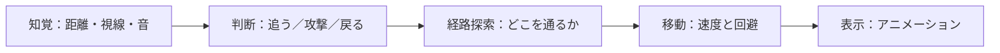

たとえば「追跡する」と決めた後に、通る道を求め、その道に沿って移動します。歩くアニメーションだけを再生しても、目的地へ到達する仕組みにはなりません。NavMesh が担当するのは図の「経路探索」と「移動」で、「追うかどうか」は決めてくれません。

## 地形を探索できる形にする

---

連続した3D空間のあらゆる点を調べるのは大変です。そこで、通れる場所を区画や点にまとめ、隣接関係を持つ**グラフ**として扱います。将棋盤のようなグリッド、通路の要所をつなぐウェイポイント、歩ける面をまとめる NavMesh は、その表現方法です。

| 表現 | 得意な場面 | 注意点 |
| --- | --- | --- |
| グリッド | マス単位の移動 | 細かいマスほど探索する点が増える |
| ウェイポイント | 決まった道を巡回 | 配置していない経路は選べない |
| NavMesh | 床の上を自由に歩く3Dキャラクター | 飛行や壁登りは別の表現・制御が必要 |

NavMesh は見えている床そのものではなく、**この体格のキャラクターが移動できる範囲**を近似したデータです。床があっても通路が狭すぎれば通れません。

## NavMesh はどう動いているか

---

NavMesh を使う処理は、エディタで**事前に行う Bake** と、**ゲーム中に行う経路探索と移動**に分かれます。

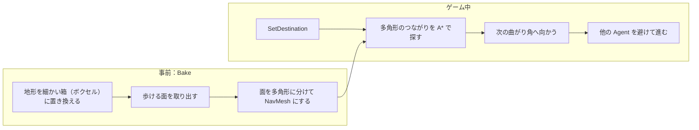

Bake は、ステージの形を調べて「歩ける場所の地図」を作る作業です。結果はファイルに保存されるので、ゲーム中に地形を調べ直す必要はありません。その代わり、Bake の後で壁を動かしても NavMesh は変わりません。

出来上がった NavMesh は、歩ける面を**凸多角形（ポリゴン）**に分けたデータです。隣り合うポリゴンの情報も持っています。

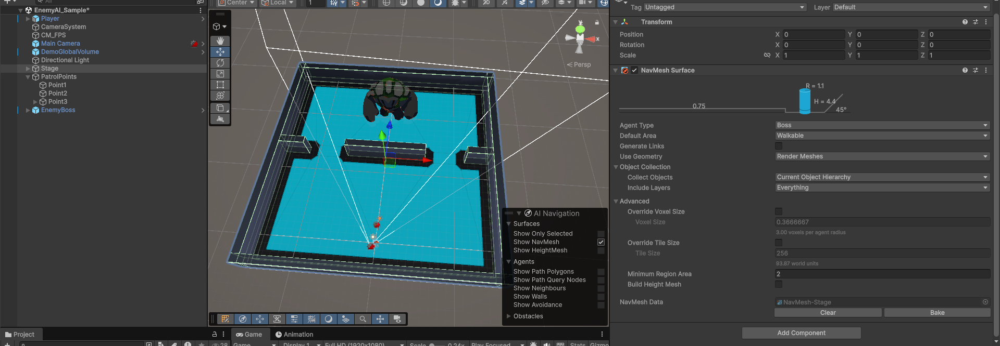

実際の面は、後の「面を見比べる」で確認します。

ゲーム中は、`SetDestination` で目的地を受け取ると、開始地点のポリゴンから目的地のポリゴンまでのつながりを探します。結果はポリゴンの列で、Agent はその中で次に見える曲がり角へ向かいます。近くに他の Agent がいれば、速度を調整して避けます。

ポリゴンをどうたどるのかは、[補足：経路探索とA*](pathfinding.md)で図を使って説明します。公式の説明は [Inner Workings of the Navigation System](https://docs.unity3d.com/Packages/com.unity.ai.navigation@2.0/manual/NavInnerWorkings.html) にあります。

## Unity の Navigation コンポーネント

---

| 要素 | 役割 |
| --- | --- |
| NavMesh Surface | 地形から移動可能な面を構築する（Bake） |
| NavMesh Agent | 経路に沿う移動や周辺の回避を行う |
| NavMesh Obstacle | 動的な障害物として扱う。Carving は条件に応じて面に穴を開ける |
| NavMesh Link | 通常の面だけではつながらない場所を接続する |

これらは「敵がプレイヤーを発見したか」「攻撃してよいか」までは決めません。役割の区分は [AI Navigation の概要](https://docs.unity3d.com/Packages/com.unity.ai.navigation@2.0/manual/NavigationOverview.html)でも確認できます。

## ボスの NavMesh を設定する

---

### Agent Type：体格ごとに NavMesh は別物

---

Bake では「この半径の円柱が通れる場所」を計算します。標準の `Humanoid` は半径 0.5 m、高さ 2 m です。ボスのカプセルは半径 1.1 m、高さ 4.4 m あるので、`Humanoid` 用の面を歩かせると壁にめり込み、狭い隙間に入り込みます。

そこで、体格の違うキャラクター用に **Agent Type** を追加します。このプロジェクトには `Boss` を追加済みです。

1. メニューの **Window > AI > Navigation** を開く。
2. **Agents** タブで `Boss` を選び、値を確認する。

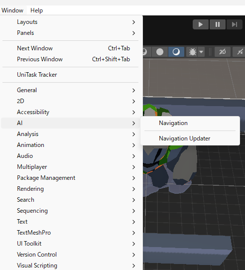{ width="400" }

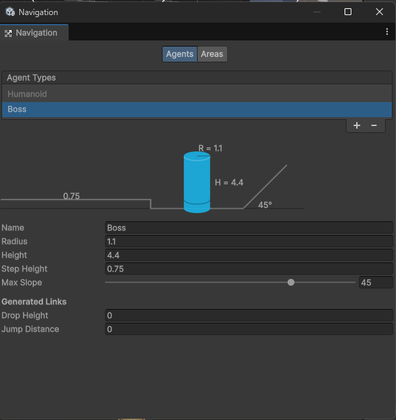{ width="480" }

| 項目 | `Humanoid` | `Boss` |
| --- | --- | --- |
| Radius | 0.5 | 1.1 |
| Height | 2 | 4.4 |
| Step Height | 0.75 | 0.75 |
| Max Slope | 45 | 45 |

### NavMesh Surface

---

`Stage` を選び、`NavMesh Surface` を確認します。

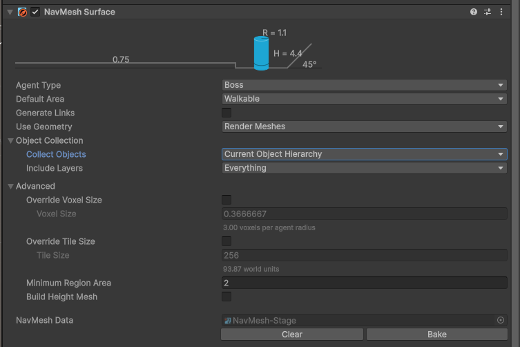{ width="600" }

| 項目 | 設定 | 意味 |
| --- | --- | --- |
| **Agent Type** | `Boss` | どの体格の面を作るか |
| **Collect Objects** | `Current Object Hierarchy` | `Stage` とその子だけを対象にする |
| **Use Geometry** | `Render Meshes` | 見た目のメッシュから床を計算する |

**Advanced** の **Voxel Size** は、Bake で地形を置き換える箱の大きさです。自動の値は Agent の半径の3分の1で、`Boss` では約 0.37 m です。

`EnemyAI_Work` を開いて **Bake** を押すと面が作られ、シーンと同じ階層の `EnemyAI_Work/NavMesh-Stage.asset` に保存されます。Bake したらシーンも保存します。Scene ビューの **AI Navigation** オーバーレイの **Show NavMesh** で、面を表示できます。オーバーレイが見当たらないときは、Scene ビューで `` ` `` キーを押して出るメニューから有効にします。

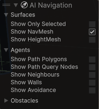{ width="320" }

Collect Objects を `All Game Objects` にすると、シーン上のすべてのメッシュが対象になります。足場にしたいものだけを対象に絞ると、Bake の結果を説明しやすくなります。

!!! warning "Surface と Agent の Agent Type を揃える"
    NavMesh は Agent Type ごとに別のデータです。Surface を `Humanoid` で Bake し、ボスの Agent が `Boss` のままだと、ボスは NavMesh の上にいないと判定されて動きません。

### 面を見比べる

---

同じステージを、Agent Type だけ変えて Bake した結果を真上から見ています。青い部分が移動できる面で、上が北です。

| `Humanoid` で Bake | `Boss` で Bake |
| --- | --- |
| 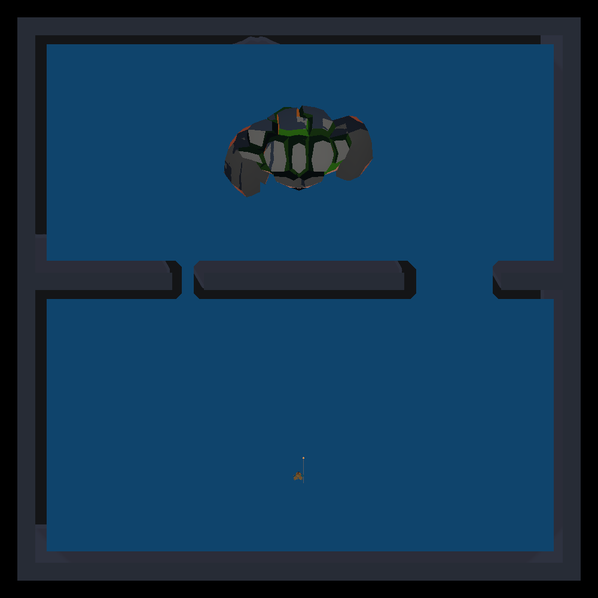 | 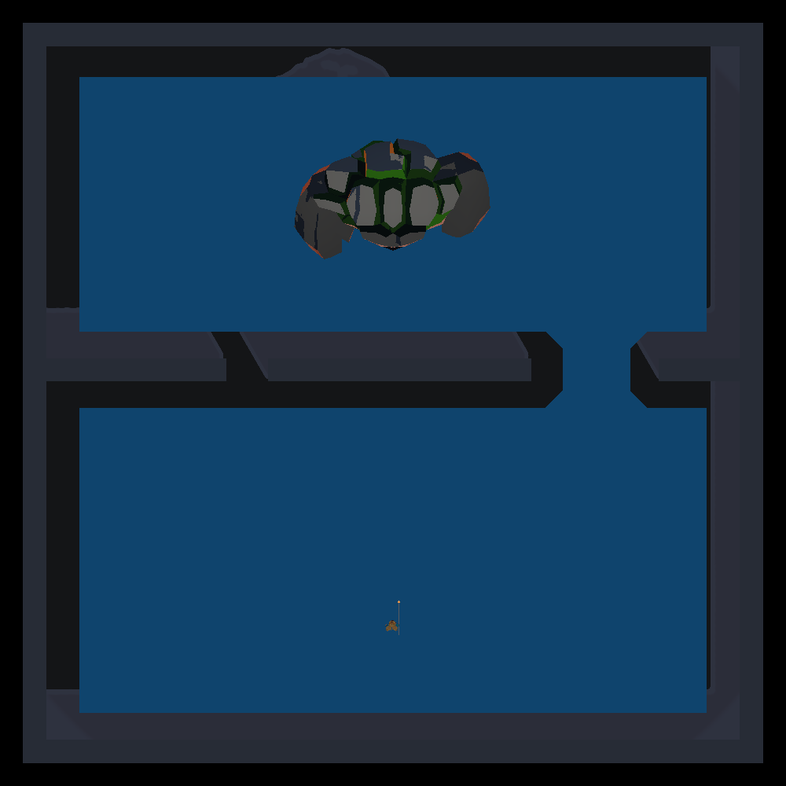 |

どちらも壁から半径分だけ離れた位置までしか面がありません。`Boss` では半径が大きいので壁際の余白が広がり、幅 1.8 m の隙間は面がなくなります。Agent の中心がこの面の上を動くので、ボスの体は壁にめり込みません。

隙間の南側（`x = -6.6, z = 10`）から北側（`x = -6.6, z = 16`）への経路の長さを比べると、`Humanoid` の面では隙間を抜ける 6.0 m、`Boss` の面では右の通路を回る 29.7 m になります。

### NavMesh Agent

---

`EnemyBoss` の `NavMesh Agent` を確認します。

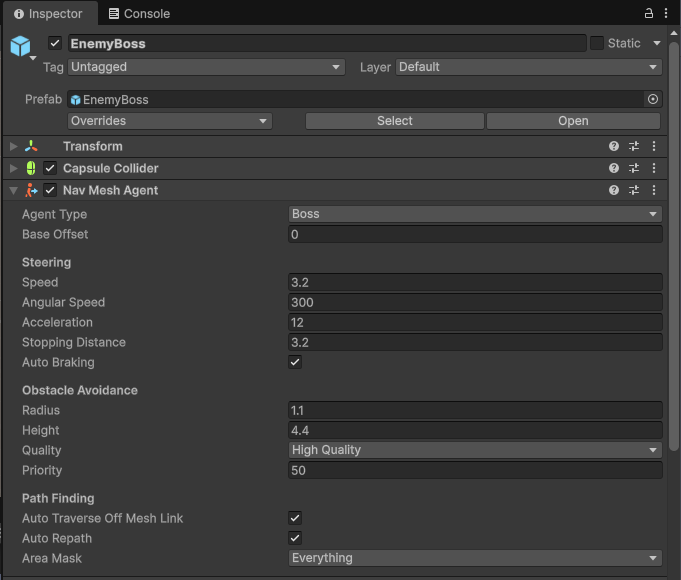{ width="600" }

| 項目 | 値 | 意味 |
| --- | --- | --- |
| **Agent Type** | `Boss` | 使う NavMesh |
| **Radius / Height** | 1.1 / 4.4 | 他の Agent を避けるときの大きさ |
| **Speed** | 3.2 | 巡回・追跡で `PursueSpeed` などに上書きされる |
| **Stopping Distance** | 3.2 | 目的地のこの距離手前で止まる |

Stopping Distance を 0 にすると、ボスはプレイヤーの位置そのものへ進もうとします。攻撃が届く距離で止まるように、攻撃開始距離（`AttackRange` 3.8 m）より小さくしています。

Agent が位置を動かしている間は、`Transform` や Root Motion で同時に動かしません。位置を決める責任を1つにしないと、揺れや引き戻しが起きます。ボスの Animator は `Apply Root Motion` を切っています。

## 敵AIの組み方

---

### 「何を見て、何をするか」を表にする

---

コードを書く前に、ボスの行動を日本語の表にします。ポイントは、**1つの行動ごとに、やることと、やめる条件を決める**ことです。

| 行動 | やること | やめる条件 → 次の行動 |
| --- | --- | --- |
| 巡回 | 4地点を順に歩き、着いたら少し止まる | プレイヤーが 12 m 以内 → 追跡 |
| 追跡 | 0.2 秒ごとに目的地を更新して走る | 20 m より遠い → 巡回／3.8 m 以内 → 攻撃 |
| 攻撃 | 止まり、振り下ろして当たり判定を出す | 2.4 秒経過 → 追跡 |
| 怯み | 止まる | 0.6 秒経過 → 追跡 |
| 怒り | 咆哮し、攻撃力と防御力を上げる | 2.4 秒経過 → 追跡 |
| 構え | 止まり、ダメージを受けない | 4 秒経過 → 追跡 |
| 死亡 | 倒れて消える | なし |

この表がそのまま [Stateパターン](state-pattern.md)の設計図になります。

### 知覚は簡単なものから始める

---

Sample の知覚は「プレイヤーとの距離」だけです。そのためボスは壁の向こうのプレイヤーにも気付きます。

視線判定（`Physics.Raycast`）や視野角、物音を足すと「背後から忍び寄れる」といった遊びになりますが、調整する値も増えます。プレイヤーに伝わらない賢さは、ゲームの面白さにつながりません。まず距離だけで動かし、遊んで足りないものを足します。

### 数値は Inspector で調整する

---

判断に使う数値は、`EnemyBoss` の Inspector に並べています。コードを直さずに調整でき、Play 中も変更できます。

| 項目 | 値 | 変えると |
| --- | --- | --- |
| `Search > Detect Range` | 12 | 大きいほど遠くから気付く |
| `Pursue > Lose Range` | 20 | 大きいほどしつこく追う |
| `Pursue > Attack Range` | 3.8 | Stopping Distance より大きくしないと攻撃が始まらない |
| `Pursue > Repath Interval` | 0.2 | 小さいほど反応が速く、計算は増える |
| `Parameters > Attack Interval Time` | 3.2 | 小さいほど攻撃の隙が減る |

再生中は `開発用 > Draw Debug` が ON なら、ボスの足元に円が描かれます。黄が発見距離、橙が見失う距離、赤が攻撃距離です。

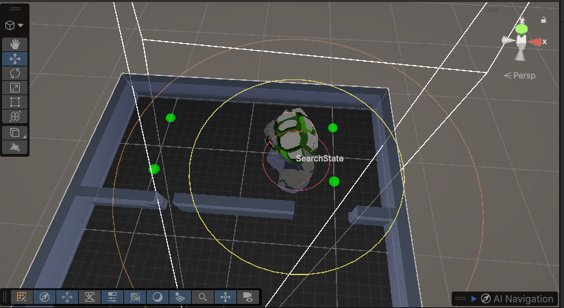{ width="640" }

### 目的地を渡す

---

AI のコードから NavMesh を使う操作は多くありません。`EnemyController` の移動はこれだけです。

```csharp
public void MoveTo(Vector3 destination, float speed)
{
    if (!_agent.isActiveAndEnabled || !_agent.isOnNavMesh) return;

    _agent.speed = speed;
    _agent.isStopped = false;
    _agent.SetDestination(destination);
}

public void StopMoving()
{
    if (!_agent.isActiveAndEnabled || !_agent.isOnNavMesh) return;

    _agent.isStopped = true;
    _agent.ResetPath();
}
```

`SetDestination` は経路計算を要求します。呼んだ直後に経路が確定しているとは限りません。到着判定には `pathPending`、`remainingDistance`、`stoppingDistance` を組み合わせます。

```csharp
public bool HasArrived =>
    _agent.isActiveAndEnabled && _agent.isOnNavMesh && !_agent.pathPending
    && _agent.remainingDistance <= _agent.stoppingDistance + 0.1f;
```

動く相手を追うには目的地を更新します。毎フレーム再計算せず、`Repath Interval` の間隔で更新しています。反応速度と計算量の交換条件です。

!!! warning "SamplePosition にも Agent Type を渡す"
    `NavMesh.SamplePosition(position, out hit, distance, NavMesh.AllAreas)` は `Humanoid` の面を調べます。`Boss` の面を調べるには、`NavMeshQueryFilter` の `agentTypeID` に Agent の値を入れて渡します（`EnemyController.TryFindPointOnNavMesh`）。

## 確認してみよう

---

Bake した `EnemyAI_Work` を再生し、次を確認します。

- [ ] ボスが4地点を巡回する
- [ ] 壁の南側から近づくと、ボスが壁越しに気付いて追ってくる
- [ ] 狭い隙間の近くにいても、ボスは広い通路を回ってくる
- [ ] プレイヤーは狭い隙間を通り抜けられる
- [ ] Detect Range や Stopping Distance を変えると、挙動が変わる

## 不具合を分けて調べる

---

| 症状 | 最初に確認すること |
| --- | --- |
| 動かない | Agent が有効か、Surface と Agent の Agent Type が同じか、Bake 済みか |
| 狭い通路を通らない | Agent の体格と、Surface の Agent Type |
| 目標の手前で止まる | Stopping Distance なのか、経路の末端なのか |
| 近づくのに攻撃しない | `AttackRange` が Stopping Distance より大きいか。経路でなく行動の条件を見る |
| 移動中にガタつく | 位置を変更するコンポーネントが複数ないか |

まず経路表示を見て「道がない」のか「道に沿って動けない」のかを分けます。見た目の結果から、原因となる層を絞る練習です。経路は、Agent を選んだ状態で AI Navigation オーバーレイの **Show Path Polygons** を ON にすると確認できます。

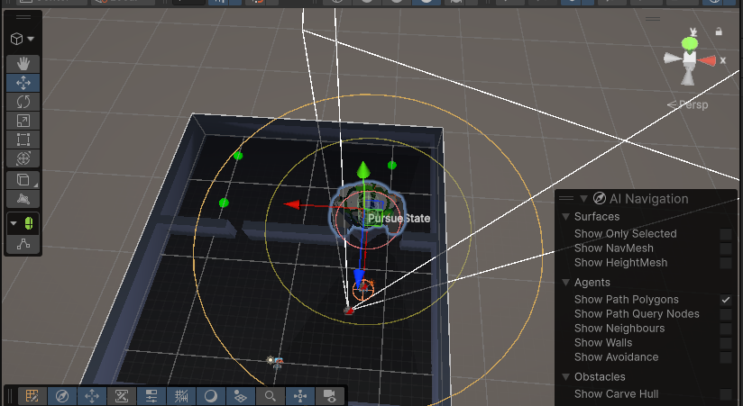{ width="640" }

## 関連資料

---

- [C#① 状態管理（Stateパターン）](state-pattern.md)
- [補足：経路探索とA*](pathfinding.md)
- [NavMeshAgent API](https://docs.unity3d.com/6000.3/Documentation/ScriptReference/AI.NavMeshAgent.html)

[シラバス](../index.md) ｜ 章の課題：[2章の課題](../problems/s2/index.md)
