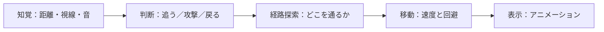

# キャラクターAI：目的地まで移動する仕組み

[シラバス](../index.md) ｜ 章の課題：2章の課題（準備中）

## 概要

---

!!! note "準備中"
    講義資料の初稿です。説明用のコードは演習シーンへの組み込み・動作確認前です。画面写真と配布シーンの対応は確定後に更新します。

敵をプレイヤーへ真っすぐ移動させるだけでは、壁に引っ掛かります。壁を避けられても、いつ追跡をやめるかを決めなければ、どこまでも追ってきます。**移動する道を探すことと、行動を選ぶことは別の問題**です。

この単元では、地形を「通れる場所」として表し、目的地までの経路を求める仕組みを学びます。その後、[Interface](interface-polymorphism.md)と[State](state-pattern.md)で行動の切り替えを整理します。

## ゲームのAIは何をしているか

---

ゲームAIは、観測した情報とルールから行動を選ぶ仕組みです。必ずしも機械学習や生成AIを使うわけではありません。敵が賢そうに見えることと、処理が複雑であることも同じではありません。



たとえば「追跡する」と決めた後に、通る道を求め、その道に沿って移動します。歩くアニメーションだけを再生しても、目的地へ到達する仕組みにはなりません。

## 地形を探索できる形にする

---

連続した3D空間のあらゆる点を調べるのは大変です。そこで、通れる場所を区画や点にまとめ、隣接関係を持つ**グラフ**として扱います。将棋盤のようなグリッド、通路の要所をつなぐウェイポイント、歩ける面をまとめるNavMeshは、その表現方法です。

| 表現 | 得意な場面 | 注意点 |
| --- | --- | --- |
| グリッド | マス単位の移動 | 細かいマスほど探索する点が増える |
| ウェイポイント | 決まった道を巡回 | 配置していない経路は選べない |
| NavMesh | 床の上を自由に歩く3Dキャラクター | 飛行や壁登りは別の表現・制御が必要 |

NavMeshは見えている床そのものではなく、**この体格のキャラクターが移動できる範囲**を近似したデータです。床があっても通路が狭すぎれば通れません。詳しくは[補足：経路探索とA*](pathfinding.md)を参照してください。

## Unity の Navigation コンポーネント

---

| 要素 | 役割 |
| --- | --- |
| NavMesh Surface | 地形から移動可能な面を構築する |
| NavMesh Agent | 経路に沿う移動や周辺の回避を行う |
| NavMesh Obstacle | 動的な障害物として扱う。Carving は条件に応じて面に穴を開ける |
| NavMesh Link | 通常の面だけではつながらない場所を接続する |

これらは「敵がプレイヤーを発見したか」「攻撃してよいか」までは決めません。役割の区分は[AI Navigation の概要](https://docs.unity3d.com/Packages/com.unity.ai.navigation@2.0/manual/NavigationOverview.html)でも確認できます。

## 演習の準備

---

| 用途 | シーン |
| --- | --- |
| **使用シーン** | 制作待ち。`Assets/Application/` 以下の2章用シーンの正式パスは未確定 |
| **完成見本** | 制作待ち。対応する `_Sample` の正式パスは未確定 |

配布シーン完成後に、床・壁・移動するCapsule・目的地だけの構成から確認します。以下は操作の流れの案で、既存の完成シーンを指すものではありません。

1. 床と壁を置き、Surface の対象レイヤーと Agent Type を確認して Bake する。
2. 移動可能な面を表示し、壁際や狭い通路に面がない理由を考える。
3. Agent を面の上に置き、目的地を設定する。
4. 目的地を壁の向こう、到達不能な場所へ順に変え、経路の状態を比べる。

!!! note "画像準備中：移動可能な面"
    同じ俯瞰位置で、通常の床と NavMesh 表示を並べます。壁際の余白・狭い通路・始点と終点に番号を付けます。予定画像：`images/navmesh-walkable-area.png`。

### 目的地を渡す最小の例

---

次はAgentが有効で、NavMesh上に配置されていることを前提に、目的地を一度渡す例です。追跡AI全体ではありません。

```csharp
using UnityEngine;
using UnityEngine.AI;

namespace Section2.Navigation
{
    public sealed class MoveToPoint : MonoBehaviour
    {
        [SerializeField] private NavMeshAgent agent;
        [SerializeField] private Transform goal;

        private void Start()
        {
            if (agent == null || goal == null ||
                !agent.isActiveAndEnabled || !agent.isOnNavMesh) return;
            agent.SetDestination(goal.position);
        }
    }
}
```

`SetDestination` は経路計算を要求します。呼んだ直後に到着までの経路が必ず確定しているとは限りません。到着判定には `pathPending`、`pathStatus`、`remainingDistance`、`stoppingDistance` などを組み合わせます。部分経路の末端に着いたことを、目的地への到着と取り違えないようにします。

### 追跡へ広げるときの考え方

---

動く相手を追うには目的地を更新します。全員が毎フレーム再計算する設計から始めず、相手の移動量や一定間隔を使って更新頻度を決めます。判定の反応速度と計算量の交換条件です。

Agent、物理、Root Motion が同時に位置を書き換えると、揺れや引き戻しが起きます。位置を決める責任を1つにし、残りはその結果を参照します。

## 不具合を分けて調べる

---

| 症状 | 最初に確認すること |
| --- | --- |
| 動かない | Agent が有効か、面の上にいるか、速度が0でないか |
| 狭い通路を通らない | Agent の半径・高さと Bake 時の Agent Type |
| 目標の手前で止まる | 停止距離なのか、部分経路の末端なのか |
| 道はあるのに攻撃しない | 経路探索でなく行動条件・射程・クールダウン |
| 移動中にガタつく | 位置を変更するコンポーネントが複数ないか |

まず経路表示を見て「道がない」のか「道に沿って動けない」のかを分けます。見た目の結果から、原因となる層を絞る練習です。

## 関連資料

---

- [補足：経路探索とA*](pathfinding.md)
- [C#② 状態管理](state-pattern.md)
- [NavMeshAgent API](https://docs.unity3d.com/6000.3/Documentation/ScriptReference/AI.NavMeshAgent.html)

[シラバス](../index.md) ｜ 章の課題：2章の課題（準備中）
