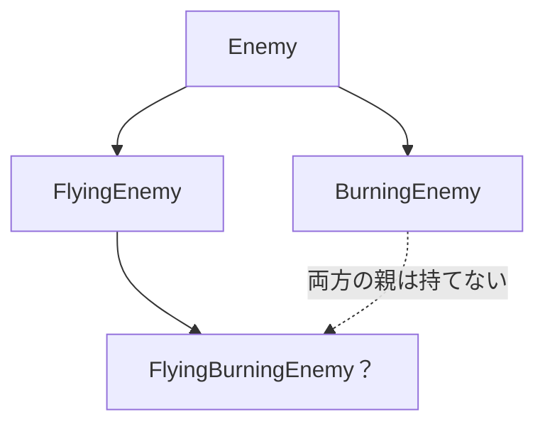
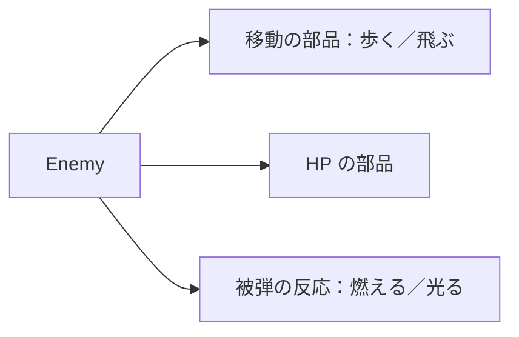
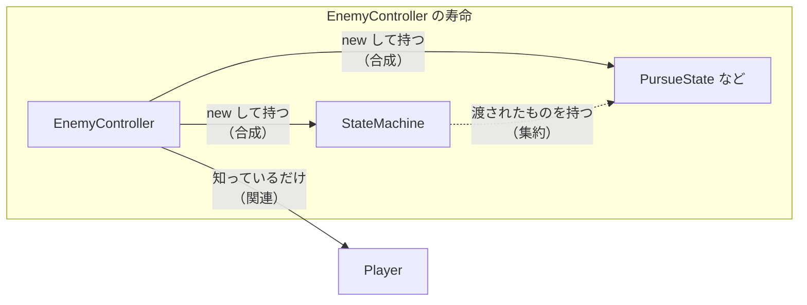
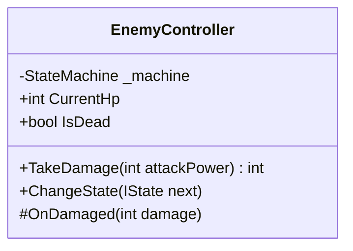
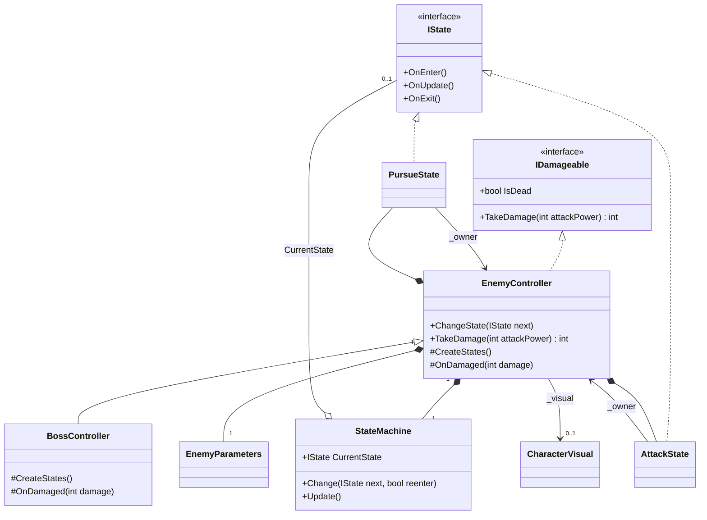

# C#③ 集約・合成とクラス図

[シラバス](../index.md) ｜ 章の課題：[2章の課題](../problems/s2/index.md)

## 概要

---

敵に「飛ぶ」「燃える」「盾を持つ」といった特徴を足すたびに、`FlyingEnemy`、`BurningEnemy`、`FlyingBurningEnemy`……と子クラスを作っていくと、特徴の組み合わせの数だけクラスが必要になります。逆に、何でも `EnemyController` に書き足していくと、1つのクラスが数百行に膨らんだり、全ての `Enemy` に特徴が追加されてしまい、どこを直せばよいか分からなくなります。

ここでは、**クラスを「〜の一種」として増やすのではなく、「〜を持つ」部品として組み合わせる**考え方を学びます。あわせて、クラス同士の関係を**クラス図**で描く方法を覚えます。コードを書く前に関係を図で確かめておくと、変更したときに影響が出る範囲を見通せたり、チームメンバーとの実装のすり合わせなどに役立ちます。

前回の [C#① Stateパターン](state-pattern.md)と [C#② インターフェースとポリモーフィズム](interface-polymorphism.md)のコードを、今回はクラス図として読み直します。

## 「〜の一種」と「〜を持つ」

---

クラスの関係は、大きく2種類に分けられます。

| 関係 | 英語での呼び方 | 言い換え | C# での書き方 |
| --- | --- | --- | --- |
| 継承 | is-a | ボスは**敵の一種**である | `class BossController : EnemyController` |
| 保持 | has-a | 敵は**状態機械を持つ** | `private readonly StateMachine _machine` |

継承は「親クラスの性質をすべて引き継ぐ」強い関係です。親を変更すると子もすべて影響を受け、1つのクラスは1つの親しか持てません。そのため、独立した特徴を継承で表そうとすると、組み合わせの数だけクラスが増えます。



`FlyingEnemy` と `BurningEnemy` は作れても、両方の特徴を持つ敵は、どちらか一方を継承して、もう一方の処理をコピーするしかありません。特徴が3つになれば、組み合わせは7通りになります。

特徴を部品にして「持たせる」形にすると、敵のクラスは1つのまま、持たせる部品の組み合わせで種類を作れます。



部品を差し替えるときには、前回の Interface が役に立ちます。`Enemy` が「移動の部品」を Interface 型で持っていれば、歩く部品と飛ぶ部品を入れ替えても `Enemy` は変更しなくて済みます。ですが、継承が悪いわけではありません。`BossController : EnemyController` のように、「ボスは敵の一種で、敵の処理をほぼそのまま使い、一部だけ足す」場合は継承が素直です。**種類の関係なら継承、特徴の組み合わせなら保持**、と考えると選びやすくなります。

## 関連・集約・合成

---

「持つ」関係は、相手との結び付きの強さで3つに分けて呼びます。区別のポイントは、**誰が相手を作り、誰が相手の寿命を決めるか**です。

| 関係 | 意味 | 作る人 | 寿命 | Section2 のコードでは |
| --- | --- | --- | --- | --- |
| 関連（Association） | 相手を知っていて、使う | 自分ではない | 別々 | `EnemyController` が追う相手 `_target`（プレイヤー） |
| 集約（Aggregation） | 全体と部分。ただし部分は外から渡される | 自分ではない | 別々。全体が消えても部分は残る | `StateMachine` が今の状態 `CurrentState` を持つ |
| 合成（Composition） | 全体と部分。部分は全体の一部として作られる | 自分 | 一緒。全体が消えると部分も消える | `EnemyController` が `_machine` や `PursueState` を `new` して持つ |



`EnemyController` は `Awake` で `PursueState` などを `new` し、自分が消えるまで持ち続けます。これが合成です。一方 `StateMachine` は、状態を自分では作りません。`Change(next)` で外から渡された状態を、次に切り替わるまで持っているだけです。`StateMachine` から見ると、状態との関係は集約です。

プレイヤーは敵より前からシーンにいて、敵が倒れても残ります。敵はプレイヤーを「追う相手」として知っているだけなので、関連です。

同じ「フィールドに持っている」でも、どの関係かを意識すると、次のような判断ができるようになります。

| 気をつけること | 関係ごとの目安 |
| --- | --- |
| 後片付け | 合成なら自分が片付ける（`Dispose` など）。集約・関連なら片付けない |
| 差し替え | 集約は外から別のものを渡せるので、差し替えやすい |
| 相手が先に消える | 関連・集約では、相手が `Destroy` されている可能性を考える |

!!! note "集約と関連の線引き"
    集約と関連の違いは厳密には決められていません。迷ったときは「全体と部分と言えるか」で判断し、言えなければ関連にします。チームで「合成＝自分で作って一緒に消える」「それ以外＝集約か関連」と決めておけば十分です。

### C# での書き分け

---

説明用のコードです。Section2 のスクリプトには含まれていません。

```csharp
namespace Section2.Composition
{
    public interface IWeapon
    {
        int Power { get; }
    }

    public sealed class Inventory
    {
        public int Potions { get; private set; } = 3;
    }

    public sealed class Hero
    {
        private readonly Inventory _inventory = new Inventory();
        private IWeapon _weapon;

        public Hero(IWeapon weapon)
        {
            _weapon = weapon;
        }

        public void Equip(IWeapon weapon)
        {
            _weapon = weapon;
        }

        public int Attack() => _weapon.Power;
    }
}
```

`Inventory` は `Hero` の中で `new` され、外からは渡せません。`Hero` と寿命が同じなので合成です。`IWeapon` はコンストラクタや `Equip` で外から渡されます。武器は落としたり別のキャラクターに渡したりでき、`Hero` が消えても残るので集約です。武器を Interface 型で受け取っているので、剣でも杖でも `Hero` を変更せずに装備できます。

## クラス図の書き方

---

クラス図は、クラスの中身とクラス同士の関係を1枚に描く図です。UML という規格の一部で、ゲーム開発に限らず設計の話し合いや資料で使われます。

### クラス図を書くツール

---

|ツール名|記述方法|特徴|web上のOpenSourceUrl|
| -- | -- | -- | -- |
| draw.io |描画ツールで図を書く|コードに慣れてないセクションや、綺麗に図を描きたい時など|[draw.io](https://www.drawio.com/)|
| mermaid |mermaid記法で図を書く|エンジニア向け。AIと相性良い。クラス間の線は綺麗にならないこともある。.mdファイル上できるので拡張ツールも豊富|[Mermaid Live Editor](https://mermaid.live/)|
|紙でかく|紙とペン| 最初のとっかかりや個人でまず実装する時に手早くイメージつかみたいとき、頭の整理をしたいときなど（その後上記ツールのどれかに移すことも） | - |


### クラス図の構成

---

1つのクラスを、3層に分けて書きます。



| 段 | 書くこと |
| --- | --- |
| 上 | クラス名。Interface は `<<interface>>` を添える |
| 中 | フィールドとプロパティ（型と名前） |
| 下 | メソッド（引数と戻り値の型） |

名前の前の記号は、アクセス修飾子を表します。

| 記号 | C# | 意味 |
| --- | --- | --- |
| `+` | `public` | どこからでも使える |
| `-` | `private` | そのクラスの中だけ |
| `#` | `protected` | そのクラスと子クラス |

すべてのフィールドとメソッドを書く必要はありません。**図で伝えたいことに関係するものだけを書きます**。関係だけを見せたいときは、箱の中を空にしても構いません。

### 関係の線

---

| 関係 | 線 | Mermaid | C# での見分け方 |
| --- | --- | --- | --- |
| 継承（汎化） | 実線＋白抜きの三角 | `Parent <|-- Child` | `class Child : Parent` |
| 実現（Interface の実装） | 点線＋白抜きの三角 | `IFoo <|.. Foo` | `class Foo : IFoo` |
| 関連 | 実線（＋矢印） | `A --> B` | フィールドで相手を知っている |
| 集約 | 実線＋白抜きのひし形（全体側） | `Whole o-- Part` | 外から渡されたものを持つ |
| 合成 | 実線＋黒塗りのひし形（全体側） | `Whole *-- Part` | 自分で `new` して持つ |
| 依存 | 点線＋矢印 | `A ..> B` | 引数やローカル変数で一時的に使うだけ |

三角は**親（約束）の側**、ひし形は**全体（持ち主）の側**に付きます。矢印の向きを逆に描きやすいので、「三角とひし形は偉い方に付く」と覚えておきます。

線の端には、数（多重度）を書けます。`1` はちょうど1つ、`0..1` はないか1つ、`*` は0個以上です。補足として、Mermaid では `EnemyController "1" *-- "1" StateMachine` のように、クラス名と線の間に `"数"` を書きます。

### Section2 の敵をクラス図にする

---

前回読んだスクリプトの関係を、クラス図にまとめます。状態は `PursueState` と `AttackState` だけを代表として描き、残りは省略しています。



図から次のことが読み取れます。

- `EnemyController` は `IDamageable` を**実現**しているので、プレイヤーの攻撃からは `IDamageable` として呼ばれます。
- `BossController` は `EnemyController` を**継承**し、`CreateStates` と `OnDamaged` だけを上書きしています。
- `EnemyController` は `StateMachine`・`EnemyParameters`・各状態を自分で作って持つ**合成**です。
- `StateMachine` は状態を `IState` としてしか知りません（**集約**）。`PursueState` が増えても `StateMachine` は変わりません。
- 各状態は持ち主の `EnemyController` を `_owner` として知っています（**関連**）。状態と持ち主は、互いを知っている関係です。

`CharacterVisual` は子オブジェクトに付いた Component で、`EnemyController` は Inspector か `GetComponentInChildren` で見つけた参照を持つだけです。自分で作ってはいないので、ここでは関連として描きました。親の GameObject を `Destroy` すると子も消えるので、「Hierarchy で見ると合成に近い」と考えることもできます。**どちらが正しいかより、図を見た人に何を伝えたいかで決めます**。

!!! tip "Mermaid で描く・紙で描く"
    この教材の図は Mermaid で描いています。[Mermaid Live Editor](https://mermaid.live/) に下記のコードを貼り付けて、記述方法やきれいな見た目で確認してみよう！

```text
classDiagram
    class IState {
        <<interface>>
        +OnEnter()
        +OnUpdate()
        +OnExit()
    }
    class IDamageable {
        <<interface>>
        +bool IsDead
        +TakeDamage(int attackPower) int
    }
    class StateMachine {
        +IState CurrentState
        +Change(IState next, bool reenter)
        +Update()
    }
    class EnemyController {
        +ChangeState(IState next)
        +TakeDamage(int attackPower) int
        #CreateStates()
        #OnDamaged(int damage)
    }
    class BossController {
        #CreateStates()
        #OnDamaged(int damage)
    }
    class PursueState
    class AttackState
    class EnemyParameters
    class CharacterVisual

    IDamageable <|.. EnemyController
    EnemyController <|-- BossController
    IState <|.. PursueState
    IState <|.. AttackState
    EnemyController "1" *-- "1" StateMachine
    EnemyController "1" *-- "1" EnemyParameters
    EnemyController *-- PursueState
    EnemyController *-- AttackState
    StateMachine o-- "0..1" IState : CurrentState
    PursueState --> EnemyController : _owner
    AttackState --> EnemyController : _owner
    EnemyController --> "0..1" CharacterVisual : _visual
```


### クラス図を描くときのコツ

---

| コツ | 理由 |
| --- | --- |
| 目的を1つに絞る | 「状態の切り替え」「ダメージの流れ」など、伝えたいことごとに図を分ける |
| 中身は必要なものだけ | 全部書くと、関係の線が読めなくなる |
| Unity の型は必要なときだけ | `MonoBehaviour` や `Transform` まで描くと線が増えすぎる |
| コードから描き起こして確かめる | 図とコードがずれていたら、どちらかが間違っている |

## 4章へのつながり

---

今回の「Interface で約束を決める」「部品を持たせて組み合わせる」「クラス図で関係を確かめる」は、4章でもう一度使います。

| 2章で学んだこと | 4章での使われ方 |
| --- | --- |
| Interface とポリモーフィズム | [MVP](../s4-csharp/mvp.md)：Presenter は View を `IHealthView` として扱い、表示の実装を差し替える |
| 集約 | MVP：Presenter は Model と View を外から受け取って持つ |
| 合成 | MVP：画面の組み立て役が Model・View・Presenter を作り、寿命をまとめて管理する |
| 関連の向き | [Observer](../s4-csharp/r3.md)：通知する側は受け取る側を知らない。矢印の向きが逆になる |
| クラス図 | レイヤーと依存の向き：ゲームのルールが UI や Unity に依存していないかを図で確かめる |

最後の「依存の向き」は、4章で MVP と合わせて詳しく扱います。今は、**ゲームのルール（HP やダメージ計算）のクラスが、UI のクラスを知らないほうが変更に強い**ということだけ覚えておきましょう。

## 関連資料

---

- [前回：C#② インターフェースとポリモーフィズム](interface-polymorphism.md)
- [C#① 状態管理（Stateパターン）](state-pattern.md)
- [4章：C#④ ObserverパターンとR3](../s4-csharp/r3.md)
- [4章：C#⑤ 設計への誘い MVPパターン](../s4-csharp/mvp.md)
- [Mermaid のクラス図の書き方](https://mermaid.js.org/syntax/classDiagram.html)

[シラバス](../index.md) ｜ 章の課題：[2章の課題](../problems/s2/index.md)
