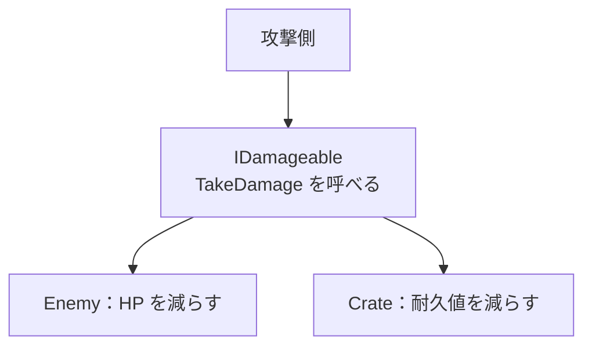

# C#① Interface とポリモーフィズム

[シラバス](../index.md) ｜ 章の課題：2章の課題（準備中）

## 概要

---

!!! note "準備中"
    講義資料の初稿です。説明用のコードは演習シーンへの組み込み・動作確認前です。画面写真と配布シーンの対応は確定後に更新します。

剣が敵にも壊せる箱にも当たるゲームを考えます。攻撃する側が「敵ならこの処理、箱ならこの処理」と相手の種類をすべて知っていると、対象を増やすたびに攻撃コードまで変更することになります。

**相手の具体的な種類を知らなくても、必要な操作だけを呼べるようにする**のが、この単元の目的です。Interface はその約束を型として表します。

## 型・実体・約束を分ける

---

クラスはデータと処理の定義、インスタンスは実際に作られた個体です。Interface は「この操作を提供する」という契約を表します。変数の型をInterfaceにすると、呼ぶ側はその契約にある操作を使えます。



同じ `TakeDamage` の呼び出しでも、実際の相手によって実行される処理が変わります。このように共通の型を通して異なる実装を扱うことを**多態性（ポリモーフィズム）**と呼びます。

## 最小の C# 例

---

以下はUnityのコンポーネントを使わない説明用コードです。Unity以外のアプリでも同じ考え方を使えます。

```csharp
using System;

namespace Section2.Contracts
{
    public interface IDamageable
    {
        void TakeDamage(int amount);
    }

    public sealed class Enemy : IDamageable
    {
        public int Health { get; private set; } = 100;
        public void TakeDamage(int amount)
        {
            Health = Math.Max(0, Health - Math.Max(0, amount));
        }
    }

    public sealed class Crate : IDamageable
    {
        public int Durability { get; private set; } = 20;
        public void TakeDamage(int amount)
        {
            Durability = Math.Max(0, Durability - Math.Max(0, amount));
        }
    }

    public static class Attack
    {
        public static void Hit(IDamageable target)
        {
            target.TakeDamage(10);
        }
    }
}
```

`Attack.Hit(new Enemy())` と `Attack.Hit(new Crate())` は同じ入口を使います。呼び出す相手を渡すことにより、攻撃側の中に種類ごとの分岐を書く必要がなくなります。

Interfaceは「必ずHPを減らす」といった意味まで自動で保証するわけではありません。負の値をどう扱うか、破壊済みの対象に呼んでよいかなど、契約の意味を揃えることも設計の一部です。言語仕様の位置づけは [Microsoft の Interface 解説](https://learn.microsoft.com/en-us/dotnet/csharp/fundamentals/types/interfaces)を参照してください。

## 継承・Interface・部品の組み合わせ

---

| 道具 | 選ぶ理由 | 例 |
| --- | --- | --- |
| クラスの継承 | 共通の実装と種類の関係を持つ | 基底クラスの共通処理を利用する |
| Interface | 異なる種類へ同じ操作を要求する | 敵も箱もダメージを受ける |
| 合成（Composition） | 機能を別の部品として持つ | 敵がHP管理のオブジェクトを持つ |

すべてを1つの巨大な基底クラスへ入れると、必要のない機能まで子クラスに広がります。逆に、1回しか使わない小さな処理にまでInterfaceを増やすと、読むファイルだけが増えることもあります。「差し替えたい場所」「呼び出し側を変更したくない場所」から導入します。

## Unity に持ち込むとき

---

Unityでは「契約の型」と「シーン内の参照をどう設定するか」は別の話です。通常のInspectorでInterface型のフィールドへそのままコンポーネントをドラッグできるとは限りません。具象コンポーネントを受け取り契約として渡す、初期化時に解決する、といった組み立て方を選びます。

また、Colliderが付いた子とダメージを受ける親が別なら、どの階層の相手を探すか決める必要があります。Interfaceを作るだけでは当たり判定や参照探索まで解決しません。

!!! note "画像準備中：契約と実体"
    攻撃側のコード、敵・箱のInspector、同じ呼び出しによる値の変化を並べます。実装済みの演習対象が決まってから撮影します。予定画像：`images/interface-targets.png`。

## State と UI 設計へのつながり

---

Stateでは `Enter`・`Tick`・`Exit`、UIでは「数値を表示する」という操作を契約にできます。型の名前を覚えるより、**呼ぶ側が何を知る必要があるか**を小さくすることが大切です。

- [次の単元：Stateパターン](state-pattern.md)
- [4章：MVPパターン](../s4-csharp/mvp.md)

[シラバス](../index.md) ｜ 章の課題：2章の課題（準備中）
