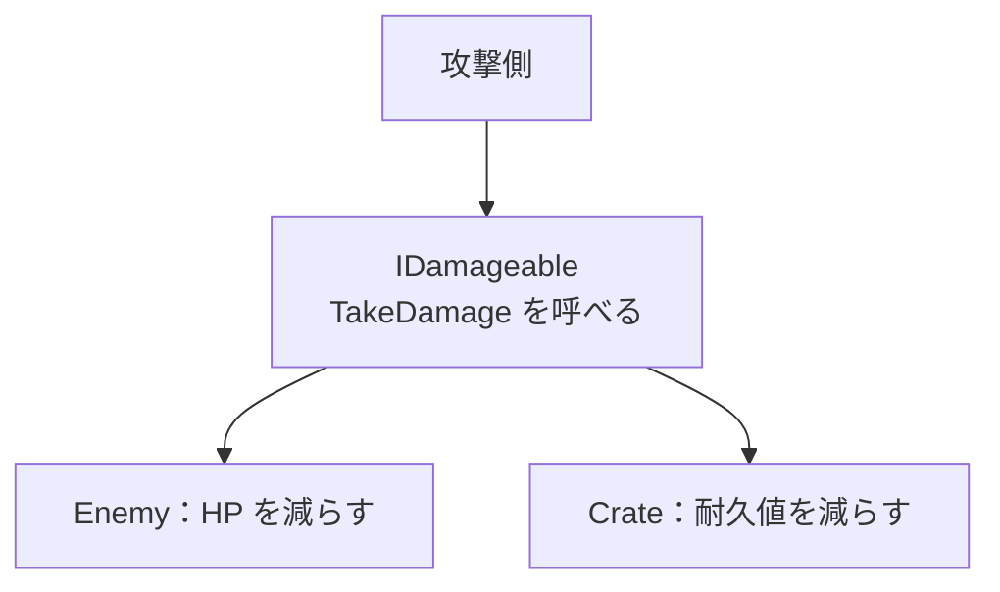

# C#② インターフェース（interface）とポリモーフィズム(polymorphism)

[シラバス](../index.md) ｜ 章の課題：[2章の課題](../problems/s2/index.md)

## 概要

---

剣が敵にも壊せる箱にも当たるゲームを考えます。攻撃する側が「敵ならこの処理、箱ならこの処理」と相手の種類をすべて知っていると、対象を増やすたびに攻撃コードまで変更することになります。

**呼び出し側（攻撃側）が、対象の具体的な種類を知らなくても、必要な操作だけを呼べるようにする**のが、この単元の目的です。Interface はその約束を型として表します。

## 型・実体・約束を分ける

---

クラスはデータと処理の定義、インスタンスは実際に作られた個体です。Interface は「この操作を提供する」という契約を表します。変数の型をInterfaceにすると、呼ぶ側はその契約にある操作を使えます。



同じ `TakeDamage` の呼び出しでも、実際の相手によって実行される処理が変わります。このように共通の型を通して異なる実装を扱うことを**ポリモーフィズム（polymorphism）または、多態性**と呼びます。

## 最小の C# 例

---

以下はUnityのコンポーネントを使わない説明用コードです。Unity以外のアプリでも同じ考え方を使えます。

```csharp
using System;

namespace Section2.Contracts
{
    public interface IDamageable
    {
        void TakeDamage(int amount);
    }

    public sealed class Enemy : IDamageable
    {
        public int Health { get; private set; } = 100;
        public void TakeDamage(int amount)
        {
            Health = Math.Max(0, Health - Math.Max(0, amount));
        }
    }

    public sealed class Crate : IDamageable
    {
        public int Durability { get; private set; } = 20;
        public void TakeDamage(int amount)
        {
            Durability = Math.Max(0, Durability - Math.Max(0, amount));
        }
    }

    public static class Attack
    {
        public static void Hit(IDamageable target)
        {
            target.TakeDamage(10);
        }
    }
}
```

`Attack.Hit(new Enemy())` と `Attack.Hit(new Crate())` は同じ入口を使います。呼び出す相手を渡すことにより、攻撃側の中に種類ごとの分岐を書く必要がなくなります。

Interfaceは「必ずHPを減らす」といった意味まで自動で保証するわけではありません。負の値をどう扱うか、破壊済みの対象に呼んでよいかなど、契約の意味を揃えることも設計の一部です。言語仕様の位置づけは [Microsoft の Interface 解説](https://learn.microsoft.com/en-us/dotnet/csharp/fundamentals/types/interfaces)を参照してください。

## クラスの継承とインターフェース（interface）

---

| 機能 | 選ぶ理由 | 例 |
| --- | --- | --- |
| クラスの継承 | 共通の実装と種類の関係を持つ | 基底クラスの共通処理を利用する |
| Interface | 異なる種類へ同じ操作を要求する | 敵も箱もダメージを受ける |

すべてを1つの巨大な基底クラスへ入れると、必要のない機能まで子クラスに広がります。逆に、1回しか使わない小さな処理にまでInterfaceを増やすと、読むファイルだけが増えることもあります。「差し替えたい場所」「呼び出し側を変更したくない場所」から導入します。

## Unity 上で利用するときの注意点

---

Unityでは「契約の型」と「シーン内の参照をどう設定するか」は別の話です。Interface を Unity のコンポーネントと一緒に使うときは、次の3点に注意します。

### Inspector に Interface 型のフィールドは表示されない

---

```csharp
using Section.Common;
using UnityEngine;

public class SampleUsage : MonoBehaviour
{
    // [SerializeField] を付けても、Interface 型は Inspector に表示されない
    [SerializeField] IDamageable _damageableField;
}
```

Unity は Interface 型のフィールドを保存しないので、Inspector からコンポーネントをドラッグして設定できません。具体的なコンポーネントの型でフィールドを作る、`TryGetComponent(out IDamageable target)` で実行中に探す、といった方法で参照を手に入れます。Section2 の `PlayerAttack` は、当たった相手から `TryGetComponent` で探しています。

### Destroy した後も null にならない

---

```csharp
IDamageable damageable = enemy;   // enemy は Destroy 済みの EnemyController

if (damageable != null)           // 破棄済みでも true になり、中に入る
{
    damageable.TakeDamage(10);
}
```

Unity では、`Destroy` したオブジェクトを `== null` で比べると `true` になります（fake null）。ただしこれは、変数の型が `UnityEngine.Object` 系のときだけです。変数の型を Interface にすると、C# の普通の比較になるので、破棄済みかどうかを判定できません。

Interface で受け取った相手が破棄される可能性があるときは、`IsDead` のような状態を契約に含めて確かめる、といった工夫をします。理由と判定の書き分けは、[付録：fake null と UnityEngine.Object の null 判定](../appendix/fake-null.md)にまとめています。

### アップキャストとダウンキャスト

---

| 変換 | 向き | 書き方 | 失敗するか |
| --- | --- | --- | --- |
| アップキャスト | 具体的な型 → Interface・基底クラス | 代入するだけ | 失敗しない |
| ダウンキャスト | Interface・基底クラス → 具体的な型 | `is` または `(型)` | 型が違うと失敗する |

```csharp
public class Door : IDamageable
{
    public bool IsDead { get; private set; }

    public int TakeDamage(int attackPower)
    {
        IsDead = true;
        return attackPower;
    }

    public void Open() { }
}

public void Foo(IDamageable damageable)
{
    // アップキャスト：Door は IDamageable を実装しているので、そのまま代入できる
    IDamageable target = new Door();
    target.TakeDamage(10);      // 契約にある操作は呼べる
    // target.Open();           // 契約にない操作は呼べない（コンパイルエラー）

    // ダウンキャスト（is）：Door のときだけ変換して中に入る
    if (damageable is Door door)
    {
        door.Open();
    }

    // ダウンキャスト（キャスト演算子）：Door 以外だと InvalidCastException
    Door forcedDoor = (Door)damageable;
    forcedDoor.Open();
}
```

アップキャストは、具体的な型を Interface や基底クラスとして扱うことです。必ず成功するので、代入するだけで変換されます。その代わり、変換後は契約にある操作しか呼べなくなります。

ダウンキャストは、その逆に Interface から具体的な型へ戻すことです。中身が本当にその型かどうかは実行するまでわからないので、`is` で確かめてから変換します。`(Door)` のようなキャスト演算子は、型が違うと実行時に例外が出ます。

ダウンキャストで種類ごとの分岐を増やすと、Interface で相手の種類を知らなくてよくした意味が薄れます。分岐を書く前に、契約のメソッドで表せないかを考えます。

### 当たった相手の探し方

---

Colliderが付いた子とダメージを受ける親が別なら、どの階層の相手を探すか決める必要があります。Interfaceを作るだけでは当たり判定や参照探索まで解決しません。

!!! note "画像準備中：契約と実体"
    攻撃側のコード、敵・箱のInspector、同じ呼び出しによる値の変化を並べます。実装済みの演習対象が決まってから撮影します。予定画像：`images/interface-targets.png`。

## State と UI 設計へのつながり

---

Stateでは `OnEnter`・`OnUpdate`・`OnExit`、UIでは「数値を表示する」という操作を契約にできます。型の名前を覚えるより、**呼ぶ側が何を知る必要があるか**を小さくすることが大切です。

- [前の単元：Stateパターン](state-pattern.md)
- [4章：MVPパターン](../s4-csharp/mvp.md)

[シラバス](../index.md) ｜ 章の課題：[2章の課題](../problems/s2/index.md)
