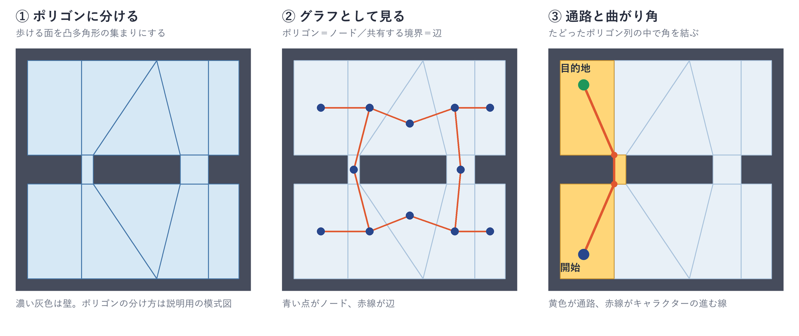
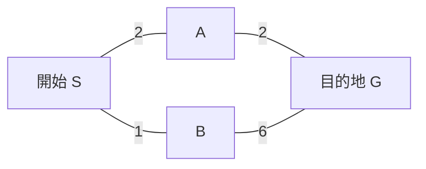
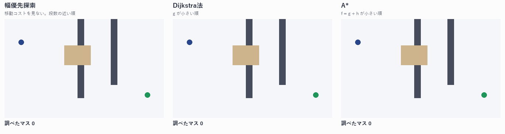
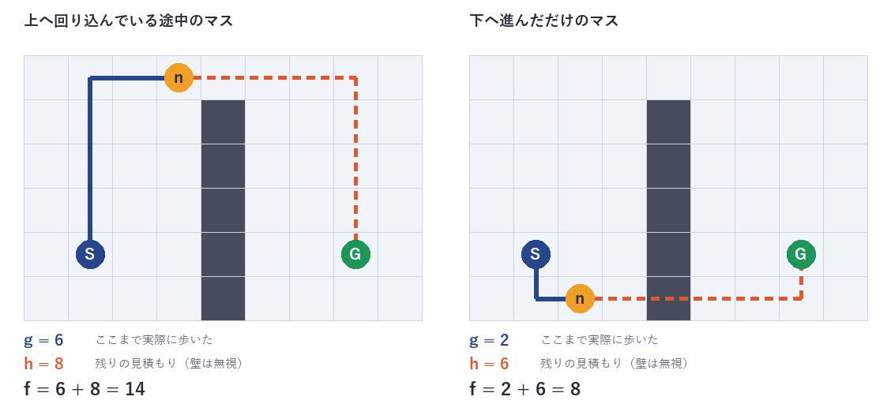
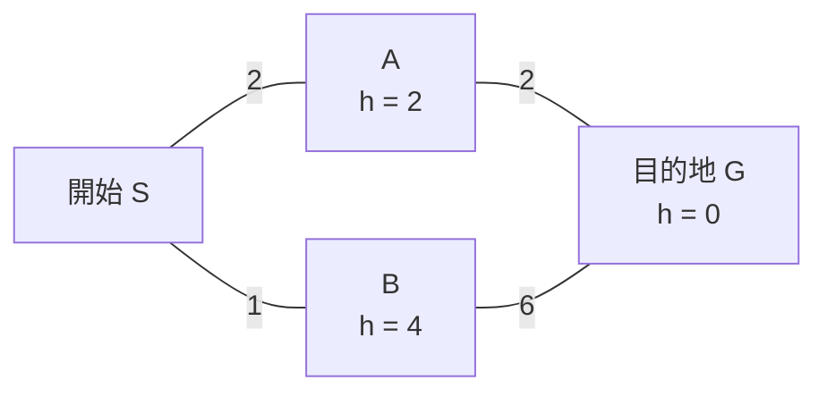

# 補足：経路探索とA*の考え方

[シラバス](../index.md) ｜ 章の課題：[2章の課題](../problems/s2/index.md)

## 概要

---

[キャラクターAI](character-ai.md)のボスは、`SetDestination` を1行呼ぶだけで壁を回り込みました。しかし壁の反対側へ行きたいとき、目的地との直線距離だけでは通る道を決められません。

この補足では、`SetDestination` の裏側で NavMesh がどう使われているかを出発点に、「道を探す」がどんな計算なのかを説明します。主教材は[キャラクターAI](character-ai.md)です。

## NavMesh をグラフとして見る

---

経路探索の説明には「ノード」と「辺」という言葉が出てきます。難しく考える必要はなく、**どこがどこにつながっているかを点と線で表した地図**です。電車の路線図に似ています。駅がノード、駅の間の線路が辺で、本当の線路の形は描かなくても乗り換えの道順は分かります。

NavMesh では、ポリゴン1枚が駅、隣のポリゴンとのつながりが線路にあたります。



左から順に見ていきます。形を簡単にした模式図で、Unity が実際に作る分け方とは異なります。

- **① ポリゴンに分ける**：Bake が、歩ける面を凸多角形の集まりにします。
- **② グラフとして見る**：ポリゴンをノード、境界を共有している隣どうしのつながりを辺として扱います。
- **③ 通路と曲がり角**：探索の結果はポリゴンの列です。この列を**通路**（corridor）と呼びます。キャラクターは通路の中で、次に見える曲がり角へ向かいます。

| グラフの言葉 | NavMesh では | 路線図では |
| --- | --- | --- |
| ノード | ポリゴン1枚 | 駅 |
| 辺 | 隣のポリゴンとつながっていること | 隣の駅へ行く線路 |
| コスト | 移動にかかる量。距離に、Area のコストが影響する | 所要時間や運賃 |

ポリゴンが凸多角形なのは、**同じポリゴンの中の2点は必ず直線で結べる**からです。1枚の中で壁を避ける必要がないので、探索では「どのポリゴンを順に通るか」だけを考えられます。

②の点はポリゴンの中心付近に描きましたが、③を見ると分かるように、キャラクターは点を順に通るわけではありません。グラフは順番を決めるためのもので、実際に歩く線はその後に決まります。

この見方をすると、[キャラクターAI](character-ai.md)の「面を見比べる」の結果も説明できます。`Boss` で Bake すると狭い隙間にポリゴンができません。ポリゴンがなければノードも辺もないので、探索の候補に上がらず、ボスは広い通路を回ります。

## ノード・辺・コスト

---

ここからは、NavMesh の形を離れて、点と線だけで探索の考え方を見ていきます。コストは距離だけでなく、坂道の負担や危険な場所の避けやすさにも使えます。



S→Bの最初の1歩は安くても、全体では7です。S→A→Gなら4なので、先のつながりも含めて判断する必要があります。数字はこの例の移動コストです。

## 探索方法の違い

---

ここでは、同じ地図を3つの方法で探索する様子を比べます。格子の1マスをノードと考えてください。



青いマスが調べ終わった場所、茶色のマスが通りにくい場所です。普通のマスのコストは 1、茶色のマスは 5 で、4方向に移動します。どの方法も1コマで同じマス数だけ調べ、到着すると赤線で経路を表示します。

| 方法 | 次に調べる場所 | 調べたマス | 経路のコスト |
| --- | --- | --- | --- |
| 幅優先探索 | 近い段数から順に | 263 | 39 |
| Dijkstra法 | 到達済みコストが小さい順 | 263 | 29 |
| A* | 到達済み＋残りの見積もりが小さい順 | 88 | 29 |

幅優先探索はコストを見ないので、歩数の少ない茶色の道を選び、コストが高くなりました。各辺のコストが等しいときなら、これで最少のステップを求められます。Dijkstra法は非負のコストを持つグラフで最も安い道を見つけますが、目的地がどちらにあるかを知らないので、全方向へ広がります。A*は同じコスト 29 の道を、目的地の方向を手掛かりにして少ないマス数で見つけました。

探索の広がりは、手で動かすと理解しやすくなります。[A*の図解（Red Blob Games、英語）](https://www.redblobgames.com/pathfinding/a-star/introduction.html)では、ブラウザ上で壁や開始点を動かして比べられます。

## A* の f = g + h

---

A* は各ノードについて、次の式の値が小さいものから調べます。

```text
f(n) = g(n) + h(n)
```

式を言葉にすると、**「ここを通って行くと、全体でどれくらいかかりそうか」** です。カーナビの到着予想に似ています。ここまで走った時間に、残りの予想時間を足した値で、ルートどうしを比べます。

| 記号 | 意味 | 性質 |
| --- | --- | --- |
| `g(n)` | 開始点から n まで、実際にかかったコスト | 探索が進むと確定していく事実 |
| `h(n)` | n から目的地までの見積もり | 計算で素早く出す予想。壁は考えないことが多い |
| `f(n)` | この経路全体の予想コスト | 次に調べるノードを選ぶ基準 |

格子の例で見ます。`h` には、縦横に何マス離れているかを使います。



左のマスは 6 歩進み、右のマスは 2 歩しか進んでいません。右の `h` は壁を突き抜けて数えているので、実際より少なく見積もられています。そのため、右のほうの `f` が小さくなり、先に調べられます。調べていくうちに壁に当たると `g` が増え、`f` も大きくなるので、探索は別の候補へ移ります。**見積もりが外れても、実際のコスト `g` が修正してくれる**わけです。

前の節のグラフで、手順を追ってみます。各ノードの `h` は次の値とします。



| 手順 | 候補の f | 次に調べる |
| --- | --- | --- |
| 1 | A：2 + 2 = 4、B：1 + 4 = 5 | A |
| 2 | B：1 + 4 = 5、G：4 + 0 = 4 | G（到着） |

手順1では `g` は B のほうが小さいのに、`h` を足すと A が選ばれます。B は調べずに終わりました。`g` だけを見る Dijkstra法なら、B を調べてから A へ進むことになります。`h` を常に 0 にすると A* は Dijkstra法と同じ動きになる、と考えることもできます。

??? note "最短経路を保証する条件"
    同じ地点へのもっと安い経路が見つかったら、親とコストを更新します。最短経路を保証するには、過大評価しない見積もりに加え、閉じたノードを再検討する扱いなどアルゴリズム側の条件も必要です。グラフ探索で再展開を省く典型的実装では、一貫性を持つヒューリスティックが重要になります。

## 経路と回避は別

---

道全体が決まっても、目の前の別のキャラクターを避ける必要があります。経路探索は全体のルート、局所回避は近くの障害への対応です。大量の敵が狭い入口に集まる問題を、探索の高速化だけで解決できるとは限りません。

Unity の公式マニュアルも、通路を求める処理と次の曲がり角へ進む処理を分けて説明しています（[Inner Workings of the Navigation System](https://docs.unity3d.com/Packages/com.unity.ai.navigation@2.0/manual/NavInnerWorkings.html)）。

Unityの内部実装をこのページの簡略例と同一視せず、まず「地形表現」「経路計画」「移動・回避」を分けるための背景知識として使ってください。

[シラバス](../index.md) ｜ 章の課題：[2章の課題](../problems/s2/index.md)
