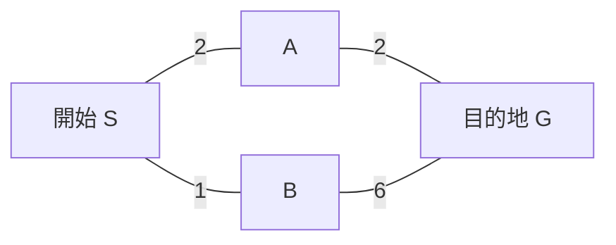

# 補足：経路探索とA*の考え方

[シラバス](../index.md) ｜ 章の課題：2章の課題（準備中）

## 概要

---

!!! note "準備中"
    講義資料の初稿です。説明用のコードは演習シーンへの組み込み・動作確認前です。画面写真と配布シーンの対応は確定後に更新します。

壁の反対側へ行きたいとき、目的地との直線距離だけでは通る道を決められません。この補足では、地形をグラフへ置き換えると「道を探す」がどんな計算になるかを説明します。主教材は[キャラクターAI](character-ai.md)です。

## ノード・辺・コスト

---

ノードは場所、辺は移動できるつながり、コストは移動に必要な量です。コストは距離だけでなく、坂道の負担や危険な場所の避けやすさにも使えます。

S→Bの最初の1歩は安くても、全体では7です。S→A→Gなら4なので、先のつながりも含めて判断する必要があります。数字はこの例の移動コストです。

## 探索方法の違い

---

| 方法 | 次に調べる場所 | 前提と特徴 |
| --- | --- | --- |
| 幅優先探索 | 近い段数から順に | 各辺のコストが等しいとき、最少ステップを求められる |
| Dijkstra法 | 到達済みコストが小さい順 | 非負のコストを持つグラフを探索する |
| A* | 到達済み＋残りの見積もりが小さい順 | 目的地の方向を手掛かりに探索範囲を絞る |

A*では `f(n) = g(n) + h(n)` として、開始点からの実コスト `g` に、目的地までの推定コスト `h` を足します。`h` は「既に払った費用」ではありません。

同じ地点へのもっと安い経路が見つかったら、親とコストを更新します。最短経路を保証するには、過大評価しない見積もりに加え、閉じたノードを再検討する扱いなどアルゴリズム側の条件も必要です。グラフ探索で再展開を省く典型的実装では、一貫性を持つヒューリスティックが重要になります。

## 経路と回避は別

---

道全体が決まっても、目の前の別のキャラクターを避ける必要があります。経路探索は全体のルート、局所回避は近くの障害への対応です。大量の敵が狭い入口に集まる問題を、探索の高速化だけで解決できるとは限りません。

!!! note "画像準備中：探索の広がり"
    同じ格子と障害物で、Dijkstra法とA*の調査済みノード・最終経路を色分けした自作図を配置します。探索条件とヒューリスティックを併記します。予定画像：`images/search-frontier.png`。

参考：[A*の図解（Red Blob Games）](https://www.redblobgames.com/pathfinding/a-star/introduction.html)。

Unityの内部実装をこのページの簡略例と同一視せず、まず「地形表現」「経路計画」「移動・回避」を分けるための背景知識として使ってください。

[シラバス](../index.md) ｜ 章の課題：2章の課題（準備中）
