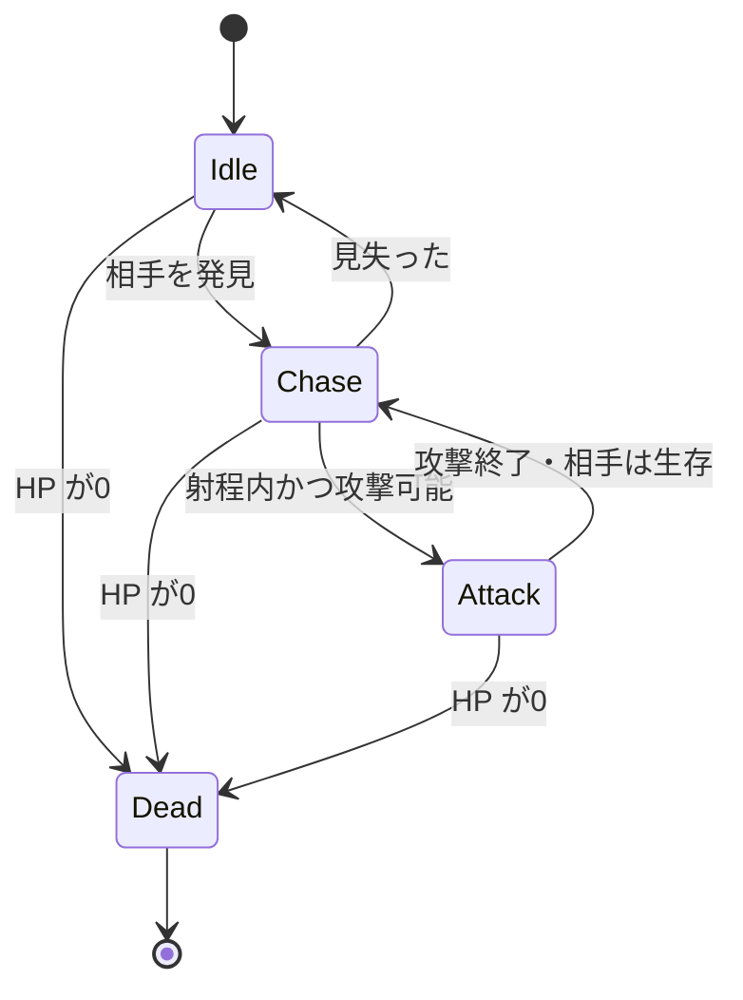

# C#② 状態管理：有限状態機械とStateパターン

[シラバス](../index.md) ｜ 章の課題：2章の課題（準備中）

## 概要

---

!!! note "準備中"
    講義資料の初稿です。説明用のコードは演習シーンへの組み込み・動作確認前です。画面写真と配布シーンの対応は確定後に更新します。

敵が「攻撃中なのに移動する」「倒れた後も攻撃する」ようになると、フラグを足して対処したくなります。しかし `isMoving`、`isAttacking`、`isDead` の組み合わせが増えるほど、許してはいけない組み合わせも増えます。

まず行動を**状態と遷移**で表し、そのあと必要に応じて状態ごとの処理をクラスへ分けます。図を整理することと、デザインパターンで実装することを分けて学びます。

## 有限状態機械（FSM）

---

状態は「今どのルールで動くか」、遷移は「どの条件でルールを切り替えるか」です。信号機、通信手順、メニュー画面など、ゲーム以外でも使われます。



この例では同時に1つの行動状態だけを選びます。どの状態からも死亡へ進めますが、死亡から追跡へ戻る矢印はありません。「できない遷移」を明確にすることも状態図の役割です。

## 最初は enum と switch でよい

---

状態が少ないうちは、`enum` で現在状態を表し、`switch` で処理を選ぶ方法が読みやすくなります。状態が増え、開始・更新・終了の処理が大きくなったら分割を検討します。

| タイミング | 仕事の例 |
| --- | --- |
| Enter | 攻撃アニメーションを開始、移動を停止 |
| Tick | 時間を進める、距離や終了条件を確認 |
| Exit | 攻撃判定を閉じる、購読や一時的な効果を解除 |

毎フレームのTickで攻撃開始を呼ぶと、アニメーションが頭から繰り返される場合があります。1度だけ行う処理をEnterへ移す理由です。

## State パターンで処理を分ける

---

[Interface](interface-polymorphism.md)を使い、状態の共通の呼び方を定義します。次は状態切り替えの核だけを示すC#例です。

```csharp
namespace Section2.States
{
    public interface IState
    {
        void Enter();
        void Tick(float deltaTime);
        void Exit();
    }

    public sealed class StateMachine
    {
        private IState current;

        public void Change(IState next)
        {
            if (ReferenceEquals(current, next)) return;
            current?.Exit();
            current = next;
            current?.Enter();
        }

        public void Tick(float deltaTime) => current?.Tick(deltaTime);
    }
}
```

古い状態のExitが終わってから、新しい状態のEnterを呼びます。この最小例では、Enter・Exitの中からさらにChangeを呼ばない約束にします。複数箇所から切り替え要求が出る実装では、要求を予約してフレーム末尾に1回だけ確定するなど、再入や優先順位を扱う必要があります。

## 遷移条件の設計

---

| 問題 | 方針の例 |
| --- | --- |
| 発見と死亡が同時に成立 | 死亡などの優先条件を先に処理する |
| 射程の境目で追跡と攻撃が往復 | 攻撃開始距離と追跡再開距離を分ける |
| 攻撃中にキャンセルされた | Exitで判定を閉じる。完了イベントだけに任せない |
| 状態ごとに同じデータを複製 | HPや対象は共通の持ち主に置き、状態から参照する |

境目に余裕を持たせる設計を**ヒステリシス**と呼びます。たとえば距離2以下で攻撃へ入り、2.5より遠くなったら追跡へ戻れば、小さな距離変化で状態が往復しにくくなります。数字は説明用で、実際の射程はゲームに合わせます。

!!! note "画像準備中：状態の見える化"
    Sceneビューの敵と、現在状態・対象までの距離を表示したデバッグ欄を同時に撮影します。追跡→攻撃の境界で比較します。予定画像：`images/enemy-state-debug.png`。

## 状態が増えたらどうするか

---

「走る／止まる」と「毒／通常」をすべて組み合わせると、状態数が掛け算で増えます。独立した要素は別の仕組みとして持ち、親子関係がある行動は階層化を検討します。複雑な行動選択にはBehavior TreeやUtility AIもありますが、道具を替える前に状態の責任が混ざっていないか確認します。

ゲームロジックの状態とAnimatorのStateは同じものではありません。ロジックが「攻撃中」と決めても、見た目は遷移の途中にいる場合があります。ゲーム側の攻撃許可を、見た目のState名だけで判断する設計には注意します。

## 関連資料

---

- [キャラクターAI：判断と移動の分離](character-ai.md)
- [付録：イベントと購読の寿命](../appendix/events-lifetime.md)
- [Game Programming Patterns：State（著者公開版）](https://gameprogrammingpatterns.com/state.html)

[シラバス](../index.md) ｜ 章の課題：2章の課題（準備中）
