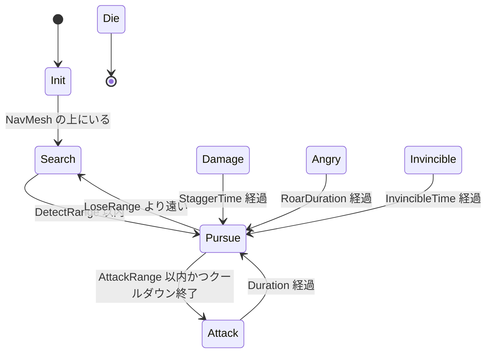
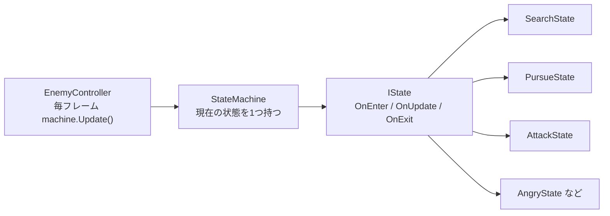

# C#① 状態管理：有限状態機械とStateパターン

[シラバス](../index.md) ｜ 章の課題：[2章の課題](../problems/s2/index.md)

## 概要

---

ボスが「攻撃中なのに歩き出す」「倒れた後も殴ってくる」ようになると、フラグを足して対処したくなります。しかし `isMoving`、`isAttacking`、`isDead` の組み合わせが増えるほど、許してはいけない組み合わせも増えます。さらに「怒り」や「無敵の構え」を足すたびに、`Update` の中の `if` はすべて見直しになります。

[キャラクターAI](character-ai.md)で整理した行動を、**状態と遷移**として図に表し、それを **State パターン**で C# のクラスに分けます。このページのゴールは、新しい行動を足すときに「既存の行動の中身を書き換えなくて済む」構造を読み取り、自分で1つ状態を足せるようになることです。

`IState` のような Interface と多態性の仕組みそのものは、次回の [C#② Interface とポリモーフィズム](interface-polymorphism.md)で詳しく扱います。今回は「使い方」に集中します。

## 演習の準備

---

| 用途 | シーン・ファイル |
| --- | --- |
| **使用シーン** | 準備中 |
| **完成見本** | `Assets/Application/Section2-AIState/EnemyAI/EnemyAI_Sample.unity` |
| **読むスクリプト** | `Assets/Application/Section2-AIState/Scripts/`（名前空間 `Section2.AIState`） |

| ファイル | 役割 |
| --- | --- |
| `Scripts/Core/IState.cs` | 状態の共通の呼び方 |
| `Scripts/Core/StateMachine.cs` | 現在の状態を持ち、切り替える |
| `Scripts/Enemy/EnemyController.cs` | 状態の持ち主。HP・Agent・対象など、状態をまたぐデータと共通の操作を持つ |
| `Scripts/Enemy/BossController.cs` | `EnemyController` を継承し、ボスだけの状態と割り込みを足す |
| `Scripts/Enemy/States/` | 状態1つにつき1クラス |

`EnemyAI_Sample` を再生すると、Scene ビューのボスの足元に、現在の State のクラス名が表示されます（Gizmos を ON にしてください）。

## 授業の進め方

---

1. フラグで書いたときの問題を確認する。
2. ボスの行動を状態遷移図で表す。
3. `IState` と `StateMachine` を読む。
4. `SearchState`・`PursueState`・`AttackState` を読み、遷移がどこに書かれているか確認する。
5. `BossController` が `AngryState`・`InvincibleState` を足す方法を読む。
6. 遷移条件の設計を、Sample の挙動を見ながら確認する。

## 有限状態機械（FSM）

---

状態は「今どのルールで動くか」、遷移は「どの条件でルールを切り替えるか」です。同時に1つの状態だけを選ぶ仕組みを**有限状態機械**（Finite State Machine、FSM）と呼びます。信号機、通信手順、メニュー画面など、ゲーム以外でも使われます。

`EnemyAI_Sample` のボスの状態は次のとおりです。



`Init`・`Search`・`Pursue`・`Attack` は、状態が自分で条件を調べて次へ進みます。図の `Damage`・`Angry`・`Invincible`・`Die` は、ダメージを受けたときに外から割り込んで入る状態です（矢印が入ってくる側は長くなるので省略しました）。

| 入る状態 | 入る条件（`OnDamaged` / `TakeDamage`） |
| --- | --- |
| `Die` | HP が 0 になった。最優先 |
| `Angry` | HP が `AngryStateTargetHp` 以下になった。1回だけ |
| `Invincible` | `HitWindow` 秒の間に `HitCount` 回当てられた |
| `Damage` | それ以外の被弾。ただし `StaggerCooldown` 中は怯まない |

死亡からどこへも戻る矢印はありません。「できない遷移」を明確にすることも状態図の役割です。

## フラグで書くと何が困るか

---

状態の考え方を使わずに書くと、`Update` はこのようになっていきます。

```csharp
private void Update()
{
    if (isDead) return;

    if (isStaggered)
    {
        staggerTimer -= Time.deltaTime;
        if (staggerTimer <= 0f) isStaggered = false;
        return;
    }

    if (isAttacking)
    {
        // 攻撃の経過時間と当たり判定
        return;
    }

    if (distance <= attackRange && canAttack)
    {
        // 攻撃を始める。Trigger を毎フレーム呼ばないよう注意
    }
    else if (distance <= detectRange)
    {
        // 追いかける
    }
    else
    {
        // 巡回する
    }
}
```

1つの行動を読むには `Update` 全体を読む必要があり、行動を足すたびに `return` の順番を考え直します。「攻撃を始めた瞬間に1回だけ行う処理」と「攻撃中に毎フレーム行う処理」も同じ場所に混ざります。

## 少ないうちは enum と switch でよい

---

状態が3つほどなら、`enum` で現在の状態を表し、`switch` で処理を選ぶ方法が読みやすいです。いきなりクラスに分ける必要はありません。

状態ごとの処理が大きくなり、開始と終了の処理が必要になったら分割を検討します。分けるときの単位が、次の3つのタイミングです。

| タイミング | メソッド | 仕事の例 |
| --- | --- | --- |
| 入った瞬間に1回 | `OnEnter` | 攻撃アニメーションを開始、移動を停止 |
| 入っている間、毎フレーム | `OnUpdate` | 時間を進める、距離や終了条件を確認 |
| 出る瞬間に1回 | `OnExit` | 無敵を解除、見た目を戻す |

毎フレームの `OnUpdate` で `SetTrigger(Attack)` を呼ぶと、攻撃アニメーションが頭から繰り返されてしまいます。1度だけ行う処理を `OnEnter` へ移す理由です。

## State パターンの構造

---

**State パターン**は、状態ごとの処理をクラスに分け、持ち主は「今の状態」を呼ぶだけにする設計です。



`EnemyController` は、今どの状態かを `if` で調べません。`StateMachine` が持っている状態の `OnUpdate` を呼ぶだけで、実際に動く処理は入っている状態によって変わります。

### IState と StateMachine

---

`Scripts/Core/IState.cs` は、状態が必ず持つメソッドの約束です。

```csharp
namespace Section2.AIState
{
    public interface IState
    {
        void OnEnter();
        void OnUpdate();
        void OnExit();
    }
}
```

`Scripts/Core/StateMachine.cs` は、切り替えの順番だけを担当します。

```csharp
namespace Section2.AIState
{
    public sealed class StateMachine
    {
        public IState CurrentState { get; private set; }

        public void Change(IState next, bool reenter = false)
        {
            if (CurrentState == next && !reenter) return;

            CurrentState?.OnExit();
            CurrentState = next;
            CurrentState?.OnEnter();
        }

        public void Update()
        {
            CurrentState?.OnUpdate();
        }
    }
}
```

古い状態の `OnExit` が終わってから、新しい状態の `OnEnter` を呼びます。同じ状態への切り替えは無視しますが、怯みのように「同じ状態へ入り直したい」場合は `reenter` を `true` にして、`OnExit` と `OnEnter` をやり直します。

### 状態のクラスを読む

---

`Scripts/Enemy/States/PursueState.cs` を見てみます。

```csharp
namespace Section2.AIState
{
    public sealed class PursueState : IState
    {
        private readonly EnemyController _owner;
        private readonly PursueStateSettings _settings;

        private float _nextRepathTime;

        public PursueState(EnemyController owner, PursueStateSettings settings)
        {
            _owner = owner;
            _settings = settings;
        }

        public void OnEnter()
        {
            _nextRepathTime = 0f;
        }

        public void OnUpdate()
        {
            float distance = _owner.DistanceToTarget;

            if (distance > _settings.LoseRange)
            {
                _owner.ChangeState(_owner.SearchState);
                return;
            }

            if (distance <= _settings.AttackRange)
            {
                _owner.StopMoving();
                _owner.FaceTarget();
                _nextRepathTime = 0f;

                if (_owner.CanAttack)
                {
                    _owner.ChangeState(_owner.AttackState);
                }

                return;
            }

            if (Time.time < _nextRepathTime) return;

            _nextRepathTime = Time.time + _settings.RepathInterval;
            _owner.MoveTo(_owner.Target.position, _owner.Parameters.PursueSpeed);
        }

        public void OnExit()
        {
            _owner.StopMoving();
        }
    }
}
```

読むときのポイントは3つです。

- **状態は持ち主を受け取る**：HP や Agent のように状態をまたぐものは `EnemyController` に置き、状態は `_owner` 経由で使います。
- **遷移は状態の中に書く**：「追跡をやめる条件」は `PursueState` だけを読めば分かります。
- **自分だけのデータは状態が持つ**：次に経路を更新する時刻 `_nextRepathTime` は追跡中しか使わないので、`PursueState` のフィールドです。

設定値は `PursueStateSettings` に分け、`EnemyController` の Inspector から調整できるようにしています（`Scripts/Enemy/States/EnemyStateSettings.cs`）。

### 持ち主が状態を作る

---

状態のインスタンスは `EnemyController.Awake` で1つずつ作って保持します。切り替えのたびに `new` しません。

```csharp
InitState = new InitState(this);
SearchState = new SearchState(this, _search);
PursueState = new PursueState(this, _pursue);
AttackState = new AttackState(this, _attack);
DamageState = new DamageState(this, _damage);
DieState = new DieState(this, _die);

CreateStates();
```

そのため、状態の中のフィールドは前回の値を残しています。`AttackState.OnEnter` で `_elapsed` を 0 に戻しているのは、このためです。入るたびに初期化が必要な値は `OnEnter` で設定します。

## ボスだけの状態を足す

---

`BossController` は `EnemyController` を継承し、`CreateStates` を上書きして状態を足します。

```csharp
protected override void CreateStates()
{
    AngryState = new AngryState(this, _angry);
    InvincibleState = new InvincibleState(this, _bossParameters, _invincible);
}
```

`SearchState` や `AttackState` は1行も変更していません。ボスの追加分は、新しいクラス2つと、ダメージを受けたときの割り込み（`OnDamaged`）だけです。

```csharp
protected override void OnDamaged(int damage)
{
    if (!IsInterruptible) return;

    if (!_isAngry && CurrentHp <= _bossParameters.AngryStateTargetHp)
    {
        _recentHitTimes.Clear();
        ChangeState(AngryState);
        return;
    }

    if (CountRecentHit() >= _invincible.HitCount)
    {
        _recentHitTimes.Clear();
        ChangeState(InvincibleState);
        return;
    }

    base.OnDamaged(damage);
}
```

`IsInterruptible` は「今の状態を割り込みで止めてよいか」です。咆哮中や構え中、倒れている途中には割り込みません。

`OnExit` の役割は `InvincibleState` を読むと分かります。無敵フラグと見た目の変更を `OnEnter` で行い、`OnExit` で戻します。どの経路で状態を抜けても、後始末が必ず実行されます。

```csharp
public void OnEnter()
{
    _endTime = Time.time + _parameters.InvincibleTime;

    _owner.StopMoving();
    _owner.IsInvincible = true;

    if (_owner.Visual != null)
    {
        _owner.Visual.SetOverlay(_settings.GuardColor, _settings.GuardAmount);
    }
}

public void OnExit()
{
    _owner.IsInvincible = false;

    if (_owner.Visual != null)
    {
        _owner.Visual.SetOverlay(Color.white, 0f);
    }
}
```

## 遷移条件の設計

---

| 問題 | 方針の例 | Sample での実装 |
| --- | --- | --- |
| 発見と死亡が同時に成立 | 死亡などの優先条件を先に処理する | `TakeDamage` で死亡を先に判定し、`Die` へ入る |
| 発見範囲の境目で追跡と巡回が往復 | 開始と終了の距離を分ける | `DetectRange` 12 m で追跡を始め、`LoseRange` 20 m で諦める |
| 攻撃が途中で中断された | 後始末を完了イベントだけに任せない | 解除は `OnExit` に書く |
| 怯みが連続して何もできない | 入る頻度を制限する | `StaggerCooldown` の間は怯まない |
| 状態ごとに同じデータを複製 | 共通の持ち主に置く | HP・対象・Agent は `EnemyController` |

開始と終了の境界に差をつける設計を**ヒステリシス**と呼びます。同じ距離で判定すると、境目で小さく動くだけで状態が往復します。

## 状態が増えたらどうするか

---

「歩く／止まる」と「毒／通常」をすべて組み合わせると、状態数が掛け算で増えます。独立した要素は別の仕組みとして持ち、親子関係がある行動は階層化を検討します。複雑な行動選択には Behavior Tree や Utility AI もありますが、道具を替える前に状態の責任が混ざっていないか確認します。

ゲームロジックの状態と Animator の State は同じものではありません。`AttackState` が攻撃中でも、Animator は遷移の途中にいる場合があります。Sample では、攻撃の当たり判定を Animator の State 名で判断せず、`AttackState` の経過時間（`HitStartTime`〜`HitEndTime`）で決めています。

!!! note "画像準備中：状態の見える化"
    Scene ビューのボスと、足元に表示された State 名、検知範囲の円を同時に撮影します。予定画像：`images/enemy-state-debug.png`。

## 関連資料

---

- [キャラクターAI：NavMeshとボスの行動設計](character-ai.md)
- [次回：C#② Interface とポリモーフィズム](interface-polymorphism.md)
- [付録：イベントと購読の寿命](../appendix/events-lifetime.md)
- [Game Programming Patterns：State（著者公開版）](https://gameprogrammingpatterns.com/state.html)

[シラバス](../index.md) ｜ 章の課題：[2章の課題](../problems/s2/index.md)
