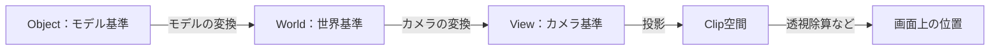

# 補足：座標・法線・UV・色の基礎

[シラバス](../index.md) ｜ 章の課題：3章の課題（準備中）

## 概要

---

!!! note "準備中"
    講義資料の初稿です。説明用のコードは演習シーンへの組み込み・動作確認前です。画面写真と配布シーンの対応は確定後に更新します。

Shaderの線をつないでも結果がおかしいとき、計算式より「どの空間の値か」「何を表す数値か」が原因になることがあります。この補足では、グラフィックスの共通語を整理します。

## 座標系を揃える

---

机の右側と、部屋の右側は同じ方向とは限りません。モデルの座標はObject空間、シーン全体の座標はWorld空間、カメラ基準はView空間です。位置や向きを足す・比較する前に、同じ空間へ変換します。

モデルを回したとき、Object空間の上方向はWorld空間の上方向とずれることがあります。Shader GraphでPositionとNormalを組み合わせる場合も、空間を揃えて考えます。

## 法線と内積

---

法線は面がどちらを向いているかを表す方向です。正規化した法線Nと、表面から光へ向かう方向Lの内積 `N・L` は、向きの揃い具合を表します。

| 関係 | 内積の値 | 拡散反射の簡略モデル |
| --- | --- | --- |
| 同じ向き | 1 | 強く光を受ける |
| 直角 | 0 | その光からの寄与は0 |
| 反対向き | -1 | `max(0, N・L)` で負の値を切る |

これは影、間接光、材質のすべてを含む式ではありません。まず角度によって明るさが変わる理由を理解するためのモデルです。

## UV は画像を読む位置

---

UVは、テクスチャのどこを読むかを示す2次元座標です。通常の0〜1の範囲を超えたときに繰り返すか端で止めるかは、Wrap設定で決まります。

`uv' = uv × tiling + offset` とすれば、拡大縮小と移動をまとめて表せます。`offset = speed × time` にすると毎フレーム読む場所が変わります。テクスチャそのものを書き換える必要はありません。

## 色と明るさの数値

---

画面に保存するsRGBの値と、光の計算に使うLinearの値は同じ間隔ではありません。単純に見た目の色の数値を足すことと、光量を足すことを区別します。色の画像と、法線・マスクなど数値として読む画像でも、インポート時の扱いは異なります。

HDRは1を超える明るさも途中の計算へ保持する仕組みです。最終画面ではTonemappingなどで表示範囲に収めます。「値が1を超えたから間違い」とは限りません。

!!! note "画像準備中：UVと法線"
    自作の番号付きUVチェック画像をQuadと球に貼り、法線の向きを矢印で示した比較を配置します。位置・UV・法線を同じものとして扱わないことが観察点です。予定画像：`images/uv-normal-comparison.png`。

このページの用語は[Shader](shader.md)、[Skybox](skybox.md)、[Rendering Pipeline](srp.md)へ戻ったときに参照してください。

[シラバス](../index.md) ｜ 章の課題：3章の課題（準備中）
