# グラフィックス基礎① Lighting

[シラバス](../index.md) ｜ 章の課題：3章の課題（準備中）

## 概要

---

!!! note "準備中"
    講義資料の改訂初稿です。画面写真と配布シーンの最終照合はこれから行います。

同じモデル、同じ配置でも、光の置き方ひとつで「昼の広場」にも「不気味な地下室」にもなります。
ライティングは飾りではなく、**世界観そのものを決める工程**です。

一方で、光の計算はとても重い処理です。光の数を増やすほど、毎フレームの計算が増えていきます。
この単元では、光の**見た目**と**コスト**の両方を見ていきます。

Unity の Light の種類と、ライトを受ける側（Material・MeshRenderer）の設定を確認し、
**リアルタイムで計算する光**と**事前に焼き付ける（Bake する）光**を使い分けられるようになることが目標です。

## 演習の準備

---

| 用途 | シーン |
| --- | --- |
| **使用シーン** | `Assets/Application/Section3-Graphics/Lighting/Lighting.unity` |
| **完成見本** | 同シーンの比較用グループ。独立した `_Sample` は未確認 |

シーンには、テーマごとに GameObject のまとまり（グループ）が置いてあります。**最初はすべて非アクティブ**です。
見たいテーマのグループだけをアクティブにして、1つずつ確認していきます。

| グループ | 中身 | 使う節 |
| --- | --- | --- |
| `SampleSpheres` | Directional Light と、設定違いの球4つ | [Directional Light](#directional-light)・[ライトを受ける側の設定](#lit-unlit)・[Cast Shadows](#cast-shadows) |
| `Plane` | 地面（Static） | `PointLight` と一緒にアクティブにする |
| `PointLight` | Point Light 2つ | [Point Light](#point-light)・[ライティングを Bake する](#bake) |
| `SpotLight` | Spot Light と球 | [Spot Light](#spot-light) |
| `AreaLight` | Area Light 2つと球 | [Area Light](#area-light) |
| `Reflection Probe` | Reflection Probe・鏡面の地面・Static あり／なしの Cube | [Reflection Probe](#reflection-probe) |

> 1つのグループを見終わったら、非アクティブに戻してから次のグループを開いてください。
> 複数のグループを同時に開くと、光が混ざってどの設定の結果なのか分からなくなります。

## 授業の進め方

---

1. Light の種類と、Lighting まわりの用語を確認する。
2. `SampleSpheres` で、**光を受ける側**の設定（Lit / Unlit、Cast Shadows）による違いを見る。
3. Point・Spot・Area の各ライトを置き、光り方の違いを比べる。
4. `PointLight` のライトを Bake し、ライトを消しても光が残ることを確かめる。
5. `Reflection Probe` で、周りの景色が映り込む床を作る。

---

## 光が届いて、目へ戻るまで

---

物体の色は、Materialの色だけでは決まりません。入ってくる光、面の向き、材質による反射、周囲からの回り込みが重なって決まります。これは現実の撮影や他の3Dソフトでも共通する関係です。

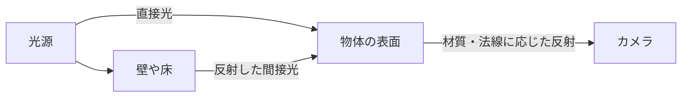

光源から直接届く光に加え、壁や床で反射して届く光があります。影の中が完全な黒にならない理由の1つが、この間接光です。リアルタイムとBakeの違いは、こうした計算のどの部分をいつ行うかにあります。

### 陰と影を分けて見る

---

球の面が光と反対を向いて暗くなることと、別の物体が光を遮って地面に影を落とすことは別の原因です。Litの陰影、Cast Shadows、Receive Shadowsを分けて確認すると、何を切り替えた結果かを説明できます。

比較ではカメラと露出を固定し、ライト・Material・影の設定のうち1つだけ変えます。[Light Modes](https://docs.unity3d.com/6000.3/Documentation/Manual/LightModes.html)も参照してください。

## Light の種類

---

Hierarchy で右クリック → **Light** から作成できます。

| ライト | 光り方 | 現実でいうと |
| --- | --- | --- |
| **Directional Light** | シーン全体に、同じ向きから光を当てる | 太陽 |
| **Point Light** | 1点から全方向に光を広げる | 電球・街灯 |
| **Spot Light** | 1点から円錐の形に光を当てる | 懐中電灯・舞台のスポットライト |
| **Area Light** | 面から光を出す | 天井の蛍光灯パネル・窓から入る光 |
| 2D Light | 2D 用（この単元では扱わない） | — |

### Lighting 関連の用語

---

| 用語 | 意味 |
| --- | --- |
| **Lit / Unlit** | 光の影響を受ける Material かどうか |
| **Shadow** | 影 |
| **Bake** | ライティングの計算を、制作中に一度だけ行って結果を保存しておくこと |
| **Reflection Probe** | 周りの景色の映り込み（反射）を作る仕組み |
| **Light Probe** | 動くオブジェクトにも、Bake した光を当てる仕組み |

---

## Directional Light

---

**`SampleSpheres` をアクティブにして**、中の `Directional Light` を選んでください。

Directional Light は、シーン上の**すべての GameObject に、同じ向きから光を当てます。** 太陽光のようなものです。
**位置は関係なく、回転（光の向き）だけが効きます。** Rotation を変えて、球の明るい面と影の向きが変わることを確かめてください。

ライトには **Mode** の設定があります。

| Mode | 内容 |
| --- | --- |
| **Realtime** | ゲーム中、毎フレームライティングを計算する。ライトや物を動かすと光と影も動く |
| **Baked** | 制作中に一度だけ計算して保存する（[Bake](#bake)）。実行時は保存データを参照する。配置や光を変更したら再Bakeが必要 |
| **Mixed** | 直接光・間接光・影をリアルタイムとBakeで分担する。詳細はMixed Lightingのモードによる |

> Directional Light は**シーン全体を照らす主光源**なので、キャラクターの影を動かすために **Realtime** で使うことが多いです。
> それ以外のライトで、**動かない物を照らすもの**は、基本的に Bake をおすすめします。

---

## ライトを受ける側の設定（Lit / Unlit） { #lit-unlit }

---

`SampleSpheres` の4つの球は、**ライトはまったく同じで、受ける側の設定だけ**が違います。

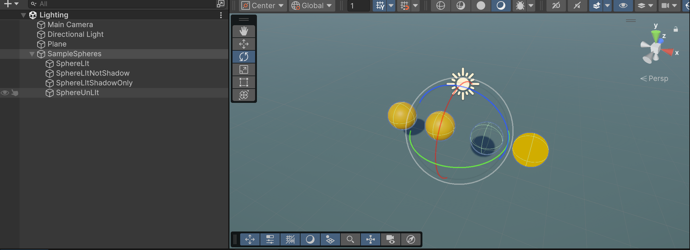

| 球 | Material | MeshRenderer の Cast Shadows |
| --- | --- | --- |
| `SphereLIt` | `SphereLit`（Lit） | On |
| `SphereLItNotShadow` | `SphereLit`（Lit） | Off |
| `SphereLItShadowOnly` | `SphereLit`（Lit） | Shadows Only |
| `SphereUnLIt` | `SphereUnLit`（Unlit） | On |

**Lit / Unlit** は、その Material が**光の影響を受ける Shader** を使っているかどうかです。
Lit は光の向きに応じて明るい面と暗い面ができ、立体に見えます。Unlit は光を計算しないので、**のっぺりとした円**に見えます。

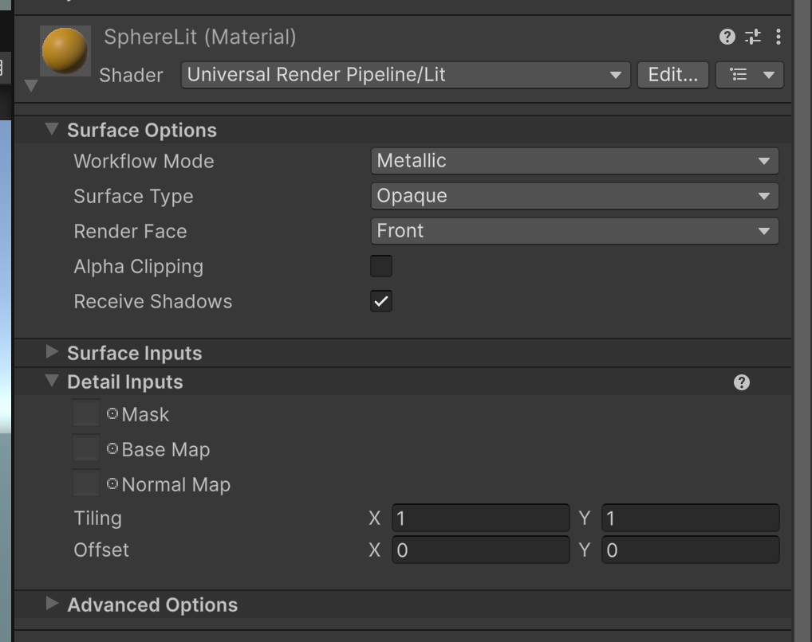

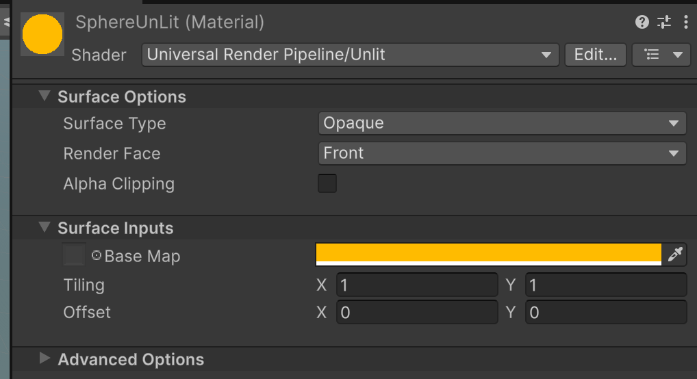

2つの Material の Inspector を見比べてください。**Shader が違うと、Material で設定できる項目そのものが変わります。**
Unlit は設定項目が少なく軽い反面、立体感は出ません。UI やエフェクト、あえて陰影を付けない表現に使います。

> Shader が「光をどう計算するか」を決めている、という話は次の単元 [Shader](shader.md) で扱います。

---

## Cast Shadows

---

**MeshRenderer** コンポーネントの **Lighting → Cast Shadows** で、そのオブジェクトが**影を落とすかどうか**を決めます。

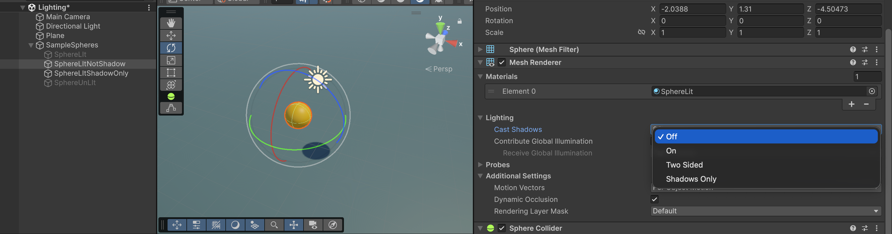

| 設定 | 結果 |
| --- | --- |
| **On** | 影を落とす |
| **Off** | 影を落とさない。地面に影ができない |
| **Shadows Only** | メッシュが消えて、**影だけ**が残る |

Shadows Only は、見た目は別の簡単なモデルで出し、影だけ本物の形で落とす、といった使い方ができます。

---

## Point Light

---

`SampleSpheres` を非アクティブに戻し、**`PointLight` と `Plane`（地面）をアクティブにしてください。**

Point Light は、1点から全方向に光を広げます。現実でいうと、**電球や街灯**です。
**Range**（光が届く距離）と **Intensity**（明るさ）を変えて、照らされる範囲がどう変わるか見てください。

## Spot Light

---

**`SpotLight` をアクティブにしてください。**

特定の対象に光を当てたいときに使います。**懐中電灯や、ライブ会場のスポットライト**です。
**Spot Angle**（円錐の広がり）を変えると、照らす範囲の形が変わります。

## Area Light

---

**`AreaLight` をアクティブにしてください。**

Area Light は**面から光を出す**ライトです。窓や天井の照明パネルのように、
Point Light よりも柔らかく、広がりのある光を表現できます。

> ⚠️ **URP の Area Light は Bake 専用です。** Bake するまでは、置いても何も光りません。
> Area Light を置いたら、次の節の手順で Bake して確かめてください。

---

## ライティングを Bake する { #bake }

---

**`PointLight` と `Plane` だけをアクティブにした状態**で進めます。

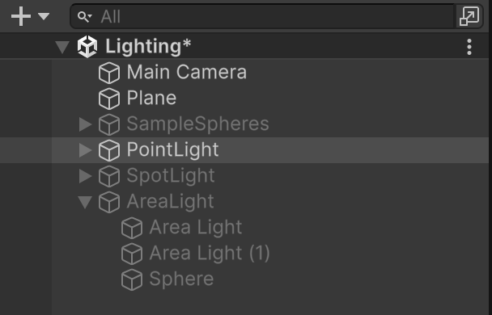

1. **Window → Rendering → Lighting** で Lighting ウィンドウを開く

    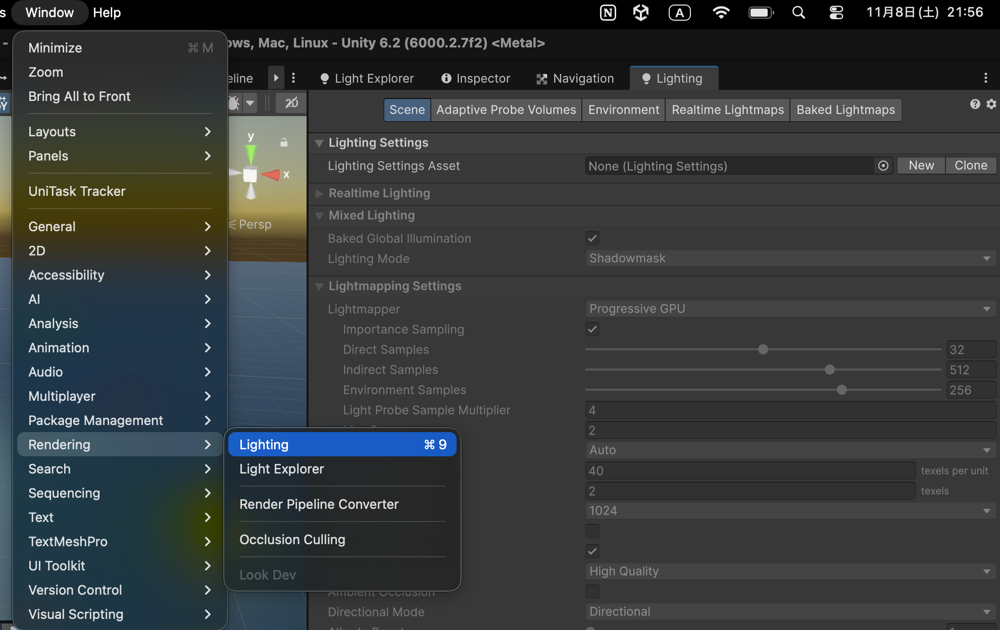

2. **Scene** タブの一番下にある **Generate Lighting** を押す

    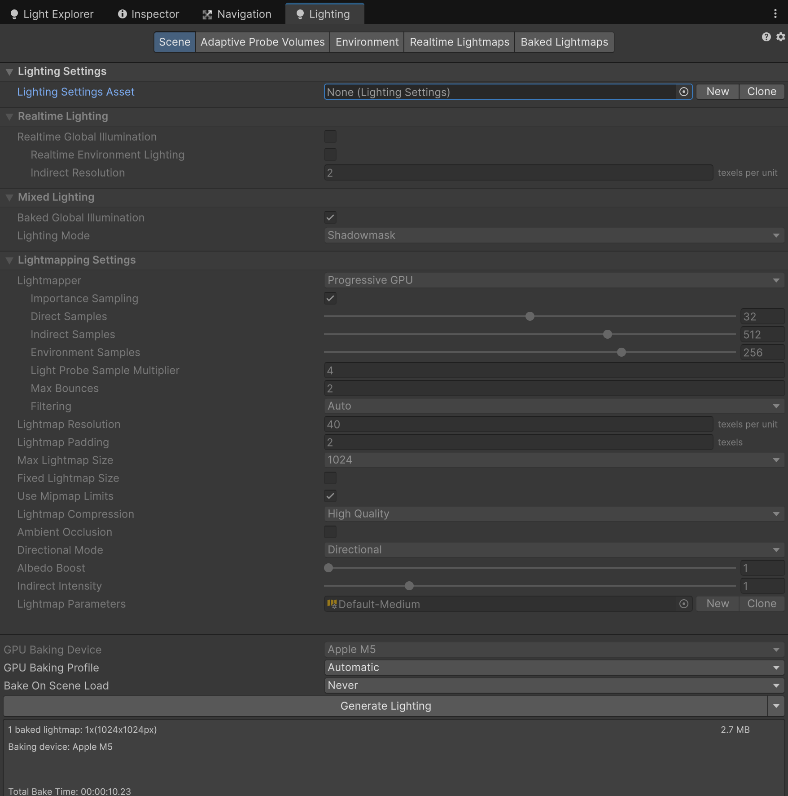

3. Bake が終わったら、`PointLight` の中の **Point Light を非アクティブにする**
4. **ライトを消したのに、地面が光ったまま**になっていることを確認する

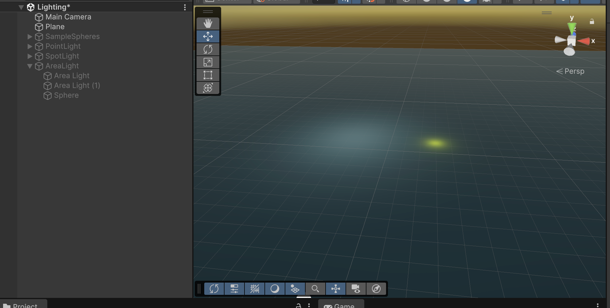

これが Bake です。光の計算結果が、**地面のテクスチャ（ライトマップ）として焼き付けられた**ので、
ライトそのものが無くても光が残ります。

### なぜ Bake するのか

---

Bakeすると、重い照明計算の一部を制作時に済ませられます。ゲーム中にもライトマップの読み出しや材質との合成は行うため、計算が完全になくなるわけではありません。
光が何度も跳ね返る柔らかい明るさ（間接光）のように、リアルタイムでは重すぎる計算も、Bake なら使えます。

そのかわり、**焼き付けた光と影は動きません。** 動くオブジェクトに Bake の光を使うと、
物が移動しても影が元の場所に残る、といった不自然な見た目になります。

| | リアルタイム | Bake |
| --- | --- | --- |
| ゲーム中の計算 | 照明をその場で計算 | 保存結果の参照・合成など |
| ライトや物を動かす | 光と影がついてくる | 光と影が残ったまま |
| 向いているもの | キャラクター・動く物・太陽 | 地形・建物などの動かない物 |

> キャラクターなど動く物は Directional Light のリアルタイムの光と影で照らし、
> 地形や建物のような動かない物には Bake を使う、という組み合わせが基本です。

### Bake の対象になるもの

---

ライトマップへ焼くメッシュでは、**Contribute GI**に加え、Rendererの**Receive Global Illumination**、ライトマップ用UVなどを確認します。動く物体へ間接光を渡す場合は、後述のProbeを使います。
地面が光らないときは、まずここを確認してください。

### Bake したデータの扱い

---

Bake すると、**Scene ファイルと同じ階層に、Scene と同じ名前のフォルダ**が作られます。
このシーンなら `Section3-Graphics/Lighting/Lighting/` です。中には `LightingData.asset` とライトマップの画像が入っています。

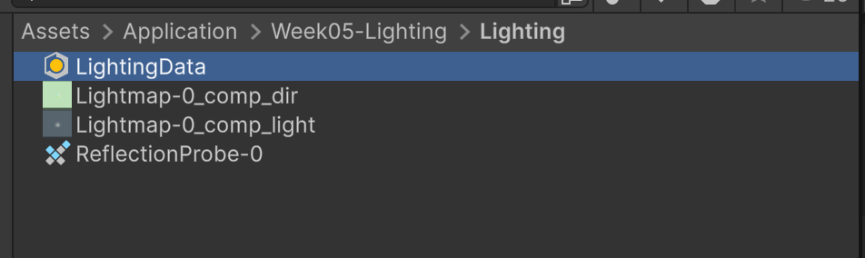

> ⚠️ **Bake した結果は、ライトを動かしても変わりません。** 焼き付けた時点の光のままです。
> ライトの位置や色を変えたら、もう一度 **Generate Lighting** を押してください。

Bake した光を消したいときは、Lighting ウィンドウの **Generate Lighting** 横の ▼ から **Clear Baked Data** を選びます。
削除・更新されるのは生成したライティングデータです。フォルダ内の他のアセットまで削除されるとは限らないため、Projectウィンドウで結果を確認します。

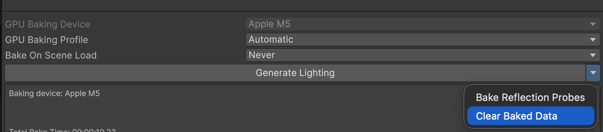

---

## Reflection Probe

---

**`Reflection Probe` をアクティブにしてください。**

Reflection Probe は、**周りの景色を撮影して、反射として映り込ませる**コンポーネントです。
金属や水面のような、周りが映り込む表現に使います。

Hierarchy で右クリック → **Light → Reflection Probe** で作成できます。

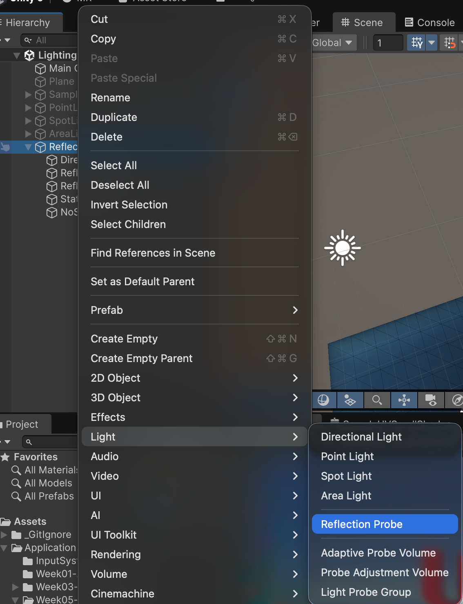

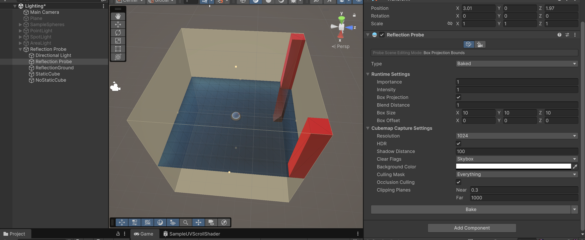

Scene ビューで**薄い黄色の箱**で表示されている範囲が、Reflection Probe が影響する範囲です。

### 映り込ませるもの：Static

---

Reflection Probe に**映り込む側**のオブジェクトは、このBaked Probeの例では、**Reflection Probe Static**を確認します。CustomやRealtimeでは取り込み方が異なり、すべてのProbeに共通する条件ではありません。
シーンの `StaticCube` と `NoStaticCube` を見比べてください。床に映るのは `StaticCube` だけです。

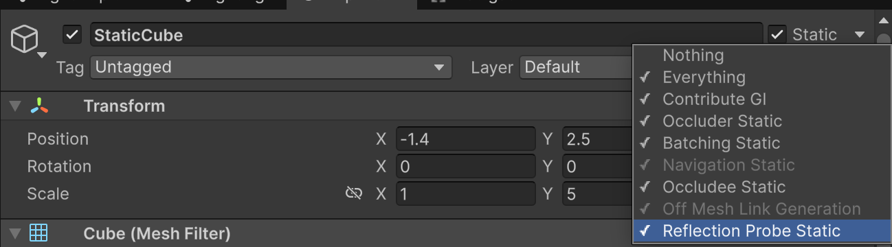

### 映り込みを受けるもの：Metallic と Smoothness

---

**映り込みを受ける側**（このシーンでは床の `ReflectionGround`）は、Material を鏡のような設定にします。
Smoothnessを上げると反射が鋭くなり、低いと広がります。Metallicは金属か非金属かという材質の違いを表し、単なる「反射の強さ」ではありません。非金属にも反射はあります。

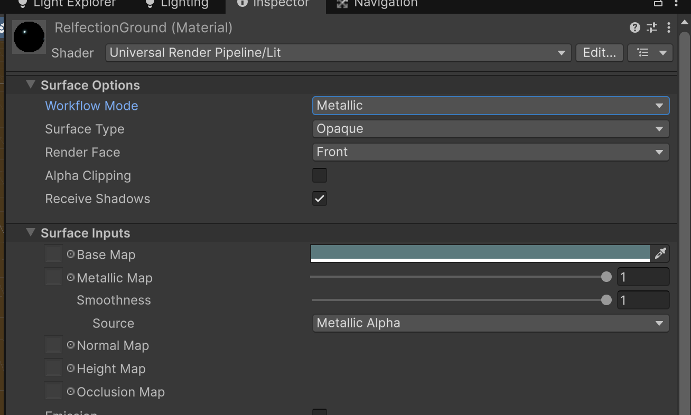

> Reflection Probe も、初期設定（Type：Baked）では **Bake したときに景色を撮影**します。
> 設定が終わったら、最後に Generate Lighting を押してください。

---

## Light Probe（紹介）

---

この単元では扱いませんが、**動くオブジェクトにも Bake した光を当てる**仕組みとして Light Probe があります。
Bake した地形の明るさを、空間のあちこちに置いた「点」で記録しておき、キャラクターがその近くを通ると同じ明るさで照らします。

Unity 6 からは、点を自動で配置してくれる **Adaptive Probe Volumes** も使えます。3D のステージを作るときに調べてみてください。

- [Unity 6 で新たなグローバルイルミネーションを適用する方法（Unity ブログ）](https://unity.com/ja/blog/engine-platform/new-ways-of-applying-global-illumination-in-unity-6)

---

## 🧯 よくある詰まり

---

| 症状 | 原因と対処 |
| --- | --- |
| Area Light を置いても**何も光らない** | URP の Area Light は Bake 専用。Generate Lighting を押す |
| Bake したのに**地面が光らない** | 地面の **Static（Contribute GI）** にチェックが入っていない |
| ライトを動かしても**光が変わらない** | Mode が Baked。もう一度 Bake するか、Realtime に変える |
| キャラクターが動くと**影が元の場所に残る** | 動く物に Bake の影を使っている。動く物は Realtime の光で照らす |
| 床に**何も映り込まない** | 映る側に Reflection Probe Static がない／床の Metallic・Smoothness が低い／Bake していない |
| 光と影が**入り混じって、何の結果か分からない** | 演習シーンのグループを複数同時に開いている。1つずつ開く |

---

## 🎬 お手本（DemoGame）で見るところ

---

灯が点いていないときの冷たい色の塔と、灯を点けたあとの暖かい色の塔。
**明るさの変化が、そのまま進行度の表示になっている**のを確認してください。

> `Assets/_DemoGame/` は、各章の内容をすべて使った**完成形の参考展示**です。授業中に編集はしません。

---

## まとめ

---

- Directional Light は**シーン全体を照らす主光源**。位置ではなく**向き**が効く
- 光の見た目は、ライトだけでなく**受ける側（Material・MeshRenderer）**の設定でも決まる
- **動かない物**を照らす光は、基本的に **Bake** する
- **Reflection Probe** は、周りの景色の映り込みを作る

---

## 🔗 参考リンク

---

- [Lighting（Unity Manual）](https://docs.unity3d.com/Manual/LightingOverview.html)
- [Light コンポーネント](https://docs.unity3d.com/Manual/class-Light.html)
- [Reflection Probes](https://docs.unity3d.com/Manual/ReflectionProbes.html)

---

[シラバス](../index.md) ｜ 次の単元：[SkyBox](skybox.md)
