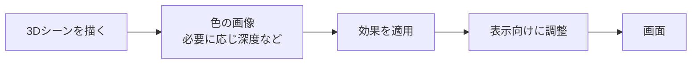

# グラフィックス基礎③ PostProcess：画像として仕上げる

[シラバス](../index.md) ｜ 章の課題：3章の課題（準備中）

## 概要

---

!!! note "準備中"
    講義資料の初稿です。説明用のコードは演習シーンへの組み込み・動作確認前です。画面写真と配布シーンの対応は確定後に更新します。

光る看板を置いても明るさが伝わらない、背景に視線が散って主人公を見失う。こうした問題では、物体ごとの設定に加え、描画した画像全体の調整が役立ちます。

**PostProcessは描画結果を入力画像として加工する処理**です。写真の露出補正や色調整にも通じる考え方ですが、ゲームではフレームごとに処理するため計算量も意識します。

## 画像をもう一度計算する

---

PostProcessから見れば、入力の主役は画面上の画像です。効果によっては深度や動きの情報も使います。実際の適用順やUIを含む範囲は描画設定で異なるため、この図は概念的な流れです。

## 効果の目的を先に決める

---

| 効果 | 基本の仕組み | 観察すること |
| --- | --- | --- |
| Bloom | 明るい部分を抽出してぼかし、周囲へ広げる | 発光感が出るか、細部が白くつぶれないか |
| Vignette | 画面周辺の明るさなどを変える | 中央を見やすくできるか、UIを妨げないか |
| Color Adjustments | 露出・彩度・コントラストなどを調整 | 大事な対象を区別できるか |
| Tonemapping | HDRの明るさを表示範囲へ圧縮する | 明部の情報が残るか |
| Depth of Field | 深度に応じて焦点外をぼかす | 見せたいものへ焦点が合っているか |

Bloomは周辺の物体を実際に照らすライトの代わりにはなりません。発光面の周りが画像上でにじむことと、床が光を受けることは別です。URPの対応機能は[公式のPostProcess概要](https://docs.unity3d.com/6000.3/Documentation/Manual/urp/post-processing-in-urp.html)で確認できます。

## Volume と Profile

---

Volumeは「どこで・どの強さで設定を適用するか」、Profileは「どの効果をどんな値にするか」を持ちます。Profileを複数のVolumeで共有すると、Profileの編集が複数箇所へ影響することがあります。

| 設定 | 意味 |
| --- | --- |
| Global | 空間全体への適用候補になる |
| Local | Colliderで定義した領域と、その周辺に適用する |
| Weight | 設定の寄与の強さ |
| Priority | 重なったVolumeを評価する優先順に関わる |
| Blend Distance | Localの外側でなじませる距離 |
| Overrideのチェック | 個々のパラメータを上書き対象にする |

Local Volumeの判定はVolume Triggerとして使うTransformの位置に依存します。プレイヤーが領域に入っても、Triggerがカメラで外に残っていると、想定した効果にならない場合があります。

## 演習の準備

---

| 用途 | シーン |
| --- | --- |
| **使用シーン** | `Assets/Application/Section3-Graphics/PostProcess/PostProcess.unity` |
| **完成見本** | 同シーン内の設定を参照。独立した `_Sample` は未確認 |

以下は確認手順の初稿です。撮影前に配布シーンのProfileとカメラ設定を照合します。

1. カメラのPost Processingが有効か、Volumeを読むLayer Maskが正しいか確認する。
2. VolumeのWeightを0と1で切り替え、無加工の画面と比較する。
3. Bloomだけを有効にし、ThresholdとIntensityを順に変える。
4. Vignetteを追加し、暗くなった場所で敵やUIが見えなくならないか確認する。
5. 最後に同じ構図の画像を並べ、どの変更が目的に効いたか説明する。

!!! note "画像準備中：効果の比較"
    同一フレーム・同一露出で、効果なし／Bloomのみ／Vignetteのみ／併用を撮影します。Profileの値も添えます。予定画像：`images/postprocess-four-views.png`。

## 見た目と負荷の両方を見る

---

解像度が上がると加工する画素が増えます。周辺画素を何度も読むぼかしや、複数の中間画像を使う処理には計算・メモリの負担があります。Editorの見た目だけで判断せず、対象端末のGPU時間で確認します。

効果を増やして画面が分かりにくくなったら、まず全部を外してLightingとMaterialを確認します。暗すぎる地形や読めない文字を、別の効果で埋め合わせ続けないことが大切です。

## 関連資料

---

- [補足：座標・法線・UV・色](coordinates-color.md)
- [Rendering Pipeline](srp.md)

[シラバス](../index.md) ｜ 章の課題：3章の課題（準備中）
