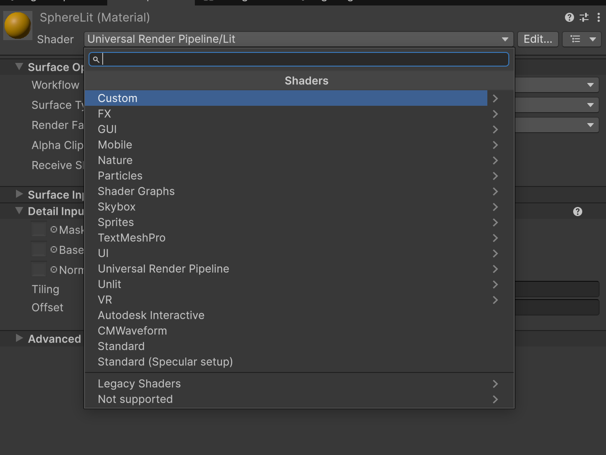
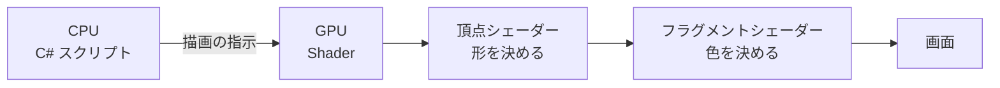
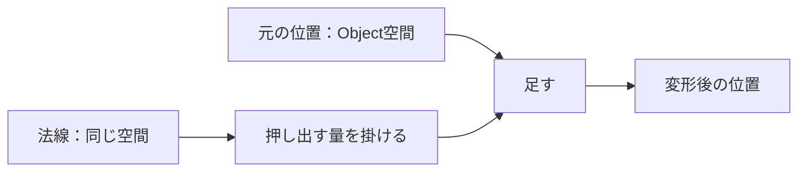
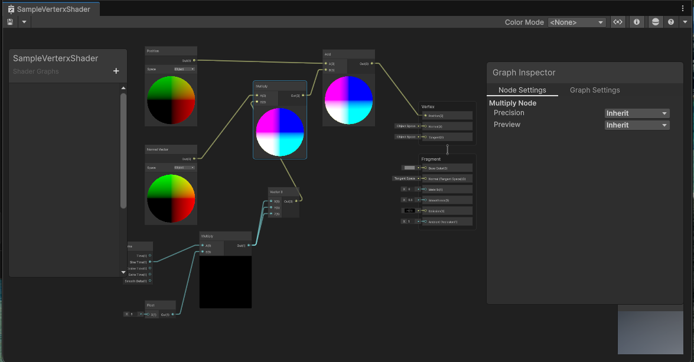
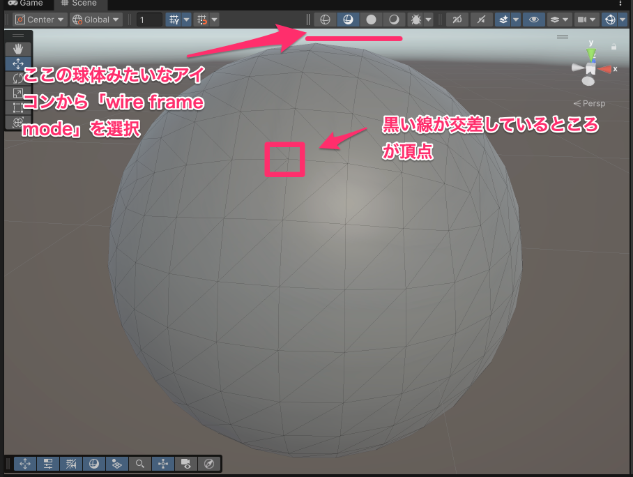
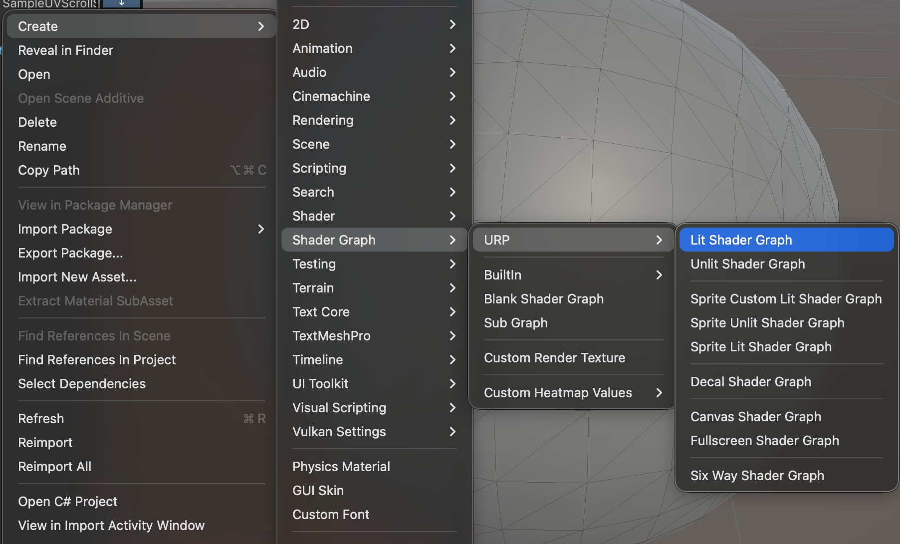
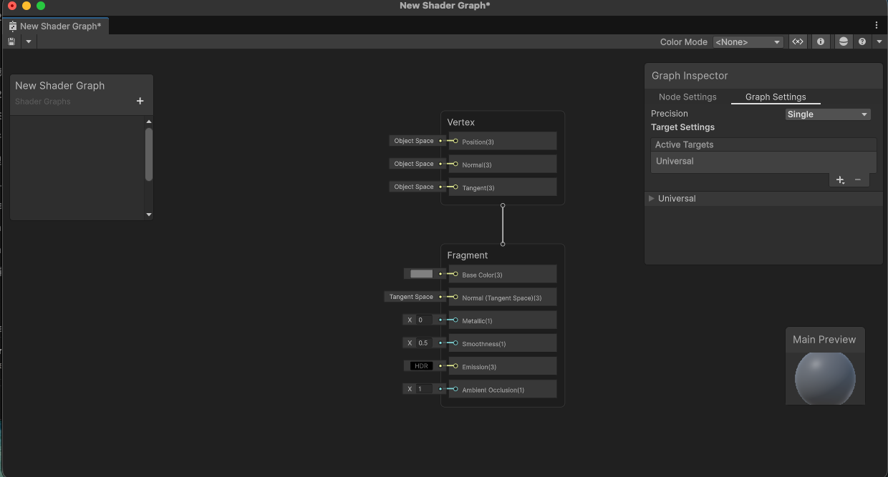
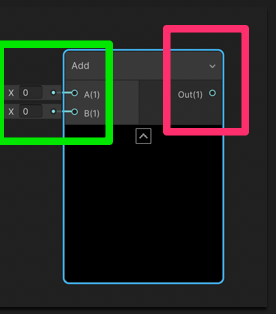
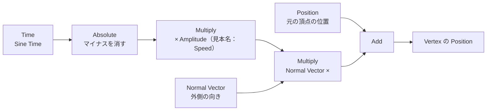

# グラフィックス基礎② Shader

[シラバス](../index.md) ｜ 章の課題：3章の課題（準備中）

## 概要

---

!!! note "準備中"
    講義資料の改訂初稿です。画面写真と配布シーンの最終照合はこれから行います。

[Lighting](lighting.md) では「**光をどう置くか**」を見ました。
この単元は「**その光を受けて、どう色を計算するか**」の話です。Lit と Unlit で見た目が違ったのも、Shader が違ったからです。

Shader が「GPU で、形と色を決めるプログラム」であることを理解し、
Shader Graph で**頂点シェーダー（形を変える）**と**フラグメントシェーダー（色を変える）**を1つずつ作れるようになることが目標です。

この単元は**入り口の案内**です。深くは扱いません。
Shader は Unity だけの機能ではなく、他のゲームエンジンや Blender・Maya などのツールにも同じ考え方で存在します。

## 演習の準備

---

| 用途 | シーン |
| --- | --- |
| **使用シーン** | `Assets/Application/Section3-Graphics/ShaderBasics/ShaderSample.unity` |
| **完成見本** | 同シーンの見本Material・Shader Graph。独立した `_Sample` は未確認 |

| 素材 | 場所（`Assets/Application/Section3-Graphics/ShaderBasics/`） | 使う節 |
| --- | --- | --- |
| `SampleVerterxShader.shadergraph` | 球を膨らませる頂点シェーダーの見本 | [頂点シェーダーで球を膨らませる](#vertex-sample) |
| `WavePlane`（シーン内・非アクティブ） | 板を波打たせる頂点シェーダーの見本（`SampleWaveShader`） | [頂点シェーダーで球を膨らませる](#vertex-sample) |
| `UVScroller`（シーン内・非アクティブ） | テクスチャの表示位置をずらすフラグメントシェーダーの見本（`SampleUVScrollShader`） | [フラグメントシェーダー](#fragment) |
| `CustomUVChecker_byValle_4K.png` | UV の位置が分かるテクスチャ | [フラグメントシェーダー](#fragment) |

> 見本は**答え**です。まず自分で作ってから、うまくいかないときに開いて見比べてください。

## 授業の進め方

---

1. Shader とは何か、CPU と GPU の違いから確認する。
2. Shader の作り方（Shader Graph と HLSL）を比べる。
3. Wireframe 表示で、モデルが**頂点と辺**でできていることを確認する。
4. Shader Graph で、**頂点シェーダー**を一緒に作る（球を膨らませる）。
5. **フラグメントシェーダー**で、テクスチャの表示位置を動かす（UV Scroll）。ここはヒントをもとに自分で考えて作る。

---

## Shader とは？

---

Shader は、画面上の**描画処理を制御するプログラム**で、主に **GPU** で動きます。
ざっくり言えば、**オブジェクトに色をつけたり、形を変化させたりするもの**です。

Unity にはすでに多くの Shader が入っていて、皆さんもすでに使っています。
Material の Inspector の一番上にある **Shader** の欄がそれです。



> **Material 1つにつき、Shader が必ず1つ付いています。**
> Material は「Shader に渡す値（色・テクスチャ・数値）をまとめたもの」です。

Shader でできることは、大きく2つです。

| ステージ | 役割 |
| --- | --- |
| **頂点シェーダー（Vertex Shader）** | 頂点の位置を動かして、**形**を決める |
| **フラグメントシェーダー（Fragment Shader）** | ラスタライズで生成されたフラグメントについて、**色や陰影**などを計算する |

この授業では通常のメッシュ描画に使う2つの段階に絞ります。頂点処理とフラグメント処理の間にはラスタライズがあります。GPUにはCompute Shaderなど別の用途もあり、この2つがShader全体の限界ではありません。

### 補足：CPU と GPU の違い

---

| | 実行するもの | 得意なこと |
| --- | --- | --- |
| **CPU** | C# のスクリプトなど | 1つ1つの処理が速い。複雑な判断をこなす |
| **GPU** | 描画（Shader） | 単純な計算を、**大量に同時に**こなす |

車で例えると、**CPU はスポーツカー**（乗れる人数は少ないが速い）、**GPU はバス**（たくさんの人をまとめて運ぶ）です。
画面には何十万個もの頂点とピクセルがあり、そのすべてに同じ計算をします。だから GPU の出番です。



---

## 値の流れとして読む

---

Shader Graphは、値を入力して計算し、結果を次の計算へ渡す図です。画面のどこを見ても、まず「位置なのか、方向なのか、色なのか」を確認します。同じ3つの数値でも、意味が違えば足してよいとは限りません。



法線へ距離を掛けると、移動量になります。それを元の位置へ加えて、新しい位置を作ります。位置と法線の空間を揃える理由は[補足：座標・法線・UV・色](coordinates-color.md)で説明します。

頂点Shaderで動かした見た目は、通常そのままCPU側のColliderを変形しません。波打つ床を作る場合には、接触判定も別途考える必要があります。また、元のBoundsの外へ大きく変形すると、カリングによって消えることがあります。

## Shader の作り方

---

Unity で Shader を作る方法は、主に2つあります。

| 方法 | 内容 |
| --- | --- |
| **Shader Graph** | ノード（処理の箱）をつないで作る。見た目で確認しながら作れる |
| **HLSL** | `.shader` ファイルに、HLSL というプログラミング言語で書く |

**この単元では Shader Graph を使います。**

> HLSL で書く方法は難易度が高く、数学の知識もそれなりに必要です。
> ただし「そういう世界がある」ことは知っておいてください。

### 例：Shader Graph

---

処理のまとまり（ノード）をつなぎ合わせて Shader を作ります。



### 例：HLSL

---

```c
Shader "Custom/NewUnlitUniversalRenderPipelineShader"
{
    Properties
    {
        [MainColor] _BaseColor("Base Color", Color) = (1, 1, 1, 1)
        [MainTexture] _BaseMap("Base Map", 2D) = "white"
    }

    SubShader
    {
        Tags { "RenderType" = "Opaque" "RenderPipeline" = "UniversalPipeline" }

        Pass
        {
            HLSLPROGRAM

            #pragma vertex vert
            #pragma fragment frag

            #include "Packages/com.unity.render-pipelines.universal/ShaderLibrary/Core.hlsl"

            struct Attributes
            {
                float4 positionOS : POSITION;
                float2 uv : TEXCOORD0;
            };

            struct Varyings
            {
                float4 positionHCS : SV_POSITION;
                float2 uv : TEXCOORD0;
            };

            TEXTURE2D(_BaseMap);
            SAMPLER(sampler_BaseMap);

            CBUFFER_START(UnityPerMaterial)
                half4 _BaseColor;
                float4 _BaseMap_ST;
            CBUFFER_END

            Varyings vert(Attributes IN)
            {
                Varyings OUT;
                OUT.positionHCS = TransformObjectToHClip(IN.positionOS.xyz);
                OUT.uv = TRANSFORM_TEX(IN.uv, _BaseMap);
                return OUT;
            }

            half4 frag(Varyings IN) : SV_Target
            {
                half4 color = SAMPLE_TEXTURE2D(_BaseMap, sampler_BaseMap, IN.uv) * _BaseColor;
                return color;
            }
            ENDHLSL
        }
    }
}
```

> 読めなくて構いません。**`vert`（頂点）と `frag`（フラグメント）という2つの関数があること**だけ見てください。
> Shader Graph でやっていることも、中身はこれと同じです。

---

## 頂点シェーダー（Vertex Shader）

---

ここで扱うメッシュは、**頂点（Vertex）**と、それらをつなぐ三角形などの面でできています。Wireframeでは面の**辺（Edge）**が見えます。
頂点シェーダーは、この**頂点1つ1つの位置を動かして、形を変えます。**

Scene ビュー左上の描画モードを **Wireframe** に切り替えて、頂点と辺を見てください。



> 頂点が少ないモデル（ローポリ）は、頂点シェーダーで動かしてもカクカクにしか曲がりません。
> 頂点シェーダーで形を変えるなら、**動かしたい細かさに見合った頂点数**が要ります。
> `UVScroller`（Quad、頂点4つ）と `WavePlane`（Plane、頂点121個）を Wireframe で見比べてください。

---

## Shader Graph で Shader を作成する

---

Project ウィンドウで右クリック → **Create → Shader Graph → URP → Lit Shader Graph** を選びます。



作った Shader Graph を選び、Inspector の **Open Shader Editor** を押すと、編集ウィンドウが開きます。



右端の **Vertex** と **Fragment** の2つの箱が、それぞれ頂点シェーダーとフラグメントシェーダーの出口です。
ここにつないだ値が、形と色になります。

作った Shader Graph を Project ウィンドウで右クリック → **Create → Material** すると、その Shader を使った Material ができます。
Material を球などにドラッグして、結果を確認します。

### ノード（Node）の作成

---

編集ウィンドウの空いている部分を右クリック → **Create Node** で、ノードを選ぶメニューが出ます。
**ノードは、プログラミングでいう1つのメソッドのようなもの**です。

例：Add ノード（足し算）



左側の入力（A・B）がメソッドの**引数**、右側の **Out** が**戻り値**で、次のノードに渡します。
中身のコードは次のようになっています。

```c
void Unity_Add_float4(float4 A, float4 B, out float4 Out)
{
    Out = A + B;
}
```

Shader は、このノードを組み合わせて作ります。ノードの種類はとても多いので、必要になったときに [Node Library](https://docs.unity3d.com/Packages/com.unity.shadergraph@17.3/manual/Node-Library.html) で探してください。

---

## 頂点シェーダーで球を膨らませる { #vertex-sample }

---

球が、**時間に合わせて膨らんだり縮んだり**する Shader を一緒に作ります。

考え方は「**それぞれの頂点を、外側（法線の向き）へ押し出す**」です。
押し出す量を時間で変えれば、膨らんだり縮んだりします。



| ノード | 役割 |
| --- | --- |
| **Position** | 元の頂点の位置 |
| **Normal Vector** | 頂点の外側の向き（法線） |
| **Time**（Sine Time） | 時間とともに -1〜1 を行き来する値 |
| **Absolute** | マイナスを消す（縮みすぎて裏返らないように） |
| **Multiply** | 押し出す量 × 向き |
| **Add** | 元の位置に、押し出す分を足す |

押し出す量を調整できるように、Blackboard（左上）にFloatのプロパティを作ります。見本では`Speed`という名前ですが、この位置で掛けている値は**速度ではなく振幅**です。新しく作る場合は`Amplitude`とすると役割が伝わります。速度を変えるには、Timeを倍率で変えてからSineへ渡します。

> 見本：`SampleVerterxShader.shadergraph`
> 同じ考え方で、`WavePlane` は「頂点の位置によって押し出す量を変える」ことで板を波打たせています。

---

## フラグメントシェーダー（Fragment Shader） { #fragment }

---

フラグメントシェーダー（**ピクセルシェーダー**ともいいます）は、ラスタライズでできたフラグメントの色などを計算します。重なりや深度テストがあるため、1回の計算結果が必ずそのまま最終画面の1画素になるわけではありません。
テクスチャを貼る、色を混ぜる、といった処理はここで行います。

ここでは、テクスチャの表示位置をずらす **UV Scroll** を作ります。

### UV 座標

---

テクスチャのどこを、モデルのどこに貼るかは **UV 座標**で決まっています。
UV はテクスチャの左下を (0, 0)、右上を (1, 1) とした座標です。

`CustomUVChecker_byValle_4K.png` を貼った Material を Quad に付けて、どこが (0, 0) かを確認してください。

### Tiling And Offset ノード

---

**Tiling And Offset** ノードは、UV を**拡大縮小（Tiling）**したり、**ずらしたり（Offset）**します。
この UV を **Sample Texture 2D** ノードに渡すと、テクスチャの表示位置が変わります。

| 入力 | 結果 |
| --- | --- |
| **Tiling** を (2, 2) | WrapがRepeatなら縦横2回ずつ繰り返す |
| **Offset** を (0.5, 0) | テクスチャが横に半分ずれる |

**Offset に時間（Time）を渡すと、テクスチャが流れ続けます。** これが UV Scroll です。

> ここは**自分で考えて作ってください。** 詰まったら、次の順で確かめます。
>
> 1. Sample Texture 2D の出力を **Fragment の Base Color** につないで、テクスチャが表示されるか
> 2. Tiling And Offset の Offset に数値を手で入れて、テクスチャがずれるか
> 3. その数値の代わりに Time をつないで、流れ続けるか

> 見本：`UVScroller` の `SampleUVScrollShader` は、Tiling と Offset を使って**テクスチャを区画に分け、表示する区画を切り替える**ところまで作っています。
> Material の **Index** と **Divide** を変えて、何が起きるか確かめてください。

---

## 🧯 よくある詰まり

---

| 症状 | 原因と対処 |
| --- | --- |
| Shader Graph を編集したのに**見た目が変わらない** | 編集ウィンドウ左上の **Save Asset** を押していない |
| Material が**ピンク色**になる | Shader がエラーになっている／URP 用でない Shader を使っている |
| 頂点シェーダーで**形がカクカクにしか動かない** | 頂点数が少ない。頂点の多いモデル（Sphere・Plane）で試す |
| 球が**縮んで裏返る** | 押し出す量がマイナスになっている。Absolute などで 0 以上にする |
| Blackboard に作ったプロパティが**Material に出てこない** | プロパティをノードとしてグラフに置いて、どこにもつないでいない／Save していない |

---

## 🎬 お手本（DemoGame）で見るところ

---

**セルルック調**の表現。陰影が滑らかなグラデーションではなく、**2〜3段の階段状**になっていること。
これは Shader の中で「明るさをどこで区切るか」を決めることで作られています。

> `Assets/_DemoGame/` は、各章の内容をすべて使った**完成形の参考展示**です。授業中に編集はしません。

---

## まとめ

---

- Shader は、**GPU で行う描画処理を制御するもの**
- Material 1つにつき、Shader が必ず1つ付いている
- **頂点シェーダー（形）→ フラグメントシェーダー（色）** の順に実行される
- Shader は C# スクリプトとは別に、**GPU で処理される**

### この先の広がり

---

Shader の考え方は Unity 固有のものではありません。
他のゲームエンジン（Unreal Engine の Material Editor など）や、Blender・Maya のマテリアル設定も、根っこは同じです。
「頂点を動かす」「ピクセルの色を決める」という枠組みは、道具が変わっても持ち運べます。

---

## 🔗 参考リンク

---

- [Shader Graph マニュアル](https://docs.unity3d.com/Packages/com.unity.shadergraph@17.3/manual/index.html)
- [Add Node](https://docs.unity3d.com/Packages/com.unity.shadergraph@17.3/manual/Add-Node.html)
- [Tiling And Offset Node](https://docs.unity3d.com/Packages/com.unity.shadergraph@17.3/manual/Tiling-And-Offset-Node.html)

---

[シラバス](../index.md) ｜ 前の単元：[SkyBox](skybox.md) ｜ 次の単元：[PostProcess](postprocess.md)
