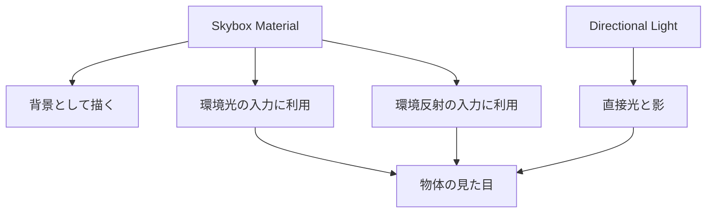

# グラフィックス基礎① Skybox：背景と環境光

[シラバス](../index.md) ｜ 章の課題：3章の課題（準備中）

## 概要

---

!!! note "準備中"
    講義資料の初稿です。説明用のコードは演習シーンへの組み込み・動作確認前です。画面写真と配布シーンの対応は確定後に更新します。

背景を夕焼けに変えたのに、キャラクターが昼のように白く見える。空に太陽があるのに、影が逆方向へ伸びる。これは、**背景として見える空と、物体を照らす光が別々の設定**だからです。

この単元では遠景の表現と環境からの照明を分け、Lightingで扱う直接光と組み合わせます。

## 遠くの景色を方向で表す

---

近くの物は移動すると見える位置関係が変わります。この差を視差と呼びます。一方、十分に遠い空は少し移動してもほとんど変わりません。Skyboxはその性質を利用し、視線の**方向**から背景の色を求めます。近所の建物をSkyboxだけで表すと、歩いても近づけず、不自然になります。

| 表現 | データの考え方 |
| --- | --- |
| 6面・Cubemap | 前後左右上下の方向を6枚に記録する |
| パノラマ | 全周の方向を1枚の画像へ展開する |
| Procedural | パラメータと計算で空を生成する |

Cubemapは空だけでなく反射にも使います。「画像を面に貼るUV」と「方向から環境を読む」の違いは[補足：座標・法線・UV](coordinates-color.md)で確認できます。

## 背景・環境光・反射・直接光

---

同じSkyboxが環境の入力に使われても、すべてが自動で同期するとは限りません。特にBake済みの照明や反射は更新のタイミングを確認します。Skyboxの太陽とDirectional Lightの向きも揃えて観察します。

## Unity で確認する流れ

---

### 演習の準備

---

| 用途 | シーン |
| --- | --- |
| **使用シーン** | Skybox専用シーンは未確定。講師指定の `Assets/Application/` 以下で実施予定 |
| **完成見本** | 制作待ち。正式パスは未確定 |

1. 同じ球・床・カメラを固定し、ライトとPostProcessの条件を記録する。
2. Skybox用Materialを用意し、LightingのEnvironmentで割り当てる。
3. カメラが背景にSkyboxを使う設定か確認する。
4. 背景、環境光、反射を1つずつ変えて、何が変わったか比較する。

Unityの具体的な設定場所は[Skyboxの作成](https://docs.unity3d.com/6000.3/Documentation/Manual/skyboxes-using.html)を参照してください。

!!! note "画像準備中：背景だけ変える／環境も合わせる"
    同じ構図で昼の背景、夕方の背景だけに変更した状態、光の向き・色も合わせた状態の3枚を並べます。各画像に変更した設定を添えます。予定画像：`images/sky-environment-comparison.png`。

## HDR画像を使う意味

---

HDRは通常の表示範囲を超える明るさを記録できます。見た目が似た画像でも、明るい窓や太陽の情報を保持しているかで、照明や反射の入力としての結果は変わります。画像の拡張子だけで品質を判断せず、元の明るさの情報とインポート設定を確認します。

空の見た目を明るくする操作、直接光を強める操作、露出で画面全体を明るくする操作を混同しないようにします。夕方の空に変えた後は、床の明るさ、影の方向、金属への映り込みを別々に見ます。

## よくある詰まり

---

| 症状 | 確認する箇所 |
| --- | --- |
| Sceneでは空が見えるがGameでは単色 | カメラのBackground Type・背景設定 |
| 空だけ変わって物体が変わらない | Environment LightingのSource・更新方法 |
| 反射だけ古い | Reflection Probeや環境反射の更新 |
| 夜空なのに強い昼の影が出る | Directional Lightの明るさ・向き |

次は、物体の色の計算を扱う[Shader](shader.md)へ進みます。

[シラバス](../index.md) ｜ 章の課題：3章の課題（準備中）
