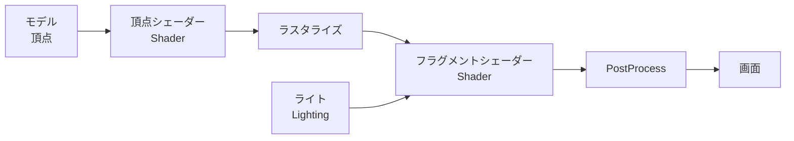

# グラフィックス基礎④ Rendering Pipeline

[シラバス](../index.md) ｜ 章の課題：3章の課題（準備中）

!!! note "準備中"
    この単元の資料は作成中です。

## 概要

---

Lighting・Shader・PostProcess は、どれも「画面に絵を出す」ための道具です。
この単元では、その道具たちが**どういう順番で動いているのか**、描画そのものの仕組みを俯瞰します。

> **この単元の問い**：ボタンを押してから画面に絵が出るまでに、何が起きているのか？

## 扱う内容

---

- **Scriptable Render Pipeline（SRP）** の紹介。Built-in と URP の違い
- **PBR（物理ベースレンダリング）** の紹介と、**セルルック調**との対比

## 🎬 お手本（DemoGame）で見るところ

---

なぜセルルックで作っているのか（PBR との対比）。

## 🔗 参考リンク

---

- [Universal Render Pipeline ドキュメント](https://docs.unity3d.com/Packages/com.unity.render-pipelines.universal@17.3/manual/index.html)
- [Scriptable Render Pipeline 概要](https://docs.unity3d.com/Manual/ScriptableRenderPipeline.html)
