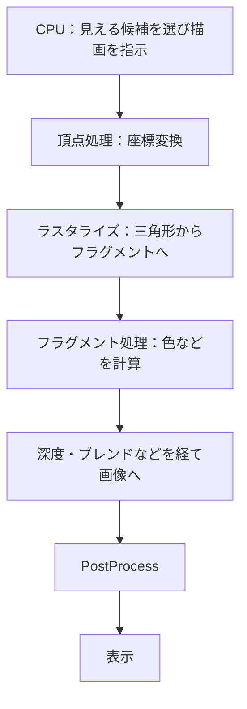

# グラフィックス基礎④ Rendering Pipeline：画面ができるまで

[シラバス](../index.md) ｜ 章の課題：3章の課題（準備中）

## 概要

---

!!! note "準備中"
    講義資料の初稿です。説明用のコードは演習シーンへの組み込み・動作確認前です。画面写真と配布シーンの対応は確定後に更新します。

Materialを別のプロジェクトへ持っていったらピンク色になった。ライトを足したら描画が重くなった。こうした問題を調べるには、個々の設定だけでなく、描画全体の流れを知る必要があります。

この単元では、モデルから画面を作る処理と、Unityがそれをどう組み立てるかを俯瞰します。

## 3Dから2Dへ

---

3Dの頂点をカメラから見た座標へ変換し、三角形が覆う画面上の場所を求めます。その候補ごとに色を計算し、深度や透明度を考慮して画像へ反映します。深度テストが早期に実行される場合など実装上の最適化は省略した概念図です。

### 画面外・手前・透明を扱う

---

**カリング**は描かなくてよい候補を減らす処理です。**深度バッファ**は手前と奥の関係を扱います。透明な面は前後の色を混ぜるため、順序や深度の書き込み方が結果へ影響します。透明にしただけで常に正しく重なるわけではありません。

1つの物体も、影用・通常描画用など複数回描くことがあります。Draw Callの数だけで負荷は決まらず、画素数、Shaderの計算、画像の読み書きも効きます。

## Render Pipeline の役割

---

Render Pipelineは、どの描画をどの順番で行い、どんな中間画像を用意するかを決めます。Shaderはその中で個々の頂点やフラグメントなどの処理を担います。

| Unityの仕組み | 位置づけ |
| --- | --- |
| Built-in Render Pipeline | Unityが提供する従来の描画方式 |
| SRP | スクリプトで描画工程を構成するための基盤 |
| URP | SRP上で提供されるレンダーパイプライン。本授業で使用 |
| HDRP | 別の機能・要件を持つSRP上のレンダーパイプライン |

SRPはURPと並ぶ完成品の名前ではなく、その基盤です。Shaderや機能はパイプライン間でそのまま互換になるとは限りません。[Unityのパイプライン概要](https://docs.unity3d.com/6000.3/Documentation/Manual/render-pipelines-overview.html)も参照してください。

## Forward と Deferred の入口

---

Forwardは、描画する物体のShaderで照明を計算する方式です。Deferredは、法線やMaterialの情報などを中間バッファへ保存し、その情報を使って照明を計算します。光の数、透明物、メモリ帯域、対象端末などによって得失が変わり、「後から計算するから必ず速い」という意味ではありません。

## PBR とセルルック

---

PBRは、光と材質の関係を物理に沿ったモデルで扱う考え方です。金属かどうか、表面の粗さなどで反射の様子を変えます。セルルックでは、明暗を段階化したり輪郭線を足したりして、見せたい絵を作ります。

PBRを使うと必ず写実的になるわけでも、セルルックで照明を考えなくてよくなるわけでもありません。どちらでも、形・色・明るさ・構図の整合が必要です。

## 描画を観察する

---

Frame Debuggerでフレームを構成する描画イベントを順番に見ると、「どの段階で影ができるか」「いつPostProcessが入るか」を追えます。Profilerは処理時間を見る道具です。順番の確認と時間の測定を使い分けます。

!!! note "画像準備中：1フレームの内訳"
    授業プロジェクトのFrame Debuggerで、影・不透明物・空・透明物・PostProcessに相当する箇所を撮影します。実際の表示順とRenderer設定を添えます。予定画像：`images/frame-debugger-passes.png`。

不具合は「形」「材質」「照明」「画面全体の加工」のどこで起きているかを分けると追いやすくなります。ピンク色なら、まずShaderの対応パイプラインとコンパイルエラーを確認します。

## 関連資料

---

- [Shader](shader.md)・[Lighting](lighting.md)・[PostProcess](postprocess.md)
- [補足：座標・法線・UV・色](coordinates-color.md)

[シラバス](../index.md) ｜ 章の課題：3章の課題（準備中）
