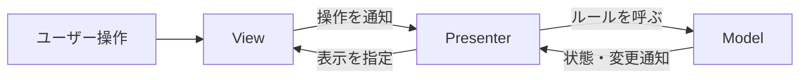

# C#④ 設計への誘い：MVPパターン

[シラバス](../index.md) ｜ 章の課題：4章の課題（準備中）

## 概要

---

!!! note "準備中"
    講義資料の初稿です。説明用のコードは演習シーンへの組み込み・動作確認前です。画面写真と配布シーンの対応は確定後に更新します。

HPの数値を表示していたUIを、ゲージと数値の両方に変えたい。表示を変えるだけなのに、ダメージ計算まで書き換える必要があると、変更の影響を見通しにくくなります。

この単元では、**状態とルール、表示、両者をつなぐ処理**を分けます。設計は変更をなくす方法ではなく、変更する場所と確かめる範囲を小さくするための工夫です。

## MVP の3つの役割

---

| 役割 | 責任 | HP表示なら |
| --- | --- | --- |
| Model | 状態とルール | HPの範囲、ダメージによる更新 |
| View | 見た目と操作の窓口 | 数値・ゲージの表示、ボタン入力の通知 |
| Presenter | 表示と状態の仲介 | HPを読んで表示し、操作をModelへ渡す |



Modelはゲージの色やTextMeshProを知る必要がありません。Viewはダメージの計算式を決めません。ここではViewから判断を減らすPassive View寄りの形を使います。MVPには複数の変種があり、名前だけで全実装が同じにはなりません。[Passive Viewの解説](https://martinfowler.com/eaaDev/PassiveScreen.html)が背景資料です。

## まず小さなコードで分ける

---

Unityのシーンに依存しない説明用の例です。Modelの現在値と通知、Viewの契約、Presenterの接続を示します。

```csharp
using System;

namespace Section4.Presentation
{
    public sealed class HealthModel
    {
        public int Value { get; private set; } = 100;
        public event Action<int> Changed;

        public void Damage(int amount)
        {
            int next = Math.Max(0, Value - Math.Max(0, amount));
            if (next == Value) return;
            Value = next;
            Changed?.Invoke(Value);
        }
    }

    public interface IHealthView
    {
        void ShowHealth(int value);
    }

    public sealed class HealthPresenter : IDisposable
    {
        private readonly HealthModel model;
        private readonly IHealthView view;

        public HealthPresenter(HealthModel model, IHealthView view)
        {
            this.model = model;
            this.view = view;
            view.ShowHealth(model.Value);
            model.Changed += OnChanged;
        }

        private void OnChanged(int value) => view.ShowHealth(value);
        public void Dispose() => model.Changed -= OnChanged;
    }
}
```

変更を待つだけでは初期値が表示されないので、接続時に現在値も表示しています。Presenterを組み立てた側が、画面を閉じるときなどにDisposeを呼びます。Unityでの組み立て役とInspectorの参照は、演習シーン完成後に追加します。

## 依存の向きとテストしやすさ

---

Viewを「最後に表示した値を記録するだけ」の実装へ置き換えると、画面を描かずに表示要求を確認できます。Modelだけなら、ダメージを与えた後のHPが0未満にならないことを確認できます。これが関心を分ける実用上の理由です。

!!! note "画像準備中：同じModelを異なる表示につなぐ"
    数値だけのViewとゲージ付きViewを左右に並べ、ModelとPresenterの接続図を添えます。予定画像：`images/mvp-two-views.png`。

## Unity に組み込む前に決めること

---

| 判断 | 考えること |
| --- | --- |
| Modelの寿命 | 画面を閉じても残るか、ゲーム終了で破棄するか |
| Presenterの寿命 | 表示中だけか、シーン全体か |
| 参照の組み立て | 誰がModelとViewを渡すか |
| 入力の二重登録 | 再表示時に古い購読が残らないか |

### R3 と組み合わせるなら

---

Modelの変更をReactivePropertyなどで公開し、Presenterで購読できます。ただし、外から自由に値を書き換えられるようにするとModelのルールを迂回できます。読み取り側の契約と、更新するメソッドを分ける意図を持ちます。

## 設計を大きくしすぎない

---

小さな表示に必ず3ファイル必要、という規則ではありません。画面や仕様が増えたときに、一緒に変わるものと別々に変わるものを見分けます。

DDDは業務・ゲームの意味やルールをモデル化する考え方、クリーンアーキテクチャは依存関係を整理する考え方です。MVPと同じ階層の置き換え候補ではありません。まず「HPルールがUIに依存していないか」という具体的な観点から始めます。

## 関連資料

---

- [Interface とポリモーフィズム](../s2-ai-state/interface-polymorphism.md)
- [Observer と R3](r3.md)
- [付録：イベントと購読の寿命](../appendix/events-lifetime.md)

[シラバス](../index.md) ｜ 章の課題：4章の課題（準備中）
