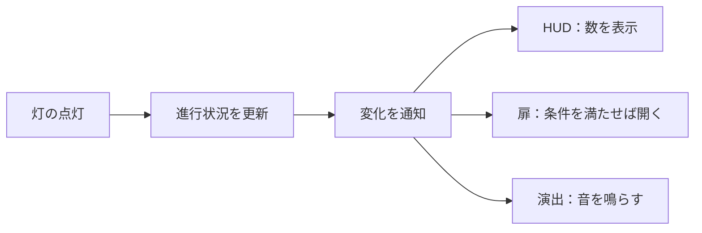

# C#③ ObserverパターンとR3

[シラバス](../index.md) ｜ 章の課題：4章の課題（準備中）

## 概要

---

!!! note "準備中"
    講義資料の初稿です。説明用のコードは演習シーンへの組み込み・動作確認前です。画面写真と配布シーンの対応は確定後に更新します。

灯が点いたら、UIを更新し、扉を開け、演出を流したい。灯のスクリプトがすべての相手を直接呼んでいると、新しい演出を足すたびに灯まで変更することになります。

この単元では、変化を知らせる側と受け取る側を分ける**Observerパターン**を学び、その通知を加工・合成する道具としてR3を使います。前提となるdelegate・eventは[付録：イベントと購読の寿命](../appendix/events-lifetime.md)で説明します。

## 毎回聞く方法と、変わったら知らせる方法

---

UIが毎フレーム「灯はいくつ点いたか」と聞く方法をポーリング、変わったときに知らせる方法を通知と呼びます。ポーリングは現在値を知りやすく、通知は変化した瞬間の処理をまとめやすいという違いがあります。



進行状況の持ち主は「誰が表示しているか」を知らなくても通知できます。ただし、呼び出し関係がコードの1箇所に集まらなくなるので、購読箇所と解除箇所を追えるようにする必要があります。

## 状態とイベント

---

| 種類 | 例 | 後から参加したUIに必要なこと |
| --- | --- | --- |
| 状態 | 現在HP、点灯数 | 今の値を最初に表示する |
| イベント | 攻撃が当たった、ボタンが押された | 過去の出来事を再実行するかは別途決める |

「点灯数3」は状態、「3つ目を点けた」は出来事です。UIを開き直したとき、状態は表示したい一方、点灯音まで鳴らし直したいとは限りません。

## R3 で値の流れを読む

---

R3では、通知の流れを購読し、条件による選別や値の変換を組み合わせます。授業プロジェクトにはR3本体1.3.1がローカルパッケージとして配置されています。Unity連携拡張の有無と混同しないよう、次の例では本体のAPIだけを使います。

```csharp
using System;
using R3;

namespace Section4.Reactive
{
    public static class NotificationExample
    {
        public static void Run()
        {
            using var count = new ReactiveProperty<int>(0);
            using var subscription = count
                .Select(value => $"灯：{value}")
                .Subscribe(text => Console.WriteLine(text));

            count.Value = 1;
            count.Value = 2;
        }
    }
}
```

これは短い寿命で完結する説明用例です。現在値の0から表示し、その後1、2への変更を通知します。`using`の範囲を抜けると購読と値の持ち主を破棄します。画面を表示している間だけ購読したい場合は、この寿命を画面に合わせます。

| 操作 | 意味 |
| --- | --- |
| Subscribe | 通知の受け取りを登録する |
| Select | 通知された値を別の形へ変換する |
| Where | 条件を満たす通知だけ通す |
| Dispose | 購読などの管理対象を片付ける |

ReactivePropertyは現在値を持ち、通常のValue代入では同じ値への変更を通知しません。R3には従来のRxと異なるエラー通知の設計もあるため、UniRxの例を無条件にコピーせず、[R3公式README](https://github.com/Cysharp/R3)で対応を確認します。

## 演習の準備

---

| 用途 | シーン |
| --- | --- |
| **使用シーン** | イベントの導入：`Assets/Application/Section4-CSharp/Event/Event.unity` |
| **完成見本** | 同シーンの `EventSample.cs` を参照。R3演習用 `_Sample` は制作待ち |

まず既存のEventシーンで、1回の通知に複数の受信処理が登録される様子を確認します。このシーンがそのままR3の完成見本という意味ではありません。R3用のUI・シーンと実行手順は別途確定します。

!!! note "画像準備中：通知と表示"
    点灯数を変える操作、値を表示するUI、購読時と変更時のログを並べます。初期表示と変更通知を区別します。予定画像：`images/r3-value-flow.png`。

## 購読の寿命を決める

---

画面を開くたびにSubscribeし、閉じるときに解除しなければ、同じ通知に2回、3回と反応することがあります。破棄まで生きる購読と、有効な間だけ生きる購読を分けます。

また、R3を使うだけでUnityの処理が自動的にメインスレッドへ移るわけではありません。別スレッドを使う通知源からUIを触る場合は、実行場所の確認が必要です。最初はフレーム更新や入力と同じ場所から通知する小さな例で関係を掴みます。

## Observer と MVP のつながり

---

Observerは通知の関係、MVPはデータ・表示・仲介の責任の分け方です。R3はそれらをつなぐ道具の1つであり、R3を使えば自動でよい設計になるわけではありません。次の[MVP](mvp.md)では、誰が値を変更し、誰が表示するかを整理します。

[シラバス](../index.md) ｜ 章の課題：4章の課題（準備中）
