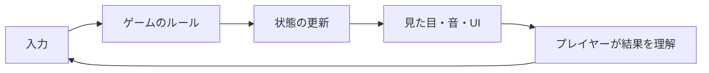

# 総合演習：学んだ技術をゲームへまとめる

[シラバス](../index.md) ｜ 章の課題：5章の課題（準備中）

## 概要

---

!!! note "準備中"
    講義資料の初稿です。説明用のコードは演習シーンへの組み込み・動作確認前です。画面写真と配布シーンの対応は確定後に更新します。

機能を別々に動かせても、1本のゲームへまとめると操作・カメラ・演出・UIが干渉することがあります。この時間は新しい機能を増やすより、**遊びの目的に必要な技術を選び、組み合わせを確かめる方法**を整理します。

このページでは制作の進め方を整理します。

## 最小の遊べる流れをつなぐ

---

「入力する→状況が変わる→結果が分かる」という短い循環を先につなぎます。たとえば、敵へ近づき、攻撃し、敵が反応し、結果が画面へ返る流れです。モデルやUIが仮でも、循環が成立するかを先に見ます。

画面が派手でも、操作の結果が伝わらなければ次の判断ができません。見た目はルールの状態をプレイヤーへ返す役割を持ちます。

## 技術を目的から選ぶ

---

| 達成したいこと | 候補 | 組み合わせるときの確認 |
| --- | --- | --- |
| 物に触れる手を合わせる | Animation Rigging | 通常アニメーションとのWeight |
| 敵が障害物を避けて迫る | NavMeshとState | 移動と行動の責任 |
| ボスを印象的に見せる | Timeline・Cinemachine | 操作制限、終了とスキップ |
| 大切なものへ視線を誘導 | Lighting・Shader・PostProcess | 加工前後の見やすさ |
| 状態をUIへ伝える | Observer・MVP | 初期表示と購読解除 |

## 変更の影響を小さく確認する

---

一度に機能を増やすと、何が原因で壊れたか追いにくくなります。小さな変更ごとに「何が変わるはずか」を決め、その前後を比べます。

1. 期待する動きを1文で書く。
2. 関係する状態・入力・表示を特定する。
3. 最小の変更を行う。
4. 正常時に加え、途中中断・再実行・対象消失を確認する。
5. 気づいたことを記録して次の変更へ進む。

## 統合するときに起きやすいこと

---

| 問題 | 観察点 |
| --- | --- |
| 演出後に操作できない | 操作制限を解除する経路が全部あるか |
| 2回目だけ処理が増える | イベントの二重登録や残った待機 |
| キャラクターが跳ね返る | Agent・物理・アニメーションの位置制御 |
| 動くが重い | ProfilerでCPU・GPUのどちらが詰まるか |

!!! note "画像準備中：1つの遊びを分解する"
    入力前・反応中・結果表示の3コマを同じ場面から撮影し、各コマへ使用技術を添えます。予定画像：`images/gameplay-feedback-loop.png`。

## 振り返る観点

---

「何のパッケージを使ったか」に加えて、「どんな問題を解くために使ったか」「別の方法では何が難しかったか」を説明します。これにより、Unity以外の道具へ移っても、問題の分け方と選び方を持ち運べます。

[シラバス](../index.md) ｜ 章の課題：5章の課題（準備中）
