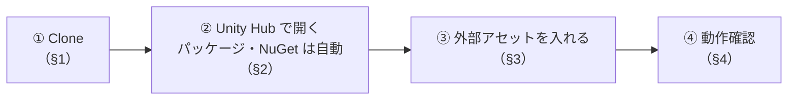
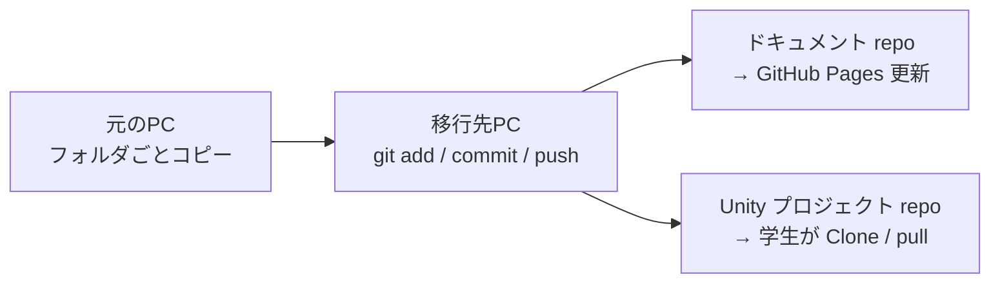

# 🛠 配布先PCでの導入手順（講師用）

このプロジェクトは **GitHub の Unity プロジェクト repo** で配ります。配布先（講師の別PC・学生）は repo を **Clone** して、Unity Hub で開きます（**Fork はしない**。授業側の更新は `git pull` で取り込んでもらう）。

repo には `Assets/` に加えて **`Packages/manifest.json` と `ProjectSettings/` も入っています。** パッケージ・ビルドに含めるシーン・レイヤー・入力の方式などは、開くだけでそろいます。

> 外部依存のうち **Asset Store などの外部アセットは repo に含めません**（再配布できないため）。配布先で各自入れます（§3）。
> 外部依存を追加したら、**このページの一覧に必ず追記**してください。

---

## 全体の流れ

---



外部アセットを入れるまでは、DemoGame のキャラクターがピンク色になったり、Missing になったりします。§3 まで終えてから確認してください。

---

## 1. Clone する

---

```bash
git clone https://github.com/<user>/<unity-repo>.git
```

学生には Fork させず、Clone したフォルダで作業してもらいます。授業側で repo を更新したら、Slack で連絡して `git pull` してもらいます（学生向けの手順は [授業用プロジェクトのセットアップ](lessons/s0-guidance/setup.md) §1）。

> 学生が触ってよいのは各単元の `_Work.unity` と自分で作ったファイルだけです（`_Sample.unity`・`Section<章>.*` 名前空間のスクリプト・`_DemoGame/` は触らない）。**配布済みの `_Work.unity` は更新しない**でください。学生の作業とぶつかって pull が止まります。

---

## 2. Unity Hub で開く

---

| 項目 | 値 |
| --- | --- |
| Unity バージョン | **6000.3.19f1**（`ProjectSettings/ProjectVersion.txt`。Hub で違うバージョンを選ばない） |
| 開き方 | Unity Hub → **Add → Add project from disk** → Clone したフォルダ |

初回はパッケージの取得と Library の生成で時間がかかります。次のものは**開くと自動で入ります。**

| もの | 入り方 |
| --- | --- |
| Unity 公式パッケージ（Cinemachine 2.10.7・ProBuilder・AI Navigation・Animation Rigging・Timeline・Shader Graph・Input System・URP など） | `Packages/manifest.json` から自動取得 |
| UniTask・NuGetForUnity | `manifest.json` の Git URL から自動取得（**PC に git が入っている必要がある**） |
| R3（NuGet） | `Assets/Packages/` に DLL ごと入っている |
| TextMesh Pro の必須リソース | `Assets/TextMesh Pro/` に入っている |

> ⚠️ **Cinemachine は 2.x を使います。** Package Manager で Update を押して 3.x に上げないでください。お手本のコードは 2.x の API（`using Cinemachine;`）なので、3.x ではコンパイルが通りません。

> 次のパッケージは作業補助用で、プロジェクトのコードからは参照していません。気になる場合は削除して構いません。
> Unity AI Assistant / AI Inference / Package Validation Suite / Performance Testing / Multiplayer Center / Visual Scripting / Version Control

---

## 3. 外部アセットを入れる

---

学生と同じものを入れます。学生向けの手順は **[使用アセット一覧](lessons/assets.md)** と **[授業用プロジェクトのセットアップ](lessons/s0-guidance/setup.md)** にまとめてあります。入れるのは下の「外部アセット一覧」の4つです（ユニティちゃんだけ公式サイト、残りは Asset Store）。

> **Import 先のフォルダはどこでも構いません。** DemoGame の Prefab やマテリアルはアセットを GUID で参照しているので、置き場所に関係なくつながります。

### 外部アセット一覧

---

元のPCでは、外部アセットを Import したら `Assets/_GitIgnore/<アセット名>/` へ移しています（`.gitignore` 済み）。
**移したら下の表に足してください。** 配布先で何を入れればよいかの一覧になります。

| 外部アセット | 入手先 | 置き場所 | 使っている所 |
| --- | --- | --- | --- |
| ユニティちゃん 3Dモデルデータ Ver 1.4.0（UCL 2.02） | [公式サイト](https://unity-chan.com/) | `_GitIgnore/UnityChan/` | `DemoPlayer.prefab`、`Animations/AC_Player.controller`、`Graphics/Materials/Character/M_Player_*`（テクスチャ） |
| Monster Minion Survivor PBR Polyart | [Asset Store](https://assetstore.unity.com/packages/3d/characters/creatures/monster-minion-survivor-pbr-polyart-269515) | `_GitIgnore/Monster Minion Survivor PBR Polyart/` | `DemoEnemyNormal.prefab`、`Animations/AC_EnemyMinion.controller`、`M_Enemy_Minion`（テクスチャ） |
| RPG Animations Pack FREE（DoubleL） | [Asset Store](https://assetstore.unity.com/packages/3d/animations/rpg-animations-pack-free-288783) | `_GitIgnore/DoubleL/` | `Animations/AC_Player.controller` の Attack（`Enemy_Attack_1`） |
| Mini Legion Rock Golem PBR HP Polyart | [Asset Store](https://assetstore.unity.com/packages/3d/characters/humanoids/fantasy/mini-legion-rock-golem-pbr-hp-polyart-94707) | `_GitIgnore/Mini Legion Rock Golem PBR HP Polyart/` | `DemoEnemyBoss.prefab`、`Animations/AC_EnemyGolem.controller`、`M_Enemy_Golem`（テクスチャ） |

---

## 4. 動作確認

---

| 確認すること | 合格の状態 |
| --- | --- |
| Console | **赤いエラーが0件** |
| `DemoTitle` シーンを再生 | タイトル画面が出て、開始でインゲームへ遷移する |
| マテリアル | ピンク色のものがない（あれば §3 の外部アセット不足） |

> デバッグ用スクリプト（`Assets/_DemoGame/Scripts/Debug/`）は、**エディタ上では常に有効**です。
> ビルドに含めたいときだけ、Scripting Define Symbols に `APP_DEBUG` を足してください。

### うまくいかないとき

---

| 症状 | 原因と対処 |
| --- | --- |
| パッケージの取得に失敗する（UniTask / NuGetForUnity） | PC に git が入っていない。git を入れて Unity を再起動 |
| `The type or namespace name 'Cinemachine' could not be found` | Cinemachine が 3.x に上がっている。Package Manager の **＋ → Install package by name...** で `com.unity.cinemachine` / `2.10.7` を入れ直す |
| `The type or namespace name 'R3' could not be found` | `Assets/Packages/` が欠けている。メニューの **NuGet → Restore Packages** |
| Prefab が Missing / キャラクターがピンク | 外部アセット未導入。§3 |
| キャラクターが動かない | Starter Assets の Import 後に再起動していない |

---

## 5. repo の更新手順（元のPC側）

---

元のPCでは git を使いません。**移行先のPCで push します。**



1. 元のPCの `unity-game-dev-advance-master/` をフォルダごと移行先へコピーする（`Library/` `Temp/` `Logs/` `.venv/` `output/` は除いてよい。どれも生成物）
2. 移行先で、2つの repo をそれぞれ commit / push する

| repo | 場所 | 中身 | `.gitignore` |
| --- | --- | --- | --- |
| **ドキュメント repo** | `unity-game-dev-advance-master/`（ルート） | `docs/` `mkdocs.yml` `src/` `.github/` | `unity-game-dev-advance/` を丸ごと除外 |
| **Unity プロジェクト repo** | `unity-game-dev-advance-master/unity-game-dev-advance/` | `Assets/` `Packages/` `ProjectSettings/` | `Library/` などの生成物と **`Assets/_GitIgnore/`**（外部アセット）を除外 |

> ドキュメント repo は、`docs/lessons/`・`mkdocs.yml`・`src/` が変わったときだけ GitHub Actions（`.github/workflows/deploy-docs.yml`）が mkdocs でビルドして GitHub Pages を更新します。初回だけ repo の **Settings → Pages → Source** を「GitHub Actions」にしてください。

> push する前に、Unity プロジェクト repo の `git status` に `Assets/_GitIgnore/` の中身や Asset Store のアセットが**出ていないこと**を確認してください。`_GitIgnore/` に移し忘れた外部アセットがあると、そのまま公開されます。
